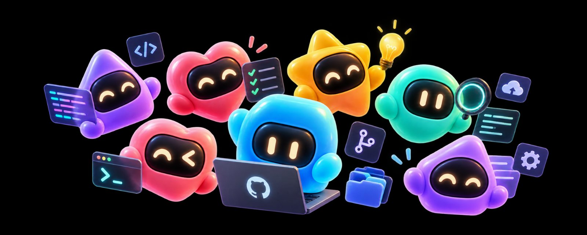
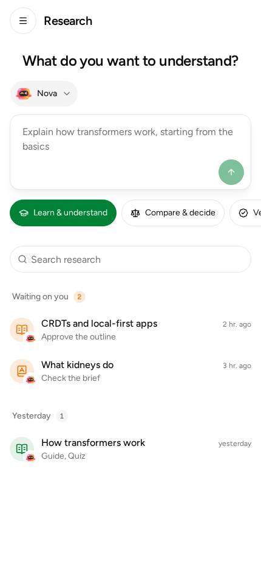
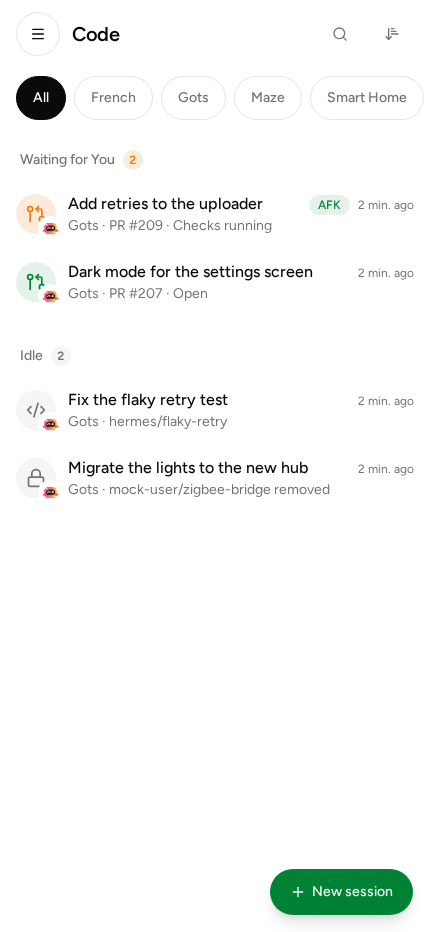
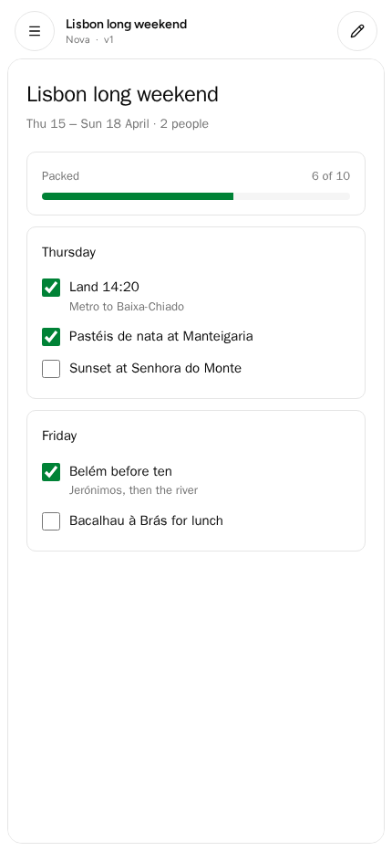
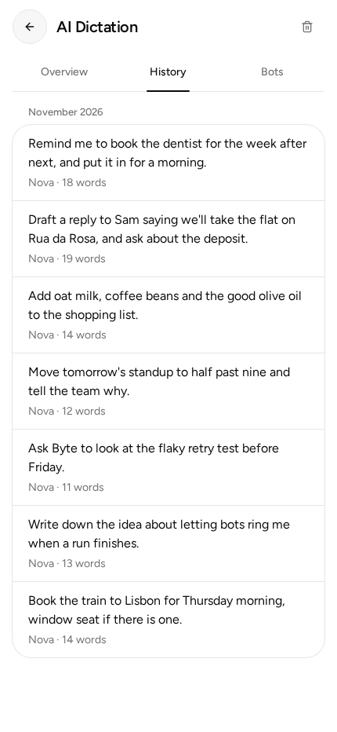

<p align="center">
  
</p>

<p align="center">
  <a href="https://hermesgots.dev"></a>
  <a href="LICENSE"></a>
</p>

**Hermes Bots that got your back!** Gots is the playful, mobile-first companion app for [Hermes Agent](https://github.com/NousResearch/hermes-agent). Chat with your bots, send them off to code, research and build, and answer the one question that actually needs you — from your phone, tablet or laptop.

Web app · Android · needs a Hermes host on 0.22.5 or newer

<table>
<tr>
<td></td>
<td></td>
<td></td>
<td></td>
</tr>
<tr>
<td align="center"><b>Research</b><br><sub>Missions that read the web and cite every sentence.</sub></td>
<td align="center"><b>Code</b><br><sub>Sessions on their own branch, back as draft pull requests.</sub></td>
<td align="center"><b>Canvas</b><br><sub>Apps your bot builds and keeps beside your chats.</sub></td>
<td align="center"><b>Dictation</b><br><sub>Talk instead of typing, in Gots or any app on Android.</sub></td>
</tr>
</table>

## What Gots does

- **Chats and routines.** Live replies with tool cards, an approval card in place of the composer when a bot wants to run something, and every scheduled job's run history beside them — run now, pause or resume from the phone.
- **Code.** Sessions work on their own branch and come back as a draft pull request. Leave AFK on and a project works through its labelled GitHub issues while you are away.
- **Research.** A mission reads the web and cites what it read. Anything without a source gets flagged rather than quietly believed.
- **Canvases.** Ask for a tracker, a dashboard or a checklist: your bot builds it as a small app, keeps it with your chats and updates it when you ask. Turn on backups and a canvas lands on your host as markdown you can edit and own.
- **Bots and rooms.** Every Hermes profile you link becomes a bot with its own model, key and character. Seat several in one room and each answers in its own voice.
- **Dictation.** Talk instead of typing — in Gots, or from any app on Android — and your own bot hears the take and tidies it up.

## Getting Started

### 1. Get the app

**Web and PWA.** Open [app.hermesgots.dev](https://app.hermesgots.dev) and install it from your browser. It works on a phone, on a tablet and on a laptop, and the chats are the same on each.

**Android.** Two ways in, and what you get differs:

| | [GitHub](https://github.com/thehaseebahmed/hermesgots/releases) | Firebase App Tester |
| --- | --- | --- |
| Who it's for | anyone | the beta programme |
| Cross-device sync | yours to set up: self-host the sync server | ready to go, hosted by us |
| Notifications | ntfy | push, hosted by us |
| Updates | with each dated release | every merge to main |

A signed APK ships with each dated release. The beta build follows main, so it's the one to install if you want sync and push without running a server for them.

### 2. Put the plugin on your host

Gots is a window onto your Hermes host, and the plugin is what lets it see your bots' chats, routines, projects and canvases. Install it, then restart the gateway:

```bash
hermes plugins install thehaseebahmed/hermesgots/plugin --enable
hermes gateway restart
```

> **The API server has to be on.** The app talks to your host through Hermes's API server, so the profile needs `API_SERVER_ENABLED=true` and an `API_SERVER_KEY`. You don't have to write them by hand: linking a bot in the next step offers to add both, along with the CORS origins the app comes from, and says what to restart.

### 3. Connect a bot

In Gots, choose **Link a bot**. It shows a code and the commands that use it; the code lasts half an hour. Run the link command on your host: it claims the code and checks in with the bot's name, address and key, so the bot reaches every device you sign in on.

```bash
hermes gots link <code> --site https://app.hermesgots.dev
```

The app follows the address you linked the bot at. If the host moves, run `hermes gots unlink` and link it again with the new one.

> **Reaching your host over HTTPS.** A browser on an HTTPS page won't call a plain HTTP server, so using Gots from your phone over the internet needs the host exposed over HTTPS — Tailscale Serve and Cloudflare Tunnel both do it — with that origin added to `API_SERVER_CORS_ORIGINS`.

Another profile is another bot: install the plugin there too (`hermes -p <profile> plugins install …`) and point Gots at `/p/<profile>/v1` with that profile's key. [The plugin's README](plugin/README.md) has the rest.

---

## How it fits together

There are three pieces, and only the first two really matter day to day.

**The app** is what you hold. It's a website you can install on your phone or tablet (and the same thing packaged as an Android app). It holds your chats, your bots and your settings on the device itself, so it opens fast and works from wherever you are.

**The Host** is your own computer or server, running [Hermes Agent](https://github.com/NousResearch/hermes-agent) with the [Gots plugin](plugin/README.md) installed. This is where your bots actually live and do their work, and where your files, sessions and history stay. The app is just the window onto it — nothing is copied anywhere else. The plugin is what lets the app see your bot's routines, projects and media.

**The sync server** is optional and only useful if you use more than one device (say a phone and a tablet). It's a small web service, and it does two things: it signs you in with GitHub, and it keeps a copy of your bot list and settings so a new device can pick them up. Everything it stores is encrypted on your device before it leaves, and the key never goes with it — so the server holds scrambled data it cannot read. Your messages and your bots' work never touch it at all; those stay on your Host.

Skip the sync server entirely and Gots still works on the device you set it up on; the server is what carries your bot list to the next device.

---

## Self-Hosting & Deployment

### Deploy to Netlify

You can deploy your own instance of Gots with zero-knowledge sync using Netlify:

1. Import this repository into Netlify (`netlify.toml` configures build settings, SPA redirects, and headers).
2. Set up **Netlify Identity** under **Project configuration → Identity**:
   - Enable Identity.
   - Under **Registration → External providers**, add GitHub.
   - Set **Registration preferences** to **Invite only**, then invite yourself.
3. Add your Netlify site URL to `API_SERVER_CORS_ORIGINS` in your Hermes Host configuration.

### Zero-Knowledge Sync Security

- Sync encrypts your Bot connection details, API keys, and settings with an AES-256-GCM data key on your device.
- The sync server only holds the key wrapped by a passkey (WebAuthn PRF) or a 25-character recovery code.
- Signing in with GitHub authenticates ownership, but Netlify can never decrypt your data. Transcripts and server data remain on your Hermes Host.

---

## Development & Contributing

See [CONTRIBUTING.md](CONTRIBUTING.md) for full development environment setup, Docker dev containers, browser E2E test flows, and local Android builds.

Quick local development:

```bash
cd app
pnpm install
pnpm mock      # Fake Hermes API on :8642
pnpm dev       # Vite dev server on :5173
```

---

## Roadmap

- **Meetings.** Hand over a recording, get back what was decided, what's yours to do and a timeline to check it against.
- **Calling.** Ring a bot and talk it through, or let it ring you when something is waiting.
- **iPhone app.** Gots in your pocket, with your chats, pushes and bots.
- **Android assistant.** Make Gots your phone's assistant and ask your bot from anywhere.
- **Your phone's data.** Calendar, contacts and health, read by your bot only when you allow it.
- **Raycast extension.** Ask your bots and check on their work from a Mac.

---

## License

MIT — see [LICENSE](LICENSE).

Built for [Hermes Agent](https://github.com/NousResearch/hermes-agent).
