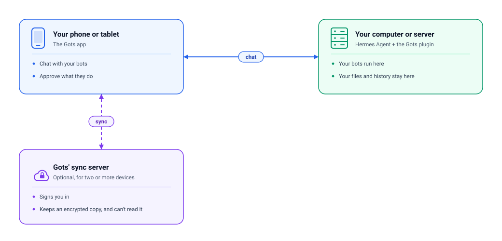

# Gots 🤖

<p align="center">
  <a href="https://hermesgots.dev">Website</a> | <a href="https://app.hermesgots.dev">App</a> | <a href="plugin/README.md">Plugin</a>
</p>
<p align="center">
  <a href="https://hermesgots.dev"></a>
  <a href="https://github.com/thehaseebahmed/memento/releases"></a>
  <a href="https://app.netlify.com/projects/hermesgots/deploys"></a>
  <a href="LICENSE"></a>
</p>

**Hermes Bots that got your back!** Gots is the playful, mobile-first companion app for [Hermes Agent](https://github.com/NousResearch/hermes-agent), built as an installable PWA and native Android app. Chat with your Bots, manage multi-step coding projects, inspect automated routines, and approve tool calls on the go—from your phone, tablet, or desktop.

Switch between multiple Hermes profiles with distinct models and keys, or let your Bots run autonomously while you are away from keyboard.

<table>
<tr><td><b>Mobile-first PWA & Android</b></td><td>Installable on phones and tablets with light and dark themes. Responsive split-pane layout adapts smoothly from mobile screens to tablet and desktop workstations.</td></tr>
<tr><td><b>Real-time chat & tool approvals</b></td><td>Live streaming replies with interactive tool progress cards. When a Bot requests a sensitive action, an approval card (Once / Session / Always / Deny) replaces the composer for inline permission control.</td></tr>
<tr><td><b>Multi-Bot management</b></td><td>Switch instantly between Hermes profiles. Each Bot maintains its own Host API URL, key, model selection, and distinct glassy character avatar.</td></tr>
<tr><td><b>Autonomous Projects & AFK</b></td><td>Run multi-repo coding sessions, track pull requests, and let Bots claim ready tasks from GitHub issues autonomously via AFK mode.</td></tr>
<tr><td><b>Routines & Cron dashboard</b></td><td>Monitor and control all Hermes cron jobs grouped by Bot. View 24-run status histories and trigger Run now, Pause, or Resume directly from your device.</td></tr>
<tr><td><b>Zero-knowledge encrypted sync</b></td><td>End-to-end encrypted with passkeys (WebAuthn PRF) and recovery codes via Netlify Blobs. Transcripts and server data stay on your Hermes Host; only ciphertext touches sync.</td></tr>
<tr><td><b>Agent-to-agent communication</b> <i>(Upcoming)</i></td><td>Direct inter-bot collaboration, delegation, and multi-agent coordination across profiles and hosts.</td></tr>
</table>

---

## Quick Start

### 1. Setup Your Hermes Host

Install the Gots plugin on your Hermes host and restart the gateway:

```bash
hermes plugins install thehaseebahmed/memento/plugin --enable
hermes gateway restart
```

Enable the API server by adding the following configuration to `~/.hermes/.env` (or via the Hermes Dashboard under **Channels → API server**):

```bash
API_SERVER_ENABLED=true
API_SERVER_KEY=<your-64-character-key>    # Generate with `openssl rand -hex 32`
API_SERVER_CORS_ORIGINS=https://app.hermesgots.dev,https://<your-site>.netlify.app
```

> **Profiles & Multiplexing:** To connect multiple Bots from different Hermes profiles on the same gateway, configure `gateway.multiplex_profiles` and point Gots to `/p/<profile>/v1` with that profile's `API_SERVER_KEY`. Ensure the plugin is installed per profile:
> ```bash
> hermes -p <profile> plugins install thehaseebahmed/memento/plugin --enable
> ```

### 2. Connect Your Bot

Open Gots on your device:
- **Web / PWA:** Open [hermesgots.dev](https://hermesgots.dev) in your browser and install it as a PWA.
- **Android:** Download the signed APK from [Releases](https://github.com/thehaseebahmed/memento/releases).

Follow the first-run setup wizard, enter your Host API URL (e.g. `http://localhost:8642/v1` or your HTTPS server URL) and API key, and tap **Test connection**.

> **Remote Access over HTTPS:** Browsers block plain HTTP calls to remote servers from HTTPS origins. To use Gots from your phone over the internet, expose your Hermes Host over HTTPS (such as via Tailscale Serve or a Cloudflare Tunnel) and add that origin to `API_SERVER_CORS_ORIGINS`.

---

## How it fits together



There are three pieces, and only the first two really matter day to day.

**The app** is what you hold. It's a website you can install on your phone or tablet (and the same thing packaged as an Android app). It holds your chats, your bots and your settings on the device itself, so it opens fast and works from wherever you are.

**The Host** is your own computer or server, running [Hermes Agent](https://github.com/NousResearch/hermes-agent) with the [Gots plugin](plugin/README.md) installed. This is where your bots actually live and do their work, and where your files, sessions and history stay. The app is just the window onto it — nothing is copied anywhere else. The plugin is what lets the app see your bot's routines, projects and media.

**The sync server** is optional and only useful if you use more than one device (say a phone and a tablet). It's a small web service, and it does two things: it signs you in with GitHub, and it keeps a copy of your bot list and settings so a new device can pick them up. Everything it stores is encrypted on your device before it leaves, and the key never goes with it — so the server holds scrambled data it cannot read. Your messages and your bots' work never touch it at all; those stay on your Host.

Skip the sync server entirely and Gots still works. You just add your bots by hand on each device.

---

## Self-Hosting & Deployment

### Deploy to Netlify

You can deploy your own instance of Gots with zero-knowledge sync using Netlify:

1. Import this repository into Netlify (`netlify.toml` configures build settings, SPA redirects, and headers).
2. Set up **Netlify Identity** under **Project configuration → Identity**:
   - Enable Identity.
   - Under **Registration → External providers**, add GitHub.
   - Set **Registration preferences** to **Invite only**, then invite yourself.
3. Add your Netlify site URL to `API_SERVER_CORS_ORIGINS` in your Hermes Host configuration.

### Zero-Knowledge Sync Security

- Sync encrypts your Bot connection details, API keys, and settings with an AES-256-GCM data key on your device.
- The sync server only holds the key wrapped by a passkey (WebAuthn PRF) or a 25-character recovery code.
- Signing in with GitHub authenticates ownership, but Netlify can never decrypt your data. Transcripts and server data remain on your Hermes Host.

---

## Development & Contributing

See [CONTRIBUTING.md](CONTRIBUTING.md) for full development environment setup, Docker dev containers, browser E2E test flows, and local Android builds.

Quick local development:

```bash
cd app
pnpm install
pnpm mock      # Fake Hermes API on :8642
pnpm dev       # Vite dev server on :5173
```

---

## Roadmap

- 🤖 **Agent-to-Agent Communication:** Direct inter-bot coordination, collaborative swarm execution, and cross-bot task delegation.
- 📱 **Native iOS App:** Capacitor iOS wrapper with Native Share Extension and App Groups.

---

## License

MIT — see [LICENSE](LICENSE).

Built for [Hermes Agent](https://github.com/NousResearch/hermes-agent).
