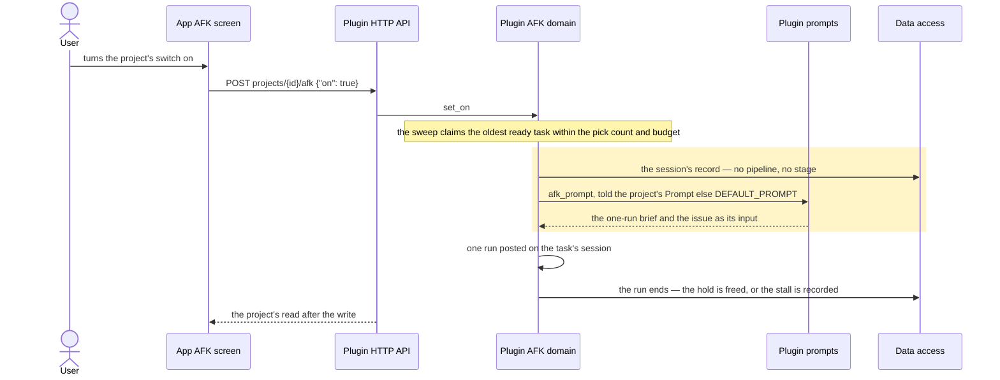
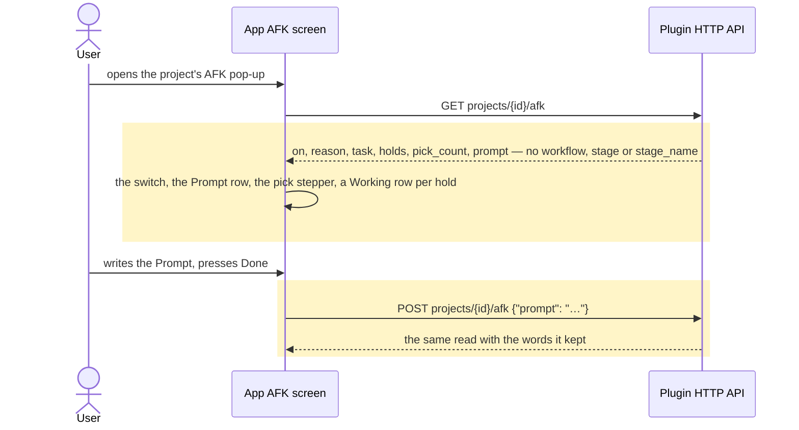

# AFK works a task in one run, and the workflow machine is gone

Status: confirmed 2026-11-06; not yet implemented. Steps run in order, and no step leaves the host
or the app drawing something the other no longer answers.

## Goals

- **G1** AFK still works, whole, with no workflow: a project's switch (host-held), its ready tasks
  claimed oldest first up to its pick count within its bot's pick budget, each held task worked in
  one run told by the project's Prompt (or the bot's default), a stall surfaced where the user finds
  it, the draft pull request shipped and nothing merged, and the usage threshold still stopping
  claims.
- **G2** The workflow library is gone: no presets, library table, routes, `afk_workflows` feature,
  picker, editor, Workflow row, or Developer setting.
- **G3** The stage machine is gone: no session pipeline snapshot, stages/rounds, gate, findings,
  stage briefs, `afk_gate`/`afk_findings` tools, pipeline pill or its sheet, `afk_pipeline` feature,
  or the run-end advance that posted the next stage's run.
- **G4** The legacy skills pickers are gone: no AfkSkills row, no skills write on the project's AFK
  row, no `build_skill`/`critique_skills` columns, no missing-skill refusal.
- **G5** An upgrading host keeps what matters and loses only what the library meant: Prompt, switch,
  holds, pick count, budget and finished sessions survive the migration, and a project that had
  picked a workflow runs its Prompt (the bot's default where it wrote none).
- **G6** The docs tell the truth: AGENTS.md, plugin/README.md, plugin/plugin.yaml, GLOSSARY.md, the
  verify-gots AFK page, mock-server-scenarios, the e2e-testing flow table, the e2e audit, and one
  removal ADR (0110) with a note on each decision it retires.

## Non-goals

- Reimplementing workflows, or any replacement stage machine. Not now.
- Changing pick count, pick budget, usage threshold, the prompt library, AFK sessions or stalls.
- Carrying a workflow into a Prompt: nothing is derived from a library entry.
- Dropping `project_afk`'s five pre-v40 hold columns, which have been dead since v40 and are not
  this change's business.
- Purging the device's inert copies (`Conversation.pipeline`, `Settings.afkWorkflows`) with a Dexie
  version: nothing reads them.
- Raising `MIN_PLUGIN_VERSION` (stays `0.109.0`): it is a floor, not a release tag (ADR 0015).
- Tombstones: no route, row, menu entry or feature string that says "removed", and none kept alive
  to quiet an older app.
- Shimming an older app build or an older host beyond what already exists.

## Change map

| Layer | Status | Goals | Tested at |
|---|---|---|---|
| Plugin AFK domain (`plugin/afk.py`) | changed | G1 G3 G4 | `plugin/tests/test_afk.py` (`PromptTests`, `StallTests`, `RunEndTests`) |
| Plugin stage engine (`plugin/pipeline.py`, `gate.py`, `findings.py`, `commands.py`) | deleted | G3 | its suites go with it; what replaces it is held by `test_afk.py` |
| Plugin workflow library (`plugin/workflows.py`) | deleted | G2 G4 | `test_afk.py` (`WriteShapeTests`, `FeatureTests`, `BotRouteTests`) |
| Plugin prompts (`plugin/prompt_builder.py`) | changed | G1 G3 | `test_afk_prompt.py`, `test_prompts_doc.py` |
| Plugin shipping (`plugin/ship.py`) | changed | G1 G3 | `test_pull_request_tool.py` |
| Plugin sessions (`plugin/sessions.py`) | changed | G3 G5 | `test_afk.py` (`MigrationTests`) |
| Plugin delegation (`plugin/delegation.py`) | affected | G3 | `test_delegation_stage.py` (deleted with its guard) |
| Plugin HTTP API (`plugin/__init__.py`) | changed | G2 G3 | `test_afk.py` (`FeatureTests`, `BotRouteTests`) |
| Data access (`plugin/store.py`) | changed | G3 G5 | `test_afk.py` (`MigrationTests`) |
| App AFK screen (`src/components/afk.tsx`) | changed | G1 G2 G3 G4 | `test-afk-picks.tsx`, `test-afk-prompt.tsx`, `pnpm e2e afk` |
| App stage UI (`src/lib/pipeline.ts`, `src/components/chat/pipeline.tsx`, `src/lib/afk-workflows.ts`, `src/routes/chat.tsx`) | deleted | G3 | `test-e2e-registry.mjs`, `test-chat-next-main.tsx` |
| App workflow screens (`src/lib/workflow.ts`, `workflow-sheet.tsx`, `workflow-editor.tsx`) | deleted | G2 | `test-afk-prompt.tsx`, `test-e2e-registry.mjs` |
| App host API and device data (`src/lib/hermes.ts`, `db.ts`, `workspace.ts`) | changed | G2 G3 G4 | `pnpm typecheck`, `test-afk-picks.tsx` |
| Developer settings (`src/routes/settings.tsx`) | changed | G2 | `test-developer-sections.tsx` |
| Test host (`app/scripts/mock-hermes.mjs`) | changed | G1 G2 G3 G4 | `pnpm e2e afk-claim`, `afk-prompt` |
| Browser flows and audit (`app/scripts/e2e/`, `docs/e2e-flow-audit.md`) | changed | G3 G4 | `test-e2e-registry.mjs` |
| Docs, versions and decisions (`AGENTS.md`, `plugin/README.md`, `plugin/plugin.yaml`, `plugin/dashboard/manifest.json`, `GLOSSARY.md`, `.agents/skills/…`, `docs/adr/`, `docs/specs/…`) | changed | G6 | `test_prompts_doc.py`, the residue search |

## Flows

### F1: A project left on works its task in one run (changed). Test: `test_afk.py::PromptTests`, "a task of a project that picked a workflow runs one run told the one-run brief"



### F2: The pop-up reads a project and writes its Prompt (changed). Test: `test-afk-prompt.tsx`, "a host that still advertises afk_workflows and afk_skills draws no Workflow row and no pickers"



### F3: An upgrading host opens a store written before this (new). Test: `test_afk.py::MigrationTests`, "a v57 store keeps its switch, Prompt, holds and pick count and loses the library and the stages"

```mermaid
sequenceDiagram
  participant Host as Hermes host
  participant DB as Data access
  Note over DB: gots.db at v57
  Host->>DB: connect()
  rect rgb(255, 245, 200)
  DB->>DB: BEGIN IMMEDIATE
  DB->>DB: a pre-v40 held task carried into holds first
  DB->>DB: project_sessions rebuilt without pipeline (intersection copy)
  DB->>DB: project_afk rebuilt without workflow_id, build_skill, critique_skills
  DB->>DB: DROP TABLE workflows; user_version 58; COMMIT
  end
  DB-->>Host: the same rows, without the four columns and the table
```

### F4: The stage pill and the library picker are gone (deleted). Test: `test-e2e-registry.mjs` — a flow in the audit with no registry entry fails, and nothing reads a session's pipeline

The app read a session's `pipeline` off the workspace answer and drew a pill and a sheet above the
composer; the picker read `GET workflows` and wrote a pick. Both leave with their code, their three
flows and their audit rows; no message of either remains, so there is nothing to draw.

## Steps

1. **An AFK task is worked in one run, and nothing stages it.** Goals: G1 G3 G4. After: none.
   Layers: Plugin AFK domain, stage engine (deleted), prompts, shipping, sessions, delegation, HTTP
   API.
   - `pipeline.py`, `gate.py`, `findings.py`, `commands.py` go with their four suites,
     `test_delegation_stage.py`, the staged classes inside `test_afk.py`, `test_afk_prompt.py` and
     `test_pull_request_tool.py`, and `_helpers.py`'s stage fixtures.
   - `afk.py` loses the stage branches — `StageHold`, the stage a hold carries, `_snapshot`,
     `staged_session`, `work_stage`, `_start_stage`, `_stage_end`, `_held_for_subagents`,
     `MISSING_SKILL` with `_missing_skill` and `_profile_skills`, and the snapshot `_begin` wrote;
     `after_run` keeps the freed-or-stalled rule a one-run task already has; `_unshipped` goes, since
     only a shipping stage was judged by it. `pipeline.text` and `pipeline.names` are the last
     borrows from the deleted library and become two private helpers here.
   - `prompt_builder.py` loses `StageWords`, the four stage briefs, `_steps_line`, `_retry_line`,
     `stage_prompt`, `stage_input` and `afk_prompt`'s stage branch; `_WORKFLOW`'s heading becomes
     `## The Project's Prompt`, since "User's Workflow" is the one workflow word left in every AFK
     run. `DEFAULT_PROMPT`, `afk_prompt`'s one-run shape and `afk_input` are untouched — that is the
     state ADR 0027 already made the default. `docs/prompts.md` is regenerated from the generator.
   - `ship.py` loses `_staged_refusal` and the branch that reads a pipeline; `sessions.py` loses
     `set_pipeline` and `pipelines_of`; `delegation.py` loses its stage guard and `DROP_STAGE`;
     `__init__.py` stops wiring `gate` and `findings`, stops registering the `commands` hook, stops
     rewriting the workspace answer through `pipeline.for_app`, and stops advertising `afk_pipeline`.
   - Check: a new `PromptTests` case — a project whose row names a workflow starts one run, its
     session records no pipeline, and the run's instructions are the one-run brief (AFK's fixed
     points, then `## The Project's Prompt` with `DEFAULT_PROMPT`) — red before (a snapshot is
     written and a stage brief is told), green after; `StallTests` keeps a one-run task stalling on
     a stopped run so the stall path is pinned once `_stage_end` goes; then
     `python3 -m unittest discover -s plugin/tests -t .` and `test_prompts_doc` green.

   Done.

2. **The library is gone, and a project's row names no workflow.** Goals: G2 G4. After: 1.
   Layers: Plugin workflow library (deleted), AFK domain, HTTP API, sessions.
   - `workflows.py` and `test_workflows.py` go with the five `/workflows` routes and the
     `afk_workflows` feature.
   - `afk.py` loses `_chosen`, `_workflow`, `_legacy`, `set_workflow`, the `workflow` write shape,
     the library's `workflow` field on the project's read, and the `build_skill`/`critique_skills`
     read and write; `write_from` takes `on`, `prompt` and `pick_count`, and `AFK_WRITES` has three
     entries.
   - Check: `WriteShapeTests` gains "a `workflow_id` is no longer a write this host takes" and "a
     `build_skill` body is not one either" — red before, green after; `FeatureTests` gains "the
     plugin advertises neither `afk_workflows` nor `afk_skills`"; `BotRouteTests` holds the
     `/workflows` routes gone.

   Done.

3. **The store forgets what only the library and the stages read.** Goals: G5. After: 2.
   Layers: Data access, sessions.
   - One schema step, v58, in the existing `_migrate` and its one `BEGIN IMMEDIATE`, so a failure
     rolls the store back to 57: carry every pre-v40 held task into `holds` **before** any column
     goes; rebuild `project_sessions` without `pipeline` and `project_afk` without `workflow_id`,
     `build_skill` and `critique_skills`, copying the intersection of stored and target columns
     (the shape v33's `main_moves` and v45's `dictations` set); `DROP TABLE workflows`; move
     `user_version` to 58. The v29 block stops creating those columns, and `sessions.FIELDS` and
     `sessions._record` stop naming `pipeline` in the same change, since a store without the column
     and a reader that names it fails every session read.
   - What is kept: `project_afk`'s switch, prompt, prompt source, pick count, budget row and the
     holds table; every `project_sessions` row with its worktree, task and mode.
   - Check: `MigrationTests` builds a v57 store by hand — every column of both tables populated, a
     library row, a project naming it with a legacy skills pair and a Prompt, a hold, and a session
     carrying a pipeline. After `connect()`: the table and the four columns are gone, and every
     surviving column is asserted back value for value (the rebuild is the riskiest statement in the
     change); `sessions.read` still answers the session; the existing v38 case stays green, which is
     what says the rebuild still runs over a store older than the columns it drops.

   Done.

4. **The app draws no stage.** Goals: G3. After: 1. Layers: App stage UI (deleted), AFK screen,
   host API, device data, test host, flows.
   - `src/lib/pipeline.ts`, `src/components/chat/pipeline.tsx`, `src/lib/afk-workflows.ts`, the pill
     and sheet in `src/routes/chat.tsx`, `test-pipeline.mjs` and `test-pipeline-sheet.tsx` go, with
     the `afk-stage` and `pipeline-pill` flows and their audit rows (the audit's counts move 91→88
     and 54→51).
   - `hermes.ts` loses the workspace's `pipeline` and a hold's `stage`/`stageName`; `db.ts` loses
     `Conversation.pipeline`; `workspace.ts` stops writing it; the Working row is the task's number
     and title, with its stall and refusal — no stage prefix, no `data-stage`.
   - The mock stops keeping a stage per project, stops building a pipeline on a claim, answers no
     `stage`/`stage_name`, drops `afk_pipeline` from its features, and keeps only `reason` and
     `reset` on `POST /__mock/afk`.
   - Check: `test-afk-picks.tsx` gains "a Working row names no stage" — red before, green after;
     `test-e2e-registry.mjs` is red until the flows, their audit rows and the counts move together;
     `pnpm lint`, `typecheck`, `test`, `build`; `pnpm e2e afk-claim`.

   Done.

5. **The app draws no library and no pickers.** Goals: G2 G4. After: 2, 4. Layers: App workflow
   screens (deleted), AFK screen, host API, device data, Developer settings, test host, flows.
   - `src/lib/workflow.ts`, `workflow-sheet.tsx`, `workflow-editor.tsx`, `test-workflow.mjs`,
     `test-afk-workflows.tsx` and `test-afk-workflows-setting.tsx` go, with the `afk-skills` flow and
     its audit row.
   - `afk.tsx` loses the Workflow row, the library and editor state, `AfkSkills`, the
     `AFK_WORKFLOWS_FEATURE`/`AFK_SKILLS_FEATURE` constants and the `useLibraryOffered` gate: the
     Prompt row is drawn wherever `afk_prompt` is advertised, which is what the code already does
     with the library off. `hermes.ts` loses the workflow routes, their parsers,
     `setProjectAfkWorkflow`, `setProjectAfkSkills` and the three fields on the project's read.
   - `settings.tsx` loses the AFK Workflows switch and `db.ts` the setting; `component-kit.tsx`'s
     `afkHost` stops defaulting a workflow and a stage; the two surviving fixtures that still name
     the removed features (`test-afk-prompt-library.tsx`, `test-afk-prompt-source.tsx`) lose them;
     `sheet-picker.tsx` keeps one caller and has its docstring corrected.
   - The mock loses `PRESET_WORKFLOWS`, the library and its routes, the `workflow` field, the
     `workflow_id` and skills write shapes, and the two features left.
   - Check: `test-developer-sections.tsx` gains "the Developer screen offers no AFK Workflows row"
     and `test-afk-prompt.tsx` gains "a host that still advertises `afk_workflows` and `afk_skills`
     draws no Workflow row and no pickers" — both red before, green after; `pnpm lint`, `typecheck`,
     `test`, `build`; `pnpm e2e afk-prompt` and `pnpm e2e afk`, plus `afk-stalled`, `afk-session`
     and `afk-switch`, since step 1 changed what ends a run.

   Done.

6. **Docs, versions and decisions say what the code says.** Goals: G6. After: 3, 5. Layers: Docs,
   versions and decisions.
   - `docs/adr/0110-afk-works-in-one-run-and-the-workflow-machine-is-removed.md`: what went, why the
     stage engine goes with the library, what an upgrading host keeps, and why the one-run default
     survives. A note at the top of 0018, 0020, 0021, 0023, 0024 and 0027's workflow clause points at
     it (ADR 0038's partial-supersession note, not a rewrite).
   - AGENTS.md: the AFK library and stage bullets go, the `pipeline` and `workflow` layout rows and
     the pill's mention leave with them. plugin/README.md: the library and stage bullets go, the AFK
     route bullet becomes switch, Prompt and picks. plugin/plugin.yaml's description stops naming
     skills and workflows, and its version and `dashboard/manifest.json`'s move to 0.112.0 together,
     because the release check refuses a moved artifact at its old version.
   - GLOSSARY.md loses workflow, preset, stage, round, step, checkpoint, loop, shipping stage,
     pipeline, rewind, build, test, review, summary and findings, and rewrites AFK, refusal and model
     pin to the one-run shape.
   - verify-gots' `features/afk.md` and its README lose the three flows and the stage and skills
     steps; `mock-server-scenarios.md` loses the library and the stage handle; the e2e-testing skill
     loses its two rows for deleted flows; `docs/specs/afk-picks-and-prompt-library.md` gains one line
     saying the library it left alone was removed by ADR 0110.
   - Check: `git grep -nE 'afk_workflows|afk_pipeline|afk_skills|workflow_id|stage_name|afk_gate|afk_findings|PRESET_WORKFLOWS'`
     answers nothing outside `docs/adr/`, `docs/plans/`, the store migration that drops the columns,
     and the tests that pin their absence — red before, green after — and `test_prompts_doc` stays
     green.

   Done.

## Decisions

- **Everything goes, whole: the library and the stage engine it drives.** Made by the user (Q1):
  the shape is what is disliked, and a workflow is the only thing that can build a pipeline.
- **The legacy `afk_skills` pickers go with their columns.** Made by the user (Q1, Q2).
- **A wire cut, not a deprecation.** Made by the agent, following ADR 0015: a feature string kept
  alive is a promise the host can't keep.
- **The migration drops the data rather than leaving it unread.** Made by the agent: nothing can read
  the rows after the cut, and an unwritten column reads as a setting to the next maintainer.
- **No Prompt is derived from a workflow.** Made by the agent: the library's stages and skills are
  not a Prompt's words, and inventing a translation is a new feature inside a removal.
- **The stages go first and the library second.** Made by the agent: once the engine is gone the
  library's remaining surface is a read field, a write, five routes and two screens, so the hard
  review lands on the step that decides AFK's behaviour.
- **The migration is its own step.** Made by the agent: it is the only step where a mistake loses a
  user's data, so it gets its own red check over a hand-built v57 store.
- **The Prompt's heading becomes `## The Project's Prompt`.** Made by the agent: "User's Workflow"
  would be the last workflow word in every AFK run.
- **`plugin.yaml` and the dashboard manifest move to 0.112.0; `MIN_PLUGIN_VERSION` does not.** Made
  by the agent: the release check refuses a moved artifact at its old version, while the floor stays
  a floor (ADR 0015). The plan was written against 0.110.0; main released 0.111.0 while this was in
  review, so the rebase puts this change above it.
- **No Dexie version for the two stale device copies.** Made by the agent: nothing reads them, so a
  device migration would buy tidiness only.

## Risks

- **A project that picked a workflow and wrote no Prompt changes method on upgrade**, from the
  workflow's stages to `DEFAULT_PROMPT`. That is the settled outcome, and it is the one change a
  user notices without asking for it; nothing tells them beyond the Workflow row disappearing.
- **A one-run task no longer stalls for shipping nothing.** `_unshipped` only ever judged the stage
  that ships; a one-run task that ends without a draft frees its hold. Same rule as before for every
  task that never picked a workflow, but the guarantee shrinks for the ones that did.
- **A task mid-stage at upgrade loses its stage.** The run that ends after the upgrade takes the
  one-run path: it frees or stalls, the claim stays on GitHub, and the remaining stages are gone.
- **The `project_sessions` rebuild is the riskiest statement in the change** — a table every session
  read goes through, and a missed column loses a worktree or a task. The plan pins it with a
  value-for-value assertion over a hand-built v57 store, inside the migration's single transaction.
- **The library is deleted for good**, presets included; the host can't restore a pick.
- **`afk_gate` and `afk_findings` disappear from the toolset**, so a run told to call them by an old
  transcript gets "no such tool" rather than a refusal.
- **An older app build against the new host** draws no Workflow row and no pill (the features are
  gone) but a build still posting `{workflow_id}` gets a 400 it shows as a toast.
- **The docs are the likeliest thing left stale**, and AGENTS.md is the map every later change reads.

## Not now

- Workflows on a different footing, or any stage machine, from "we'll reimplement later (if need
  be)".
- A host-run gate for one-run sessions: `afk_gate`'s record was a stage's checkpoint, and bringing it
  back is a new decision.
- Rewinding a task to an earlier stage (ADR 0024), gone with the machine.
- `project_afk`'s five pre-v40 hold columns, dead since v40 and not this change's business.
- Purging `Conversation.pipeline` and `Settings.afkWorkflows` from devices.
- A tombstone route, a dead feature string or a "removed" menu entry.
- Raising `MIN_PLUGIN_VERSION`.
