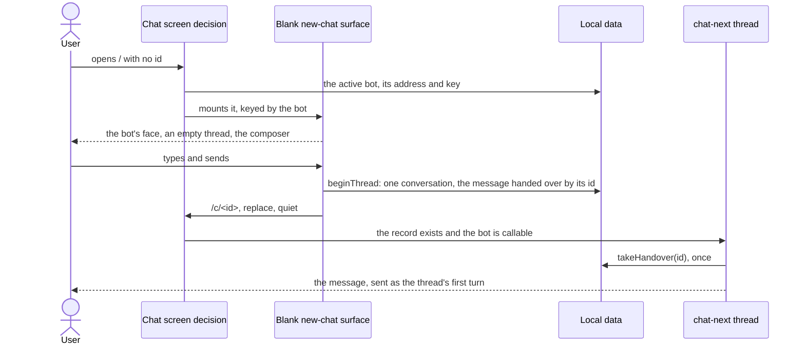
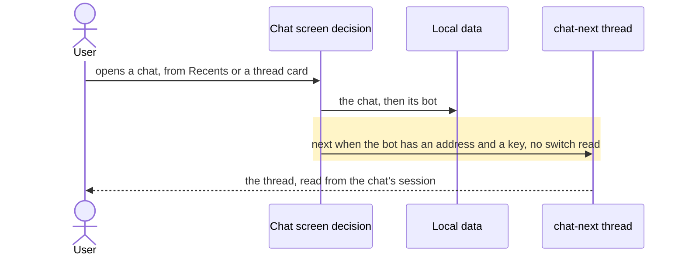
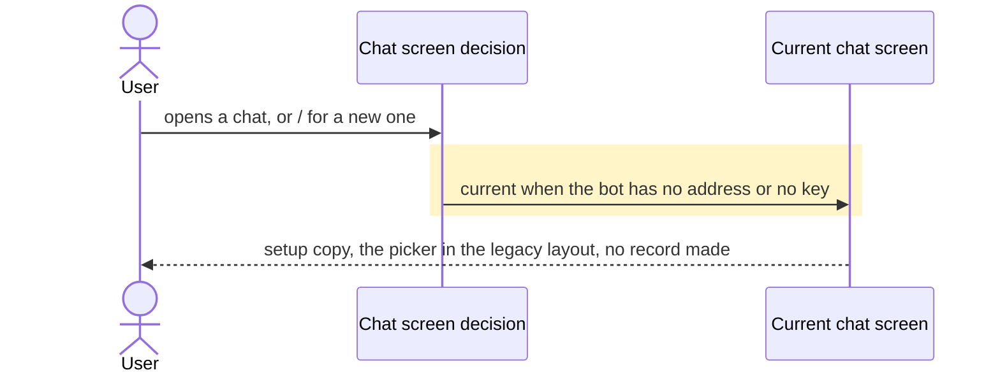
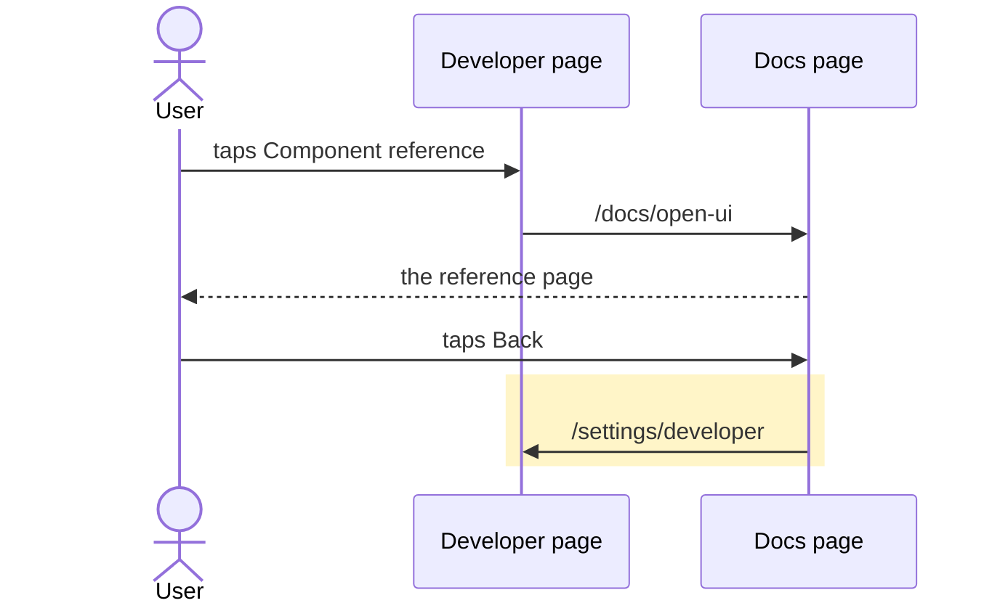

# Bot threads by default, every chat on chat-next, and a Developer page that carries its own links

**Revised 2026-11-07, after Step 3 blocked.** The user approved the test-disposition rule recorded in "Decisions"; the Step 3 dispositions list is that rule applied, not a later widening of the scope. The original step named only `test-session-leave.tsx`, which was wrong about how many current-screen tests the switch removal would strand.

## Goals

- **G1** Bot threads — bots in the sidebar, each chat a thread in its bot — are the layout on every device, with no Developer gate. The Developer switch "Bot threads" becomes **Enable legacy chat UX**: on means the old `Recents` sidebar, off or unset means bot threads.
- **G2** The "New chat screen" switch is deleted. chat-next draws every chat it can, for everyone, and a chat with no record yet opens on a chat-next blank surface. A bot with no server address or key keeps the current screen.
- **G3** "Hide developer settings" becomes a `ghost`, `h-11`, `rounded-full` button with an inline-start icon, not destructive in colour, in the shape of Settings > MCP > Config > Remove server.
- **G4** Device state sits under Sync server in one Group.
- **G5** "Component reference" leaves the Settings menu.
- **G6** Every `/docs/*` link is one Group in Settings > Developer, built from one small list; the OpenUI page's back link goes to Developer.

## Non-goals

- Moving the legacy switch to Appearance.
- Replacing the five-taps-on-the-version unlock.
- A confirmation before hiding developer settings.
- Changing what `/` means under bot threads: it still opens the active bot's Main.
- Deleting the current chat screen: it keeps its jobs for a missing chat and a bot that cannot be called.
- Docs that are not `/docs/*` routes.

## Change map

| Layer | Status | Goals | Tested at |
|---|---|---|---|
| Settings store (`Settings`, defaults, retired keys) | changed | G1, G2 | `test-developer-sections.tsx` |
| Layout rule (`useBotThreads`) | changed | G1 | `test-main-navigation.tsx` |
| App home, sidebar list, share nouns | affected | G1 | `test-main-navigation.tsx` |
| Chat screen decision (`ChatPage` verdict, `chat-next/route`) | changed | G2 | `test-chat-next-route.mjs` |
| App composer (the record-free body) | changed | G2 | `test-chat-next-mount.tsx` |
| Blank new-chat surface (chat-next) | new | G2 | `test-chat-next-new-chat.tsx` |
| chat-next thread mount and first turn | affected | G2 | `test-chat-next-new-chat.tsx` |
| Local data (conversations, the handover) | affected | G2 | `test-chat-next-new-chat.tsx` |
| Current chat screen | affected | G2 | `test-session-leave.tsx` and the migrated current-screen tests |
| Developer page (switch, groups, hide action, docs group) | changed | G1, G3, G4, G6 | `test-developer-sections.tsx` |
| Settings menu | changed | G5 | `test-openui-reference.tsx` |
| Docs page (`/docs/open-ui`) | changed | G6 | `test-openui-reference.tsx` |
| Diagnostics and device state | changed | G1, G2 | `test-diagnostics.mjs` |
| e2e harness and flow audit | affected | G1, G2 | `test-e2e-registry.mjs` |

## Flows

### F1: a reader starts a chat that has no record yet (new). Test: "a new chat opens on chat-next, and its first message is the thread's first turn" (new `test-chat-next-new-chat.tsx`)



The blank surface never posts. `beginThread` already writes the record and the handover map, and `ChatNextThread` already takes a `start` and sends it once as turn one (ADR 0096), so the blank chat and `/thread` share one delivery path.

### F2: a chat with a record opens (changed). Test: "a plain chat opens on chat-next, read from its bot and its session" (`test-chat-next-mount.tsx`)



### F3: a chat whose bot cannot be called (changed, the edge of F2). Test: "a chat whose bot has no key stays on the current screen" (`test-chat-next-mount.tsx`)



### F4: the layout switch (changed). Tests: "with no switch at all the app is the bot-first layout" (`test-main-navigation.tsx`) and "the legacy switch survives Hide" (`test-developer-sections.tsx`)

```mermaid
sequenceDiagram
  actor User
  participant Dev as Developer page
  participant Store as Settings store
  participant Layout as Layout rule
  User->>Dev: turns Enable legacy chat UX on
  rect rgb(255, 245, 200)
  Dev->>Store: legacyChat: true
  Store-->>Layout: useBotThreads answers false
  end
  Layout-->>User: Recents and the New chat button
  User->>Dev: Hide developer settings
  rect rgb(255, 245, 200)
  Dev->>Store: developer false, netLog false; legacyChat untouched
  end
  Layout-->>User: still the legacy layout
```

### F5: the docs Group (changed). Test: "the docs Group opens the reference, and its back link goes to Developer" (`test-openui-reference.tsx`)



## Steps

1. **Preparatory refactor: the chat-next composer body stands without a chat record.** Split the record-bound composer from the part that takes a draft key, a model choice, the bot and the send handlers, so a surface with no chat row mounts the real composer rather than a copy. Prepares: 4. After: none. Layers: App composer. Check: `test-chat-next-mount.tsx` green before and after, and the composer's props still come from one component.

   Done.

2. **Bot threads become the default, and the switch becomes the legacy opt-out.** Settings gains one local `legacyChat` boolean; `useBotThreads` returns `!legacyChat` and no longer ANDs `developer`; the Developer switch reads **Enable legacy chat UX**, loses the Experimental badge, and writes `legacyChat`; Hide writes `developer` and `netLog` only, so the layout survives it; `botThreads` joins the retired keys a save sheds, with no Dexie bump; diagnostics reports the effective `botThreads`. Goals: G1. After: none. Layers: Settings store, Layout rule, App home/sidebar/share, Developer page, Diagnostics and device state. Check: a mount with nothing stored draws bots and lands on Main; `legacyChat: true` draws `Recents` and the New chat button; Hide writes only `developer` and `netLog`. `test-main-navigation.tsx` and `test-developer-sections.tsx` red then green; `test-device-state.tsx` and `test-diagnostics.mjs` follow.

   Done.

3. **Callability alone chooses the screen.** `chatNext` leaves the settings type, the Developer page, device state and diagnostics, and joins the retired keys; `opensOnChatNext` loses its switch argument and keeps the record requirement; `callable(bot)` is the one address-and-key test; the verdict consults no switch. `test-session-leave.tsx`'s second arm becomes a keyless bot — the one way the current screen still draws a session. The current screen's other tests follow one rule: a test of behaviour chat-next also draws moves to chat-next, or is retired where a chat-next test already covers it; a test of a path the product still produces on the current screen keeps a keyless bot; a test of a path the current screen no longer draws is deleted. Every component file is run to take the inventory, and each disposition is named in the step's report. Goals: G2. After: 2. Layers: Settings store, Chat screen decision, Current chat screen, Diagnostics and device state. Check: `test-chat-next-route.mjs` and `test-chat-next-mount.tsx`: a callable bot's chat is chat-next with no switch stored; a keyless or addressless bot's chat is the current screen; the suite no longer seeds `chatNext`; and every component file runs green in batches, including each migrated or retired current-screen test.

   Done.

4. **A chat with no record opens on chat-next.** The verdict gains a third answer, `blank`, for an address with no id whose active bot is callable. The blank surface draws the bot's face, an empty thread, the composer from step 1, and the `BotPicker` only in the legacy layout. No record is written on mount. Its send calls `beginThread` with the pending model pick and the typed text, then replaces the address; the thread takes the handover and sends it as its first turn. The picker writes `activeProfileId` and the verdict re-runs. An uncallable bot never reaches the surface. Prune `CurrentChatPage`'s now-dead no-id create branch and its pending pick, keeping the picker and the uncallable path. Goals: G2. After: 1, 3. Layers: Chat screen decision, App composer, Blank new-chat surface, chat-next thread mount, Local data, Current chat screen, e2e harness. Check: new `test-chat-next-new-chat.tsx`: no row before the send, one conversation and one run after it, the message drawn as the thread's first turn, no record for an uncallable bot, and the draft survives the replace.

   Done.

5. **The Developer page's shape.** The hide control becomes ghost, `h-11`, `rounded-full`, with an `EyeOff` icon carrying `data-icon="inline-start"`, no destructive colour, same handler. Sync server and Device state become one Group, Sync server first. Goals: G3, G4. After: 2. Layer: Developer page. Check: `test-developer-sections.tsx` asserts the button's shape and that both rows share one group; Hide still writes only `developer` and `netLog`.

   Done.

6. **One docs Group in Developer.** `ReferenceRow` leaves the Settings menu. The Developer page renders a Group from a literal list of `/docs` entries — one today: Component reference, `/docs/open-ui`. The OpenUI page's back link goes to `/settings/developer`, labelled **Back to Developer**. Goals: G5, G6. After: 2. Layers: Developer page, Settings menu, Docs page. Check: `test-openui-reference.tsx`: `/settings` has no docs link, `/settings/developer` has one, it opens the page, and Back returns to Developer.

   Done.

7. **The browser flows and the audit speak the new vocabulary.** e2e seeds drop `botThreads` and `chatNext`; `wake-window`'s flip asserts `legacyChat`; `chat-message` is seeded to the legacy layout, or its row is rewritten to prove the blank surface; `bot-threads`, `sidebar-collapse`, `steer-offer`, archive, older and compaction seeds follow; the audit's `bot-threads` and `chat-message` rows say what the flows now do. No flow is added or retired, so the registry's counts stand. Goals: G1, G2. After: 2, 3, 4, 5, 6. Layer: e2e harness and flow audit. Check: `test-e2e-registry.mjs` green both sides, then `pnpm e2e chat-message bot-threads wake-window` green.

   Done, with one flow red. The registry is green; Playwright is at `/usr/local/lib/node_modules/playwright/index.mjs` with browsers at `/opt/ms-playwright`, and `chat-message` and `wake-window` pass. `bot-threads` is red: its seed writes `db.messages`, which chat-next no longer reads, so Main draws its cards but none of the seeded messages; porting that seed to chat-next's store is a follow-up, not done in this step.

## Coverage: every old read and test

| Read or test | Disposition |
|---|---|
| `useBotThreads` and its 12 call sites (`App.tsx`, `conversation-list.tsx`, `chat.tsx`, `share.tsx`) | The hook body flips in step 2; every call site keeps its call. |
| `ChatPage` verdict and `opensOnChatNext` | Steps 3 and 4. |
| `Settings` type, defaults, retired keys | Steps 2 and 3. |
| Developer page (two switches, groups, hide action, docs row) | Steps 2, 3, 5 and 6. |
| Device state and diagnostics | Steps 2 and 3. |
| 14 files seeding `botThreads` | Step 2. |
| 5 files seeding `chatNext` | Step 3. |
| `test-session-leave.tsx` | Step 3: the second arm becomes a keyless bot. |
| Current-screen tests that mount a configured bot (inventory: every component file; 14 failed before the migration) | Step 3: each moves to chat-next, keeps a keyless bot where the product still draws that path, or is retired where a chat-next test already covers it; the step's report names each disposition. |
| New `test-chat-next-new-chat.tsx` | Step 4. |
| `test-developer-sections.tsx` | Steps 2 and 5. |
| `test-openui-reference.tsx` | Step 6. |
| `e2e/lib.mjs`, `chat-message`, `bot-threads`, `wake-window` and the rest | Step 7. |
| `docs/e2e-flow-audit.md` | Step 7. |

### Step 3 test dispositions

- **Migrated to chat-next:** `test-attach-menu.tsx`, `test-slash-menu.tsx`.
- **Kept keyless on the current screen, the still-real uncallable-bot path:** `test-live-cluster`, `test-live-span`, `test-thinking-line`, `test-thread-rendering`, `test-main-cards`, `test-cheatsheet-sheet`, `test-main-thread`, `test-bot-chrome`, `test-bot-pane`, `test-main-navigation`, `test-switch-hold`, `test-switch-scroll`, `test-page-fade`, `test-openui`, `test-openui-switch`, `test-media-gallery`, `test-media-cache`, `test-media-reply`, `test-previewer-zoom`, `test-attachment-row`, `test-composer-steer`, `test-pending-card`, `test-card-undo`, `test-session-close`, `test-subagent-result`, `test-routine-run`, `test-thread-command`, `test-progress-reminder-row`, `test-archive-thread`.
- **Retired with named chat-next coverage:** `test-compaction-thread` (chat-next mount dividers and the compaction matrix), `test-compaction-live`'s divider case, `test-todos-live` (the finished turn's todo pill), `test-model-pin` (the composer's model pill and pin), `test-wake-follow` and `test-wake-question` (the chat-next delegate wake turn).
- **Retired, with its still-reachable state tested elsewhere:** `test-chat-history-missing`. The notice is still reachable on an uncallable bot with a synced chat, so the current screen keeps it; `test-thread-missing.tsx` covers that state, its Try again and its Copy details.

## Decisions

- **The legacy switch stays in the Developer section.** Made by the user (Q1: where the legacy switch lives), because the Developer section is where the old switch lived.
- **A chat with no record opens on chat-next.** Made by the user (Q2: what a new chat does before its first message), because one chat screen is the point of deleting the switch.
- **One local `legacyChat` boolean, unset meaning bot threads; no migration and no Dexie bump; `botThreads` and `chatNext` join the retired keys a save sheds.** Made by the agent, following D1 and the existing retired-keys mechanism.
- **`useBotThreads` is the one read and returns `!legacyChat`; no developer AND.** Made by the agent, because every layout call site already reads the hook.
- **`callable(bot)`, address plus key, is the one screen rule; `opensOnChatNext` keeps the record requirement.** Made by the agent, so the blank surface and a chat with a record ask the same question.
- **The blank surface is a sibling composition, not `ChatNextThread` running session-less; no record on mount; the first send creates and hands over; the picker writes the active bot; today it is reachable only from the legacy layout's `/`.** Made by the agent, because bot threads start chats at Main with `/thread`, and every read and poll in the thread is keyed by a session.
- **Diagnostics keeps an effective `botThreads` and drops `chatNext`.** Made by the agent, because a bug report still needs to say which layout the device was on.
- **The docs Group is a literal list in the Developer page; the OpenUI page's back link goes to Developer.** Made by the agent, because one route exists and a registry with one consumer is an abstraction with no job.
- **Hide is ghost, `h-11`, `rounded-full`, with an inline-start icon and no destructive colour; it writes `developer` and `netLog` only.** Made by the agent, from the Remove server precedent and G3.
- **`CurrentChatPage`'s dead no-id create branch and pending pick are pruned; its picker and uncallable path stay.** Made by the agent, because the blank surface now owns a new chat with a callable bot.
- **The current screen's configured-bot tests are migrated to chat-next, kept keyless only where the product still draws that path, or retired where a chat-next test already covers the behaviour — never kept reachable through a test-only seam.** Made by the user, approving the rule after step 3 showed the plan had scoped only `test-session-leave.tsx` for the current screen's test fallout.

## Risks

- The blank surface could become a second composer; step 1 exists to close that. Its test must assert the draft survives the replace.
- About 30 test files seed the old flags. `typecheck` finds the seeds, not an assertion that now passes for the wrong reason.
- The current screen's configured-bot tests cannot reach it once the switch goes. Step 3 includes their migration, and a missed file is a red suite, not a silent pass; the full component suite must be run file by file because one invocation OOMs this sandbox.
- A bot can lose its key between drawing the blank and sending, leaving an empty record and a stale handover.
- The current screen's `configured` (address alone) and the verdict's `callable` (address plus key) still disagree for a bot with an address and no key; that bot keeps a composer that looks ready and fails on send. This is existing behaviour, not worsened.
- The reference page becomes reachable only after five taps, because its menu row goes and the docs Group lives in Developer.
- Every device flips to bot threads on upgrade, including one that had deliberately stored `botThreads: false`. Getting the old sidebar back means finding the switch, and hiding Developer makes it five taps away again.
- `chat-message` starts at `/` and ends in Recents; after the flip it lands on Main unless it is seeded to the legacy layout or rewritten.
- The blank surface is unreachable under bot threads. If a record-less chat should be reachable from a bot's Main too, that is a new entry point, not covered here.

## Not now

- Moving the legacy switch to Appearance.
- Replacing the version-tap unlock.
- A confirmation before hiding developer settings.
- Deleting the current chat screen.
- Docs outside `/docs`.
- Migrating stored `botThreads` or `chatNext`.
- A `/docs` index or registry.
- An e2e flow dedicated to the blank chat.
- A second way to start a chat under bot threads.
