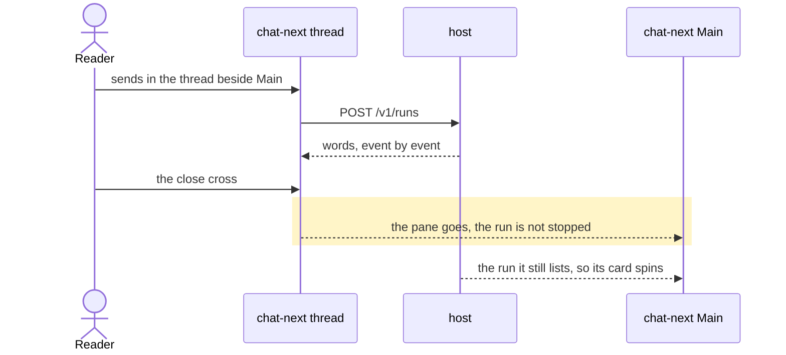

# A bot's Main on chat-next keeps its thread beside it

## Goals

- **G1** The skipped test `"a switch out of a closed lane never flashes the 412px rail"` runs unskipped and passes: after the switch out of a closed lane, no frame draws the 412px rail.
- **G2** The lane — split share, drag handle, close cross, Escape, Cmd+\ to reopen, no slide — is proven with Main drawn by chat-next, not only by the current screen.
- **G3** A thread closed while its reply streams keeps running on chat-next: nothing is posted to stop it, its card in Main still spins, and the words are there when it is opened again.
- **G4** The current screen keeps its behaviour for a keyless bot and for a chat this device is missing.
- **G5** A bot's row in the sidebar stops dotting once its thread has been read, whether chat-next or the current screen drew it.

## Non-goals

- What a bot's Main is: Main stays chat-next for a callable bot and the current screen for an uncallable one (`opensOnChatNext`).
- New lane features: the split, its handle, its keys and its chord already exist (#918).
- The legacy layout's single screen (`legacyChat`), beyond the tests that pin it.

## Change map

| Layer | Status | Goals | Tested at |
|---|---|---|---|
| chat-next transcript read (`src/chat-next/api.ts`) | changed | G1 | `scripts/test-chat-next-reads.mjs` |
| bot pane (`src/components/app-shell.tsx`, `src/lib/threads.ts`) | affected | G1, G2 | `scripts/test-bot-pane.tsx` |
| chat-next Main and its thread screen (`src/chat-next/*`, `src/routes/chat.tsx`) | affected | G2, G3 | `scripts/test-bot-pane.tsx` |
| the current screen (`src/routes/chat.tsx` outside chat-next) | affected | G4 | `scripts/test-bot-pane.tsx` |

## Flows

### F1: a reader switches from a closed lane to a callable bot's Main (changed). Test: "a switch out of a closed lane never flashes the 412px rail"

```mermaid
sequenceDiagram
  actor Reader
  participant Shell as bot pane
  participant Main as chat-next Main
  participant Read as chat-next transcript read
  participant Host as host
  Reader->>Shell: Main of another bot
  Shell->>Main: draw Main in the lane it had (closed, whole width)
  Main->>Read: newest rows of its session
  rect rgb(255, 245, 200)
  Read->>Host: GET /api/sessions/{session}/messages
  Host-->>Read: an answer with no `data` page
  Read-->>Read: no rows, so the read ends
  end
  Read-->>Main: no rows
  Shell->>Shell: the bot's list answers; the lane opens on its thread
  Shell-->>Reader: Main and its thread, half the row each
```

### F2: a reply streams in a thread the reader puts away (changed). Test: "a thread closed while it streams keeps running, and its card in Main still spins"



## Steps

1. **A page the host cannot give is no rows.** The read ends on an answer that carries no `data` array instead of asking for the next offset for ever. Goals: G1. After: none. Layers: chat-next transcript read. Check: `scripts/test-chat-next-reads.mjs` with the new case, red (the page comes back `undefined`) then green. Done.
2. **The lane's own test runs unskipped, with its probe gone.** The unskipped switch test passes, and the file's other cases still do, including the one that hung its process out of memory before. Goals: G1, G4. After: 1. Layers: bot pane, chat-next Main. Check: the command the request names, red (it never returns) then green. Done.
3. **The lane is proven where Main is chat-next.** A callable bot's Main, beside the thread this device remembers for it: the bot's name and thread count, the thread's pane in half the row, the handle, Main's header with its picture and no close cross, the thread's with the cross and no back, the card marked open, and the cross closing it — the thread forgotten and Main taking the whole row, as `Escape` and the chord do. Goals: G2. After: 1. Layers: bot pane, chat-next Main. Check: the new case is red before step 1 (the read never ends) and green after. Done.
4. **The run outlives the pane on chat-next.** The mid-stream close is driven by chat-next's own composer and host, and asserts nothing was posted to stop the run, the card in Main still spins, and the words are there on reopening. It replaces `"a thread closed while it streams keeps running, and its card in Main still spins"` as written for a keyless bot on the current screen, which can no longer send: a callable bot's thread is chat-next's. Goals: G3. After: 1. Layers: chat-next Main, chat-next thread. Check: the case fails before the rewrite (`waited for the run's POST`) and passes after. Done.
5. **Every suite the request names, and the tier at three.** The named files, `pnpm typecheck`, `pnpm build`, `pnpm test:unit`, and the component tier at `--test-concurrency=3`, which is retried and left at 2 only if it still runs out of memory, said so in the pull request: it does, a worker reaching SIGKILL, so the tier stays at 2 and the pull request names it. Goals: G1–G4. After: 1–4. Layers: all. Check: each command's own output. Done.
6. **A chat-next chat writes its own read mark.** The sidebar's bot row reads the marks of the bot's threads (ADR 0110), so a thread drawn by chat-next writes the mark its own render has seen, as the current screen does for every chat — not only for a coding session, which is all chat-next wrote before it drew a bot's thread. Goals: G5. After: none. Layers: chat-next Main and its thread screen. Check: `scripts/test-bot-rows.tsx`, its two mark cases red (`waited for the dot to clear once the thread renders`, `waited for the mark the thread's own render wrote`) then green. Done.
7. **A page the host cannot give is a failed read, not the end of the chat.** `readPage` raises `HostNoPage` for an answer with no page in it, and only the first page of a read with nothing held turns that into an empty chat: the older-page walk says `failed` and offers the retry a refused page gets, a thread with rows drawn keeps them, and a whole-transcript read is never returned short. Goals: G1. After: 1. Layers: chat-next transcript read, chat-next thread screen. Check: `scripts/test-chat-next-reads.mjs` red as `Missing expected rejection (HostNoPage)` and `scripts/test-chat-next-older.tsx` red as `undefined !== 'failed'`, both green after. Done.
8. **The attachment rows are proven on the screen that draws a callable bot's chat.** The two cases that seeded the device's own message rows drew the current screen when their bot had no key, and chat-next — which folds the host's rows — where it had one. They now seed the host's transcript with the marker its row was written with, and keep their assertions: a HEIC draws the row the platform opens rather than a cell that can never fill, and a tap the host refuses for a size says the host's own sentence. Goals: G2. After: none. Layers: chat-next thread screen. Check: `scripts/test-attachment-row.tsx` red as `waited for the photo's download row` and `waited for the file's row`, then 5/5. Done.

## Decisions

- **The cause is the transcript read, not a render loop.** Made by the agent: a CPU sample of the hung test process names `readNewest` (`src/chat-next/api.ts`) spinning, the probes show its offset climbing with no render in between, and answering the same fake with `{data: []}` instead of `{}` makes the test pass in 0.5s. Refuted: a render loop in `AppShell`/`Panes` (render counts stay at three), `NextChat`'s back-guard and `hold` effects (they run once, and nothing re-renders during the spin), and the lane's transition (the lane is closed across the switch and asks no animation).
- **The read is fixed where the page is read.** Made by the agent: `readPage` answering rows is the seam both readers share (`readNewest` and `readTranscript`), so a host that answers a body with no page can neither spin the reader nor throw on `page.length`.
- **A page-less answer fails the read, rather than ending it.** Made by the user after the review: a `[]` for a body with no page let every paging site read it as the start of the chat, so an older page cleared `partial` with no retry and a whole-transcript read came back short. `readPage` raises `HostNoPage`; only a first page with nothing held becomes an empty chat.
- **The mid-stream test moves to chat-next rather than keeping a bot it cannot send from.** Made by the agent: the branch seeds that bot keyless so the current screen draws it, and a keyless bot cannot post a run.
- **This is not the plan's own gate.** Made by the agent: the request carries its own requirements, so the steps above are the wtf plan rather than a wdyt feature plan.

## Risks

- An answer with no page is a failed read everywhere but the first page of a chat this device holds nothing of, so a host that sends one mid-thread leaves the thread as drawn and offers the retry a refused page gets — the same words, from a 200 rather than a 500.
- The mid-stream test rewritten on chat-next asserts against the fake host's own record (`asked.stops`), so a regression in this device's stop path is caught there, not in the legacy send.
- The component tier's three-at-once run is a sandbox limit, not a product one; if it still runs out of memory the workaround stays at 2 and the pull request says so.

## Not now

- `readTranscript`'s own loop and its `page.length` on a page the host never gave — the same fix covers it, and no test drives it.
- A live-run follow that two readers share (this device's send and chat-next's read of the same run), from the mixed send the old streaming test made.
- The `act` warnings the component tier prints for chat-next's own updates, from the branch's screens.
