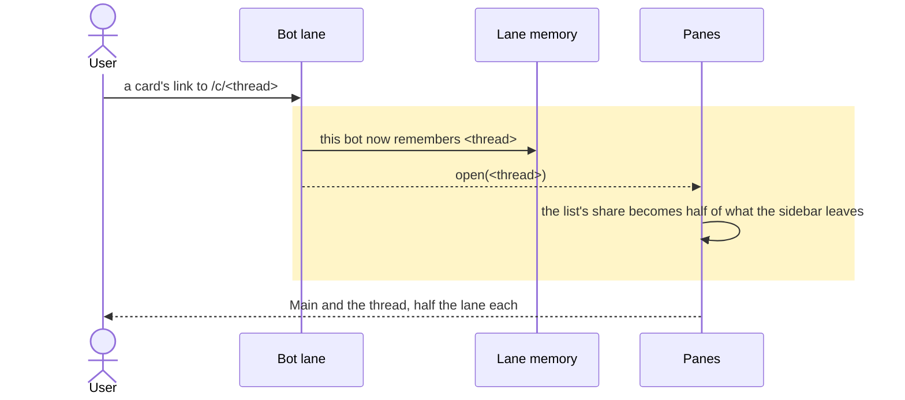
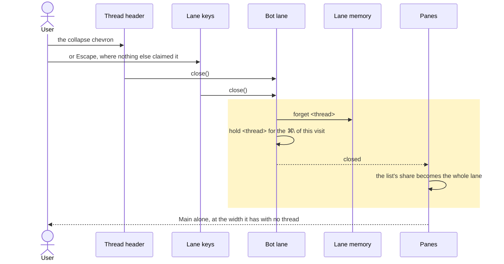
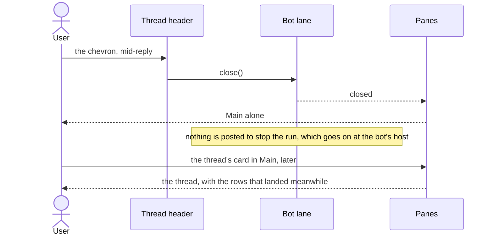
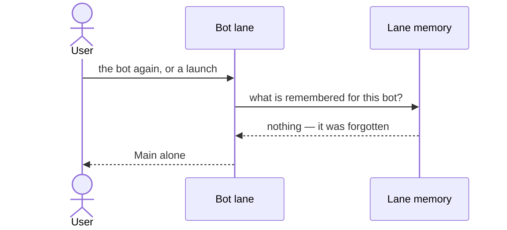
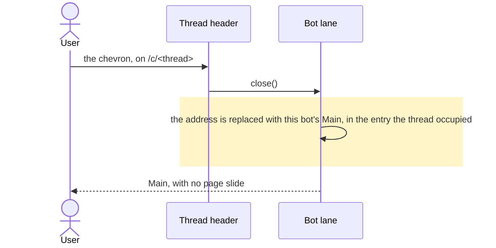
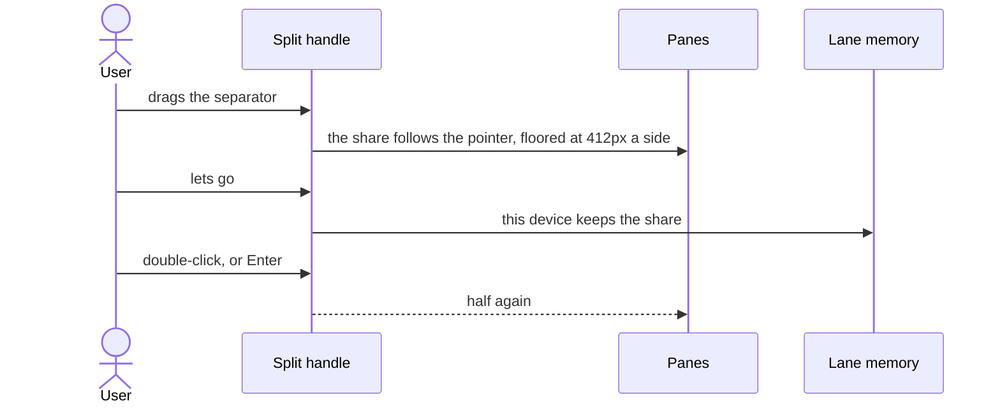
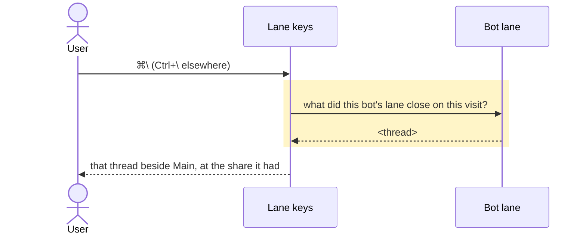

# A bot's Main and its thread share the laptop, and the thread can be put away

## Goals

- **G1** At laptop widths a bot's Main and the open thread take half of the room the sidebar leaves,
  instead of Main being pinned to the 412px list lane.
- **G2** The thread can be closed, and closing leaves Main at the width it has when no thread was
  ever opened.
- **G3** Opening and closing read as one surface rearranging — not a pane sliding over another, and
  not a snap — and a reader who asked for no motion gets both states at once.
- **G4** Closing the thread the address names returns the address to that bot's Main quietly, with no
  page slide and no history entry that walks back into the thread just dismissed.
- **G5** A closed thread is forgotten: the next visit and the next launch open Main alone, and only
  opening a thread again — a card, `/thread`, or the ⌘\\ keystroke — brings one back.
- **G6** The split can be dragged, neither chat can be crushed, the share a reader drags to is
  remembered on that device, and a double-click returns it to half.
- **G7** ⌘\\ on a mac, Ctrl+\\ elsewhere, reopens the thread just closed — that thread, not the
  newest — held in memory only until the reader leaves that bot.

## Non-goals

- The sidebar never collapses itself to icons when a thread opens.
- Code, projects, meetings, research and apps keep their 412px lane. `Panes` gains a width policy so a
  later lane costs one line, but only the bot's thread lane takes the new one here.

## Change map

| Layer | Status | Goals | Tested at |
|---|---|---|---|
| `Panes`, the shell's list-beside-item layout (`components/app-shell.tsx`) | changed | G1, G3 | `scripts/test-bot-pane.tsx` mounted at 1440; the laptop section of `scripts/e2e/bot-threads.mjs` |
| Bot lane: `useBotPane` and its close and reopen (`lib/threads.ts`) | changed | G1, G2, G4, G5, G7 | `scripts/test-bot-pane.tsx` |
| Lane memory: the remembered thread as a subscribe-able device store (`lib/threads.ts`, `lib/store.ts`) | changed | G2, G5, G7 | `scripts/test-bot-pane.tsx`, whose `remembered()` reads `gots:last-thread:<bot>` |
| Thread header: the thread's leading slot (`routes/chat.tsx`, both screens) | changed | G2, G4 | `scripts/test-bot-pane.tsx`; the laptop section of `scripts/e2e/bot-threads.mjs` |
| Lane keys: one Escape rule and one reopen chord (`lib/keys.ts`, `components/keyboard-shortcuts.tsx`) | changed | G2, G7 | `scripts/test-keys.mjs`; `scripts/test-bot-pane.tsx` |
| Split handle: the separator between the halves (`components/app-shell.tsx`) | new | G6 | the laptop section of `scripts/e2e/bot-threads.mjs` |

## Flows

### F1: a reader opens a thread from a card (happy path, changed). Test: "the thread beside Main shares the lane evenly"

### F2: a reader closes the thread from its header (changed). Test: "the chevron by the thread's title closes it, and Main takes the lane"

### F3: a reader closes a thread while it streams (new). Test: "a thread closed while it streams keeps running, and its card in Main still spins"

### F4: the reader comes back after a close (new). Test: "a thread closed here is not reopened on the next visit"

### F5: a reader closes the thread the address names (changed). Test: "closing the thread the address names lands Main with no slide"

### F6: a reader drags the split and comes back (new). Test: "a drag keeps its share across a reload, a close and a reopen"

### F7: the reader asks for the thread back (new). Test: "⌘\\ reopens the thread just closed, and nothing after leaving the bot"

## Steps

1. **Preparatory refactor: `Panes` takes a width policy.** Today it hard-codes the list's share (`w-103` open, `w-full` closed) and always plays the 48px slide on the item column when a pane opens. It gains one policy from its caller — a list lane at 412px, or a share of the lane's own width — and whether the item arrives by sliding. Every caller passes today's policy, so no screen moves. Prepares: 4, 5, 9, 10. After: none. Layers: `Panes`. Check: every case of `scripts/test-bot-pane.tsx` and `scripts/test-pane-transition.tsx` green before and after, and the laptop section of `scripts/e2e/bot-threads.mjs` still finding two header rows in the same boxes. Done.
2. **Preparatory refactor: the remembered thread becomes a subscribe-able device store.** Today the id under `gots:last-thread:<bot>` is read inside a `useLiveQuery` whose dependencies are the wide screen, the switch, the bot and the address's thread, so nothing re-runs it when the stored id itself changes — a close that only wrote storage would leave the lane drawn as it was. The store holds each bot's remembered id, loads a bot's row from storage on first read (so a test that seeds storage before mounting still finds it), persists on write and notifies every reader. `lastOpened` answers from the store, so the device-state dump keeps reporting `lastThread` and `lastStored`. Prepares: 3, 5, 7, 10, 11. After: none. Layers: Lane memory. Check: "a thread opened for a bot is the one its pane keeps" and "the thread that was open is the one beside Main when the user comes back to it" in `scripts/test-bot-pane.tsx`, and the device-state case in `scripts/test-device-state.tsx`, green before and after. Done.
3. **Preparatory refactor: what the lane holds becomes one answer.** Today the answer is assembled in two places in the shell — the item's thread and whether the lane is open — from three sources: the address, the stored id and the thread count. `useBotPane` becomes the one answer: which bot, whether the lane is closed or open at a thread or not answered yet, what it holds, and `close()` and `reopen()`. Nothing calls the moves yet. Prepares: 4, 5, 6, 7, 8, 9, 10, 11. After: none. Layers: Bot lane, `Panes`. Check: "a bot with no threads keeps the pane and says so", "a remembered thread that is gone leaves the pane closed" and "a bot switch leaves its thread lane blank, and no frame calls a bot thread-less before its list answers" in `scripts/test-bot-pane.tsx`, green before and after. Done.
4. **The two lanes share the room.** Where the bot's thread list has answered and the lane holds a thread, Main and the thread take half the lane each: 1440 with the sidebar open is 560/560, 1280 is 480/480, 1920 is 800/800 — a percentage of the row, never a pixel. While the list is unanswered the lane keeps the state and the width it had, so a switch never flashes Main wide and back. A bot with no threads keeps today's 412px rail for "No threads yet". Goals: G1. After: 1, 3. Layers: `Panes`, Bot lane. Check: `scripts/e2e/bot-threads.mjs`, laptop section, "the thread beside Main shares the lane evenly" — the two chats' boxes within 2px of each other and both wider than 500 at 1440, red today at 412 against 708 — and a case in `scripts/test-bot-pane.tsx` that a project's lane is still `w-103`. Done.
5. **The thread closes.** A collapse chevron named "Close thread" stands in the thread header's leading slot, where a phone's Back sits, and Escape is its twin where a thread is a lane and nothing else has claimed the key. Two assertions that pinned the absence flip in this step and only this step: `scripts/test-bot-pane.tsx`'s "a thread beside Main carries no control of its own", and the laptop section of `scripts/e2e/bot-threads.mjs`, which asserts the thread's controls exclude "Close thread". Goals: G2. After: 4. Layers: Thread header, Bot lane, Lane memory, Lane keys, `Panes`. Check: "the chevron by the thread's title closes it, and Main takes the lane" and "Escape closes the lane, and only where the thread is a lane" in `scripts/test-bot-pane.tsx`, and "closing the thread gives Main the whole lane" in the laptop section of `scripts/e2e/bot-threads.mjs` — Main's box within 2px of the lane's — all red before. Done.
6. **Closing never stops the run.** The close closes the view, not the work: nothing is posted to stop the run, the thread's card in Main keeps the spinner the host's live-runs ledger gives it, and opening the thread again from that card shows the rows that landed meanwhile. Goals: G2. After: 5. Layers: Bot lane, Lane memory, `Panes`. Check: "a thread closed while it streams keeps running, and its card in Main still spins" in `scripts/test-bot-pane.tsx` — the run's POST recorded, the chevron pressed mid-stream, no stop posted, the card still spinning, the later rows drawn on reopen — red before, there is no chevron to press. Done.
7. **A closed thread is forgotten.** Closing drops the remembered id, so the next visit and the next launch open Main alone, and only opening a thread again — a card, `/thread`, or the keystroke — brings one back. Goals: G5. After: 5. Layers: Lane memory, Bot lane. Check: "a thread closed here is not reopened on the next visit" in `scripts/test-bot-pane.tsx` (close, unmount, remount: the only header is the bot's, `gots:last-thread:<bot>` is null, and the empty line is not drawn because the bot does have threads), and a reload case in the laptop section of `scripts/e2e/bot-threads.mjs`. Done.
8. **The address comes back quietly.** Closing the thread the address names replaces that entry with the bot's Main, the way a sidebar row does, so no page slide plays and Back lands where it did before the thread was opened. Goals: G4. After: 5. Layers: Thread header, Bot lane, `Panes`. Check: "closing the thread the address names lands Main with no slide" in `scripts/test-bot-pane.tsx` (the path is the bot's Main and Main's screen element was not animated), and `goBack()` in the laptop section of `scripts/e2e/bot-threads.mjs` landing the page before the thread. Done.
9. **The lane closes and opens as one surface.** One number animates: the lane's share. The thread being closed keeps the width it had, is clipped and made inert rather than squeezed, and is dropped when the share reaches zero — a timer matching the 300ms transition, because the component harness has no layout events. A split lane opens by the edge moving, not by the item sliding 48px. `PaneTransition` is left alone: its pinned "fades nothing when the item stays, opens from nothing or closes" stays true because the lane's exit belongs to the shell, not to the item swap. Reduced motion gets both states in one frame. Goals: G3. After: 4, 5. Layers: `Panes`, Bot lane. Check: "the lane closes as one surface" in the laptop section of `scripts/e2e/bot-threads.mjs` — frames sampled across a close hold the thread's inner column at the width it had and then find it gone, Main's box only ever growing, and the same close under `emulateMedia({ reducedMotion: "reduce" })` shows the closed state on the first frame — and "the lane opens by rearranging, not by sliding" in `scripts/test-bot-pane.tsx`, where no `translateX` is asked for on a split lane. Done.
10. **The split is dragged, floored and remembered.** The separator takes a pointer, carries a role and a current share, and takes arrow keys, Enter and a double-click. Each side is floored at 412px — the width the app already asks text to read in — as a CSS `clamp`, so no resize listener is needed and shrinking the window cannot crush Main. The share is kept as a fraction of the lane on this device, and it survives a close and a reopen. Goals: G6. After: 4, 5, 7. Layers: Split handle, `Panes`. Check: "a drag keeps its share across a reload, a close and a reopen" in the laptop section of `scripts/e2e/bot-threads.mjs` — drag, reload and measure the same share, drag to the stop and find Main at 412, close and reopen and find the share again, double-click and find two halves within 2px — and arrow keys and Enter in `scripts/test-bot-pane.tsx`. Done.
11. **The close can be undone from the keyboard.** A chord predicate in `lib/keys.ts` and the existing `keyboard-shortcuts.tsx` host, which already stands down on `defaultPrevented` and `isComposing`. It reopens the id this bot just closed, held in memory only: after a switch to another bot it opens nothing, and it never closes an open lane. Goals: G7. After: 3, 5. Layers: Lane keys, Bot lane, Lane memory. Check: "⌘\\ reopens the thread just closed, and nothing after leaving the bot" in `scripts/test-bot-pane.tsx` — of two threads the older is opened, closed and brought back by the key, and the switch-and-return case finds it gone — and the chord's predicate in `scripts/test-keys.mjs`, both red before. Done.

## Decisions

- **The split, the drag and the close are the bot's thread lane only, and the shared `Panes` takes a width policy.** Made by the user (Q1), because every other list keeps the lane it was designed around, and a later lane should cost one line rather than a second layout.
- **Closing forgets the thread.** Made by the user (Q2), because a thread that reopens by itself is the complaint, so Main alone is what the next visit and the next launch show.
- **A thread may be closed while it streams; the run goes on at the host.** Made by the user (Q3), because the close is the reader putting a surface away, not a stop — the card keeps spinning and reopening shows the rest.
- **The close is a collapse chevron in the thread header's leading slot, where a phone's Back sits, and Escape is its twin.** Made by the user (Q4), because that slot is where leaving a thread already lives.
- **The keystroke reopens the thread just closed, in memory only until the reader leaves that bot.** Made by the user (Q5), because "the newest" is not what the reader just closed.
- **Half is half of the room the sidebar leaves, written in CSS.** Made by the agent, because the sidebar may be open or a rail, and a fixed pixel would be wrong in one of the two.
- **The dragged share is one per device.** Made by the agent, following the fifteenth breadth item the user accepted; a per-bot width is left out.
- **Each bot keeps its own closed state, and a bot switch is a change of place.** Made by the agent, because one bot's closed thread says nothing about another's.
- **A bot with no threads keeps the 412px rail that says so.** Made by the agent, because half a screen for one sentence is worse than the rail, and nothing in the goals asks for that state to change.
- **Unknown is not closed.** Made by the agent, because while a bot's thread list is unanswered the lane must keep the state and the width it had, or a switch flashes Main wide and back.
- **One number animates, and the leaving chat is clipped rather than re-wrapped.** Made by the agent, because a transcript re-measured per frame is the squash this change exists to avoid.
- **Neither chat is ever narrower than 412px, and the floor is a CSS `clamp`.** Made by the agent, because the split must not make a chat worse than the lane it replaced, and a clamp holds on every screen without a listener.
- **`PaneTransition` is untouched; the lane's exit belongs to the shell.** Made by the agent, because the fade it plays is for an item swapped for another, and its pinned "closes" case must stay true.
- **The exit window is a timer, not `transitionend`.** Made by the agent, because the component harness has no layout, and the 300ms matches the class already on the lane.
- **Below 1280 nothing changes, and Escape closes only where a thread is a lane.** Made by the agent, because below that width the thread is a screen with a Back of its own.

## Risks

- At 1280 with the sidebar open the halves are 480 each: the thread loses 68px against today's 548 while Main gains 68. The even split reads as relief from 1440 up, and as a draw at 1280.
- Both halves sit under the 736px reading column until roughly 1792 with the sidebar open. The split evens the two chats; it does not widen them, and the drag is the only answer — so it has to be discoverable.
- Two assertions that pinned the missing control — one component, one browser — flip in step 5. In the diff that will look like a regression to anyone who has not read this plan.
- A thread's screen aborts its own transcript poller when it unmounts, so "the card still spins" rests on the host's live-runs ledger; a host without that feature shows a still card for a run that is going on.
- 300ms on half the screen moves a lot of pixels, and reduced motion now also removes the exiting thread rather than only the transition.
- Closing has no undo beyond ⌘\\ on that bot, and that chord is invisible.
- Escape meant for a slash menu or a sheet is guarded by `defaultPrevented`, which is not the same as the reader's intent.
- The browser flow is load-bearing for halves, floors and motion: the component harness has no layout, so those cases exist only there.

## Not now

- The same split for Code, projects, meetings, research and apps — the policy makes each one line, and Q1 keeps them at 412 for now.
- A per-bot dragged share, from the "per device" reading above.
- Deleting the "No threads yet" rail and drawing Main alone for a bot with no threads.
- A toggle button in Main's header that opens a thread beside it.
- Snap points, a drag ghost, a maximised thread, or the thread on the left of Main.
- Cross-tab agreement: another tab's close does not redraw this one until the address moves.
- A "keep this thread open on launch" switch, which Q2 decides the opposite of.

Recorded in [ADR 0113](../adr/0113-a-bots-main-and-its-thread-share-the-pane.md), which this plan is
the evidence for.
