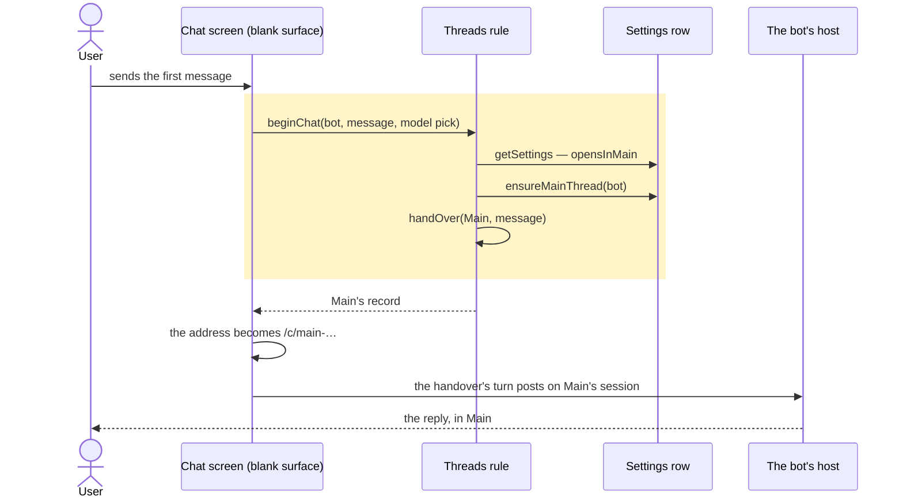
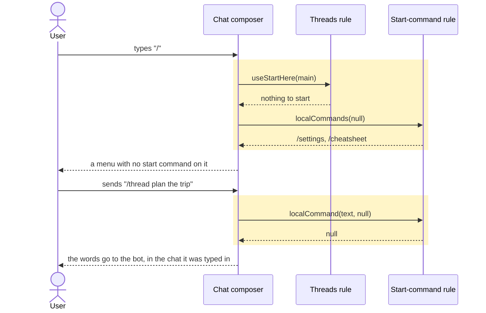
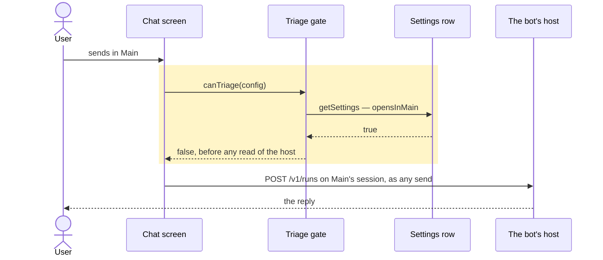
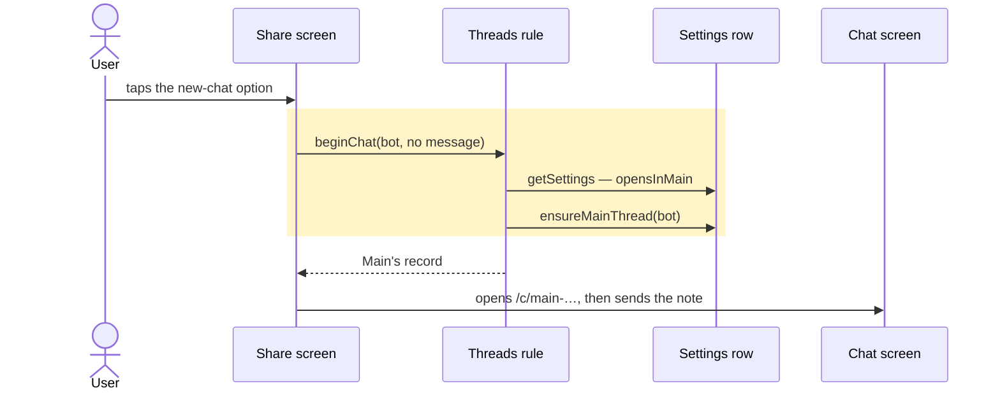
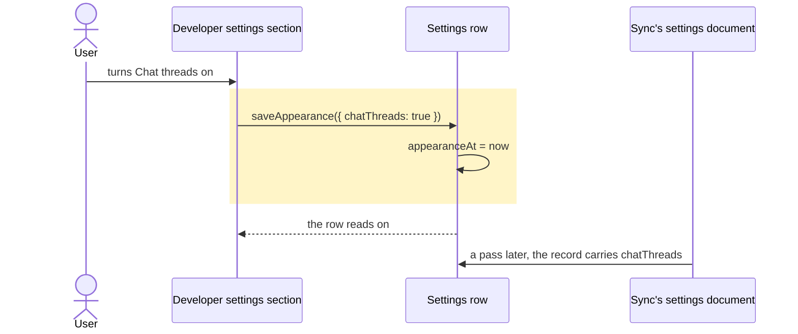

# Chat threads are off by default, and Developer turns them back on

## Goals

- **G1** A Developer switch — **Chat threads**, off by default, carried by the account like the
  Appearance switches — is the only way to start a new chat thread again.
- **G2** With chat threads off in the bot layout, no path starts a new thread: no chat offers a
  start command, a typed `/thread` does not resolve, a new chat's first send lands in that bot's
  Main, and Share's new-chat option opens Main.
- **G3** Triage does not run with chat threads off — no `/triage` ask, no model call — and the
  triage model is a setting nowhere.
- **G4** Threads that already exist are untouched: Main still draws their cards, they open and
  send, the thread lane still holds one, and a bot's thread count still counts them.
- **G5** Turning the switch on restores every path exactly as it was, and the host's stored triage
  model is still there to use.

## Non-goals

- A per-bot switch rather than one for the account.
- Any host-side change: no plugin route, no plugin-stored switch, no triage refusal on the host, no
  plugin version bump. App-only.
- Hiding or folding away threads that already exist.
- A "start fresh" for Main: with the switch off a bot has one conversation that never restarts.
- Deleting the triage plugin route, or the host's stored triage model.

## Change map

| Layer | Status | Goals | Tested at |
|---|---|---|---|
| Settings row (`lib/db.ts`: `Settings`, `DEFAULT_SETTINGS`, `saveChatThreads`, `adoptChatThreads`) | changed | G1 | `scripts/test-developer-sections.tsx` |
| Sync's settings document (`lib/sync.ts`: `localSettings`, its `appearance` and `threads` records, and the fingerprint) | changed | G1 | `scripts/test-developer-sections.tsx` |
| Developer settings section (`routes/settings.tsx`: `DeveloperSettings`) | changed | G1 | `scripts/test-developer-sections.tsx` |
| Start-command rule (`lib/slash.ts`) | changed | G2 | `scripts/test-start-command.mjs`, `scripts/test-slash.mjs` |
| Threads rule (`lib/chat-threads.ts`: `chatThreadsOn`, `opensInMain`, `startCommandFor`; `lib/threads.ts`: `useStartHere`, `beginChat`) | new | G1, G2, G3, G4 | `scripts/test-thread-command.tsx`, `scripts/test-chat-next-new-chat.tsx` |
| Chat composer (`components/chat/composer.tsx`) | changed | G2 | `scripts/test-thread-command.tsx` |
| Chat screen (`routes/chat.tsx`, `chat-next/chat-body.tsx`, `chat-next/blank.tsx`) | affected | G2, G4 | `scripts/test-thread-command.tsx`, `scripts/test-chat-next-new-chat.tsx` |
| Share screen (`routes/share.tsx`) | changed | G2, G4 | `scripts/test-share-caps.tsx` |
| Triage gate (`lib/triage.ts`: `canTriage`) | changed | G3 | `scripts/test-main-triage.tsx` |
| Triage-model read (`lib/triage-model.ts`: `useTriageModel`) | changed | G3, G5 | `scripts/test-triage-model.tsx` |
| Bot's Models page (`components/bot-settings.tsx`: `ModelsPage`) | affected | G3 | `scripts/test-bot-models-and-chain.tsx` |
| The bot's host (its `capabilities`, `plugins/gots/info` and `triage` routes) | affected | G3 | `scripts/test-main-triage.tsx` (the faked host's whole log) |
| Browser flow `bot-threads` (`scripts/e2e/bot-threads.mjs` seed) | changed | G4, G5 | `pnpm e2e bot-threads` |
| `docs/adr/0120-chat-threads-are-off-by-default.md`, `GLOSSARY.md` | new | G1 | none — prose, read in review |

## Flows

### F1: a new chat's first send, chat threads off (changed). Test: "with chat threads off, a blank chat's first send lands in the bot's Main"

### F2: the `/` menu in a bot chat, chat threads off (changed). Test: "with chat threads off, Main offers no start command and a typed /thread is words"

### F3: a message sent from Main, chat threads off (changed). Test: "with chat threads off, a Main send asks the host nothing and stays in Main"

The chat-next Main runs the same sequence with `triageTurn` in place of `sendFromMain`: both call
`canTriage`, so both are the one test's two cases.

### F4: a share into a bot, chat threads off (changed). Test: "with chat threads off, Share's new option opens the bot's Main"

### F5: the switch, off to on (changed). Test: "the Chat threads row ships off, writes chatThreads, and moves the clock the account rides"

## Steps

1. **Preparatory refactor: the slash menu is told which command to start, not whether this is a
   Main.** `localCommands` and `localCommand` take a `StartCommand | null` instead of a boolean;
   `startCommand` and `LOCAL_COMMANDS` go, since the composer is the last thing that composed them.
   The composer passes `main ? "thread" : "new"`, which is exactly what it passes today, so nothing
   moves. Prepares: 3. After: none. Layers: Start-command rule, Chat composer. Check:
   `node --experimental-strip-types --test scripts/test-start-command.mjs` and
   `node --test scripts/test-slash.mjs`, re-expressed over the command (`localCommands("thread")`
   where they said `localCommands(true)`, same expectations), and
   `node --test --import ./scripts/component-hooks.mjs scripts/test-thread-command.tsx` — all green
   before and after. Done.

2. **The switch exists, ships off, and follows the account.** `Settings.chatThreads` with a `false`
   default and `chatThreadsAt` for its clock, drawn as a `SwitchRow` in Developer's first group —
   **Chat threads**, subtitle *Start a thread from a bot's Main* — written through `saveChatThreads`.
   It rides the account as a record of its own in the `settings` document, beside the `appearance`
   record rather than inside it: that one merges whole, so a device that has not pulled yet would
   revert the switch by saving any Appearance preference. ADR 0120 records why the default is off,
   why the record is its own and why the only row lives in Developer; the glossary gains **Chat
   threads**. Goals: G1, G5. After: none. Layers: Settings row, Sync's settings document, Developer
   settings section, ADR and glossary. Check: `scripts/test-developer-sections.tsx` — red first on a
   row that does not exist, then the row ships off, a tap writes `chatThreads: true` and moves
   `chatThreadsAt` while `appearanceAt` stays, the switch is absent from the Appearance section,
   `adoptChatThreads` takes another device's record, and a stale `appearance` write beside a newer
   `threads` record leaves the switch standing. Done.

3. **No bot chat offers a start command, and a typed `/thread` is words.** The threads rule gains
   `chatThreadsOn`, `opensInMain` (the bot layout with the switch off) and `startCommandFor(main,
   settings)` answering `"thread"`, `"new"` or nothing, with `useStartHere(main)` for the composer.
   The composer asks it, so the menu and a typed command both read one answer: with the switch off
   neither `/thread` nor `/new` is offered anywhere in a bot's chat, and `/thread plan it` is sent
   to the bot as its words. The `bot-threads` flow's seed turns the switch on, since the flow is the
   proof of the thread paths. Existing tests that mean threads seed `chatThreads: true`, unchanged
   otherwise — that seeding is G5's proof for this path. Goals: G2, G4, G5. After: 1, 2. Layers:
   Threads rule, Chat composer, Start-command rule, Chat screen, Browser flow. Check:
   `scripts/test-thread-command.tsx` — with the shipped default, a bot's Main offers neither start
   command, a thread's composer offers none either, `/thread plan it` opens nothing and lands in
   that chat, a message sent in an existing thread still posts its run on that thread's session
   (G4's send half), and flipping the switch on without a reload gives `/thread` back; with
   `scripts/test-main-cards.tsx`, `scripts/test-bot-rows.tsx` and `scripts/test-bot-pane.tsx` still
   green under the new default, and `pnpm e2e bot-threads` green on its seeded switch. Done.

4. **A new chat's first send lands in the bot's Main.** The threads rule gains `beginChat`: with the
   switch off in the bot layout it is `ensureMainThread` plus the handover, and otherwise it is
   `beginThread`, so the legacy layout still makes a plain chat and never a Main. `beginThread`
   keeps its one job — making a record — and grows no guard. The blank surface's send calls
   `beginChat` and keeps only its navigation; the model pill it held is not written onto Main, which
   is the decision below. Goals: G2, G4. After: 2. Layers: Threads rule, Chat screen. Check:
   `scripts/test-chat-next-new-chat.tsx` — a first send with the default off adds no record, opens
   `/c/main-…` and posts its turn on Main's session; the case with the switch on still makes a
   thread, and the file's legacy case is unchanged. Done.

5. **Share's new-chat option opens the bot's Main.** `routes/share.tsx` asks `beginChat` which chat
   its first option opens instead of calling `createConversation` itself; with the switch off that
   option reads **Main** and the list below it leaves Main out, so one chat is not offered twice.
   With the switch on nothing changes. Goals: G2, G4. After: 2, 4. Layers: Share screen, Threads
   rule. Check: `scripts/test-share-caps.tsx` — with the default off the option writes Main's record
   and opens `/c/main-…` with the note in it; with the switch on it makes a thread. Done.

6. **Triage stops being asked.** `canTriage` is the one gate both senders pass through, so it reads
   `opensInMain(await getSettings())` first and answers false before it touches the host: no
   capabilities read, no `plugins/gots/info` read, no `/triage` ask, no model call, from
   `sendFromMain` and `triageTurn` alike. Neither caller is edited. Goals: G3. After: 2. Layers:
   Triage gate, Chat screen, The bot's host. Check: `scripts/test-main-triage.tsx` — with the
   default off, a Main send makes no `/triage` ask and adds no capabilities or plugin read of its own
   (the two the log still holds are the send's, `chat.ts`'s run choice and its post-turn queue check,
   which no gate here can take away), no row left `triaging`, and the message in Main; the file's
   triage cases, seeded on, stay green (the restore half). Done.

7. **The triage model is a setting nowhere.** `useTriageModel` folds `opensInMain` into `supported`
   and skips the host's model-permission read with it, so the Models page's Gots section and the
   picker's `TriageModelSetting` hide without either growing a guard. Nothing is deleted: the host's
   stored pick is read again the moment the switch is on. Goals: G3, G5. After: 2, 6. Layers:
   Triage-model read, Bot's Models page. Check: `scripts/test-triage-model.tsx` — with the default
   off nothing is drawn and the host is not read; with the switch on the field returns holding the
   pick the host kept; `scripts/test-bot-models-and-chain.tsx` — no Gots section off, and the
   Hermes models still drawn. Both files' cases that mean the row seed `chatThreads: true`, since
   they describe it. Done.

## Decisions

- **Triage is off entirely, not just its "new thread" answer: no ask, no model call.** Made by the
  user (Q1), because a model call that can only answer "stay" is a cost with no decision in it.
- **Main is never reset or recreated.** Made by the user (Q2): the switch decides who may make a
  chat, never what an existing one holds.
- **No host-side refusal; the change is app-only.** Made by the user (Q3), because the app can
  decide not to ask.
- **The switch follows the account while its only row is Developer's.** Made by the user — the
  breadth item accepted at the sharpening gate — so turning threads back on is one flip, not one
  per device.
- **The field is `chatThreads`, positive and off.** Made by the agent, because every other switch in
  `Settings` reads that way and a `threadsOff` key would double-negate in the sync record.
- **`APPEARANCE_FIELDS` keeps its name and widens its comment.** Made by the agent: the list is
  already what the account carries, and renaming five identifiers across `db.ts`, `sync.ts` and the
  Appearance page buys a tidier word for churn no goal asks for.
- **One composition, `opensInMain`, feeds the menu, a new chat and triage.** Made by the agent,
  because "threads off in the bot layout" is one fact and three answers hang off it; the legacy
  layout must keep making plain chats, which the negation of a single `mayStartThreads` would have
  lost.
- **`startCommandFor` answers three things where a boolean answered two.** Made by the agent: with the
  switch off there is nothing to start, and a boolean cannot say that — the trap that left `/new`
  as a dead command in every shape considered.
- **`beginChat` decides where a new chat goes; `beginThread` stays the primitive.** Made by the
  agent, because a refusal inside `beginThread` turns a send into a thrown error mid-flight, and
  because the legacy layout reaches the same blank surface and must not be handed a Main.
- **The blank surface's model pick is dropped when the message lands in Main.** Made by the agent:
  Main's model is a synced field, so writing one device's pick onto it would move the bot's model
  on every device to honour a pill pressed once.
- **The triage gate is inside `canTriage`, not at its two callers.** Made by the agent: it is the
  one chokepoint every ask passes, and answering false before the host reads is what "no ask"
  costs.
- **`useTriageModel` answers "not supported" rather than each screen hiding its row.** Made by the
  agent, because hiding belongs to the read: the two mounts and anything added later cannot forget
  it.
- **The e2e flow seeds the switch on rather than flipping it through Developer.** Made by the
  agent: the flow is a deterministic regression guard for the thread paths, and the Developer row
  has its own component case; a five-tap unlock would add a flake to a long flow for a fact already
  proved.
- **Existing tests that mean threads seed `chatThreads: true`.** Made by the agent, because those
  cases describe the threads-on behaviour, which is now the switched-on behaviour.

## Risks

- **Every device loses threads on update, silently.** Nothing prompts, and a reader who never opens
  Developer cannot start a thread again. That is what "off by default" asks for; Main and existing
  threads keep working, so nothing breaks outright.
- **Triage goes quiet for everyone until the switch is on.** Messages that used to continue a
  thread pile into Main instead, with no notice anywhere but Developer.
- **"No ask to the host" is scoped to the triage path.** A Main send makes no ask, but a bot's
  Models page still reads the host's feature list for its own rows; the ADR says so rather than
  claiming the device is silent.
- **A typed `/thread …` is delivered to the bot as words beginning with `/thread`.** Not stripped
  and not refused — what the app already does with a command it does not know — but the bot reads
  them.
- **The blank surface's model pill does nothing when the chat lands in Main.** The pill is Main's
  from then on, so a pick made there is silently not honoured.
- **An older build's appearance push can make the account's record forget the switch.** The record
  is one document with one clock, and a build that does not know `chatThreads` pushes a value
  without it; a device joining later then reads off. Nothing corrupts, and `adoptAppearance` keeps
  this device's own value.
- **While settings are unanswered on a cold open the switch reads off,** so a Main can be drawn for
  a moment without a start command. The safe direction only: nothing is offered that may not run.
- **The Cheatsheet still lists its Bot threads group** (`Escape`, `Ctrl+\`). Its keys act on
  threads that exist, so it is not wrong, but it advertises a feature that cannot start one.

## Not now

- Closing the thread lane's "No threads yet" pane when a bot may never have one: geometry, the
  sweep's to judge, and no goal asks for it.
- A row for the switch in the device state a bug report carries (`components/device-state.tsx`), and
  one in `lib/diagnostics.ts`.
- Retiring the picker's `TriageModelSetting`, which nothing in `app/src` mounts but a test: the
  switch hides it either way, and deleting it belongs to a cleanup of its own.
- An e2e flow for the threads-off paths: every one of them is reachable in a component test over a
  seeded device, and ADR 0019 asks for the cheapest tier that would fail.
- Reworking the Cheatsheet's Bot threads group to follow the switch.
- Telling the reader anywhere but Developer that triage exists and is off.
