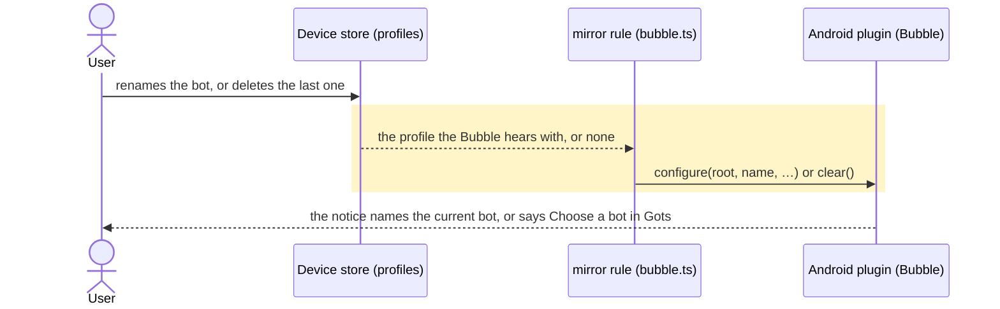

# The Bubble's notification reads as Gots, ready to dictate

## Goals
- **G1** The ongoing notification's title is the app's name, Gots, taken from the app's own label rather than typed again in the service.
- **G2** Its text names the bot that hears the take: `<botname> is ready for AI dictation`.
- **G3** With no bot mirrored, or a mirrored bot whose name is blank, the text keeps today's `Choose a bot in Gots.`, so the notice never claims a bot is ready when none is named.
- **G4** Renaming that bot reaches the phone, so the sentence names the bot as it is now instead of the one it was.
- **G5** When no bot is left that can be called — the last one deleted leaves a placeholder with no host or key — the phone is told to forget the one it held, so the notice says `Choose a bot in Gots.` rather than naming a bot that was deleted.

## Non-goals
- The notification channel's name and description (`Dictation Bubble`), declined by the user.
- The `Turn off` action label, and the Bubble's other messages (`NO_TYPING`, `SLOW`, and `NO_BOT`'s uses as a take's refusal).
- Moving the Bubble's copy into `strings.xml`, and translating it.
- Checking that a mirrored bot's host is actually reachable: the notice is a statement of setup, not a health check.

## Change map
| Layer | Status | Goals | Tested at |
|---|---|---|---|
| Android foreground-service notification (`BubbleService.notice`) | changed | G1 G2 G3 | `notice()` on a phone after `ACTION_START` |
| Notification channel (`BubbleService.channel`) | affected | — | Android's own notification settings for Gots |
| The app's mirror rule (`app/src/lib/bubble.ts`) | changed | G4 G5 | `app/scripts/test-bubble-bot.tsx` |
| Android plugin and its stored block (`BubblePlugin.clear`, `BubbleConfig.clear`) | changed | G5 | the page's side in `app/scripts/test-bubble-bot.tsx`; the Kotlin compiles in CI |

## Flows
### F1: what a take will be heard by moves (changed). Test: "a renamed bot is written to the phone again" and "the last bot going takes the phone's copy with it"

The notice is posted by the service when it is told: `ACTION_REFRESH` → `announce()` → `notice()`. No other layer moves.

## Steps
1. **The notice names the app and the bot.** Read the title from `R.string.app_name` and build the text as the mirrored bot's name plus `is ready for AI dictation`, keeping `Choose a bot in Gots.` where no bot is mirrored. Goals: G1 G2 G3. After: none. Layers: notification. Check: a `grep` for `setContentTitle(getString(R.string.app_name))` and for the `is ready for AI dictation` literal is red before and green after; the Kotlin compiles in the PR's Android job (`./gradlew lintDebug assembleDebug`), since this sandbox has no JDK or Android SDK.

   Done.

2. **The mirror follows a rename, and withdraws a bot that is gone.** Put the bot's name in the fingerprint that decides a mirror, so a rename writes the block again; when no bot is left that the app can call — the last one deleted leaves a placeholder with no host or key — call a new `clear()` that forgets the stored block and re-posts the notice. Goals: G4 G5. After: 1. Layers: mirror rule, Android plugin and config. Check: `node --test --test-force-exit --import ./scripts/component-hooks.mjs scripts/test-bubble-bot.tsx` — 9 tests, 3 of them new — is red before (7 pass, 1 fail on "waited for the phone told no bot is left" once the test deletes the way the app does, `deleteProfile(id, { last: true })`) and green after (9 pass); the third, "a write that changes nothing the phone hears with is not sent", fails if the effect is keyed on the profile object instead of the fields, which is the cheaper test it replaces; then `pnpm lint`, `pnpm typecheck`, `pnpm test` and `pnpm build`, with the Kotlin compiled by the PR's Android job.

   Done.

## Decisions
- **The title is read from `R.string.app_name`, not written as a literal.** Made by the agent: `AGENTS.md` records a rename (memento → gots) leaving copies of a name stale in files no gate reads, so a second "Gots" in the service is a drift risk; the value on screen is unchanged.
- **The subtitle stays composed in `notice()`.** Made by the agent: the file's other copy is inline, one reader builds the notice, and extracting it buys nothing yet (KISS).
- **The no-bot line is unchanged.** Made by the user (Q1). `NO_BOT` also refuses a take and is drawn on the Bubble, so rewording it for the shade would reword a refusal too.
- **The channel is left alone.** Made by the user (Q2). Its name is already learned in Android's settings, and the request named the notification.
- **No Kotlin unit test is added.** Made by the agent: CI runs `lintDebug` and `assembleDebug` and no unit-test task, and an assertion on `notice()` would need Robolectric, which the module does not depend on; the compile is CI's and the words are a phone's.
- **The rename and the withdrawal are fixed here, not filed.** Made by the user (Q3): the sentence names the bot, so a stale name and a deleted bot would both be claims the notice could not keep.
- **"No bot" means one the app can call, not an empty store.** Made by the agent: the app never leaves its store empty (the last delete seeds a placeholder with no host or key), so the guard is `hasServer` — the same test the chat screens use — and the test deletes the way the app does, `deleteProfile(id, { last: true })`.
- **A phone with no bot left keeps its Bubble switched on.** Made by the agent: the notice then reads `Choose a bot in Gots.` and a tap says the same, which is truthful; switching the Bubble off on the user's behalf would be a surprise they would have to undo.

## Risks
- A long bot name ellipsises in the collapsed shade: the text is one line there.
- Nothing in this change proves the rendered notification. CI compiles it and the strings' source is checkable; only a device shows the shade.
- `NO_BOT` stays as it is, so a shade with no bot mirrored reads `Gots` / `Choose a bot in Gots.` — the title and the sentence name the app twice, which is what the user chose over claiming readiness.
- Android draws the app's own name above a notification's title, so most shades will read `Gots` twice in every state; that duplication is the title the user asked for.
- A mirrored bot with a blank name draws `NO_BOT` too, so the notice reads `Choose a bot in Gots.` while a bot is mirrored. That shape is carried over unchanged.
- Renaming writes the whole block again, as a changed connection does, and the phone re-posts. A failed write is retried once and then said in the log, so a phone can still hold the old name until something else moves it.
- `clear()` leaves the Bubble's takes and its dock position alone, but a kept take that names the deleted bot is still dropped by `collectTakeaways` on the next open, after the Bubble toasted that it was saved: the handover writes only under a bot the app still holds. That is older than this change.

## Not now
- Renaming the channel to match the notice, from the declined breadth item.
- Carrying the take's state (recording, uploading) in the notice's text, from the re-post path `announce()` already owns.
- A `tap to change` bot hint, or moving every Bubble string into `strings.xml`.
- Asking a mirrored bot's host whether it is really up, which is the one thing the sentence still cannot know.
- Re-pointing a Bubble pick whose bot was deleted: the setting keeps the dead id, so until another pick is made every read falls back to the selected bot, and opening a chat can move the phone's bot. Found while writing this plan; it needs a product decision about what a pick means once its bot is gone.
