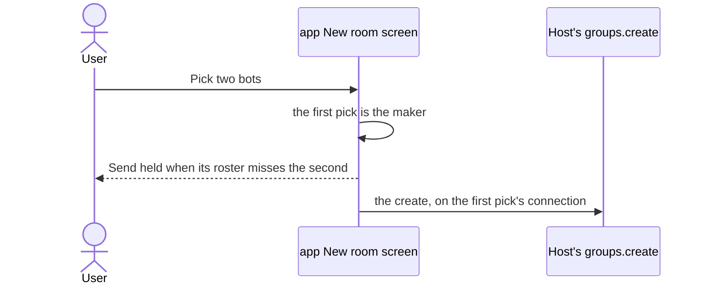
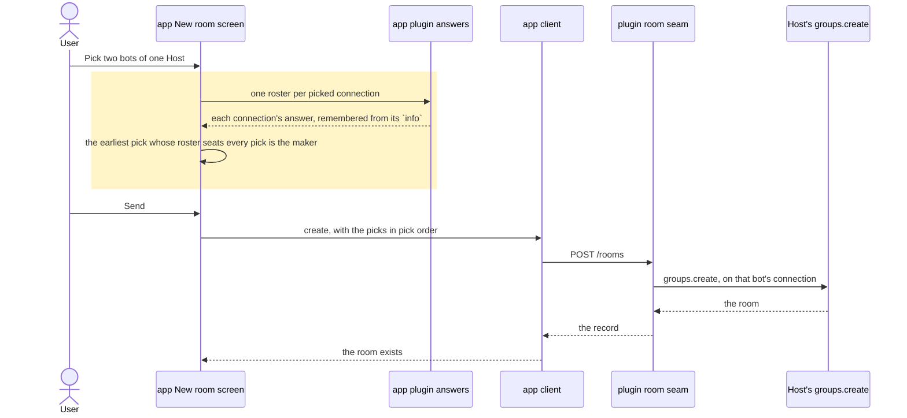
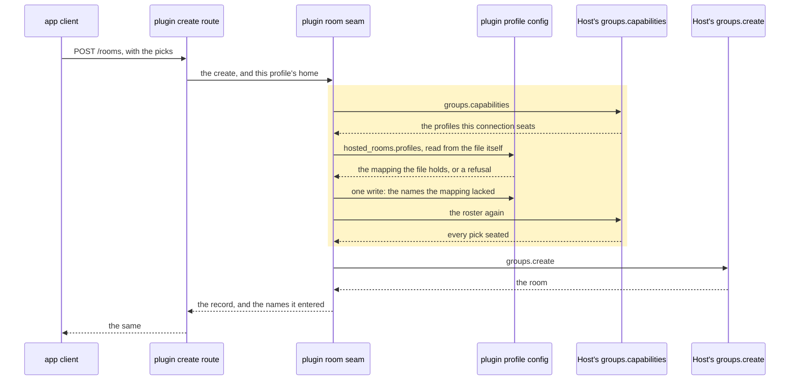
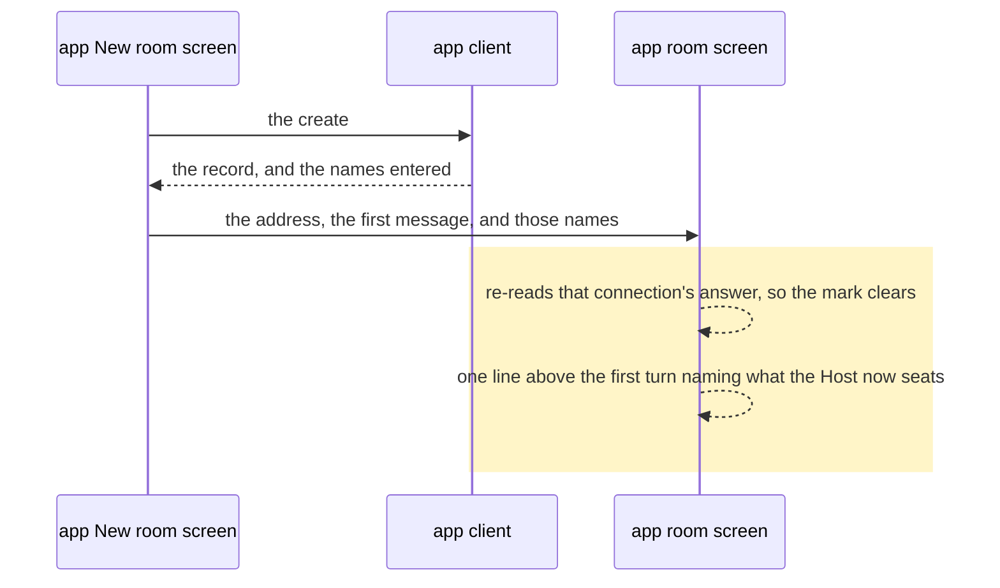

# A room is made where it can be seated, and the Host configured when it can't

## Goals

- **G1** Starting a room with two bots of my Host no longer fails because the first pick's connection
  is the wrong one: the room is made on the first picked bot whose connection seats every pick, while
  pick order still names the room and orders its members.
- **G2** When no picked connection seats them all, the Host is configured rather than refused: before
  the create, the plugin adds the missing profiles to the making profile's `hosted_rooms.profiles`,
  re-reads the roster, and only then makes the room.

## Non-goals

- A Host picker on New room: the Host is a bot's origin, not a choice.
- Any new Host field — no `host_scoped`, no `seatable_homes`, nothing Hermes would have to add.
- Starting or configuring a bot's gateway from New room.
- Telling the reader which `hosted_rooms.profiles` entry a bot would need.
- Writing config entries anywhere but the making profile's own `config.yaml`.
- Pruning an entry when the room it was added for is disbanded.

## Change map

| Layer | Status | Goals | Tested at |
|---|---|---|---|
| Host's `groups.capabilities` | affected | G1, G2 | `plugin/tests/test_rooms.py` (the fake Host's answer) |
| Host's `groups.create` | affected | G2 | `plugin/tests/test_rooms.py` (the fake Host's roster check) |
| plugin room seam (`plugin/rooms.py`) | changed | G2 | `plugin/tests/test_rooms.py` |
| plugin profile config (`plugin/config_keys.py`) | changed | G2 | `plugin/tests/test_rooms.py` |
| plugin create route (`plugin/__init__.py`) | affected | G2 | `plugin/tests/test_rooms.py` |
| app plugin answers (`app/src/lib/features.ts`) | changed | G1, G2 | `app/scripts/test-new-room.tsx` |
| app room seats rule (`app/src/lib/room-seats.ts`) | changed | G1 | `app/scripts/test-room-seats.mjs` |
| app client (`app/src/lib/hermes.ts`) | changed | G2 | `app/scripts/test-new-room.tsx` |
| app room writes (`app/src/lib/room-writes.ts`) | changed | G2 | `app/scripts/test-new-room.tsx` |
| app New room screen (`new-room-screen.tsx`) | changed | G1 | `app/scripts/test-new-room.tsx` |
| app room screen (`room-chat.tsx`) | changed | G2 | `app/scripts/test-new-room.tsx` |

## Flows

### F1: Two picks, and the earlier one that seats both makes the room (changed). Test: "the room is made on the connection that seats every pick"

Before — the first pick's connection decided, and a pick it could not seat held Send:

After — the maker is the earliest pick whose roster holds every pick:

### F2: No pick's connection seats them all, so the Host is configured first (changed). Test: "a member the roster misses is entered in the making profile's config and the room made"

Its refusal is the same sequence stopping before the write: a name or home the Host's entry rule would
refuse ends the request with a sentence naming that profile and no room.

### F3: A pick no picked connection seats is marked, and is still a pick (changed). Test: "a bot no picked connection seats is marked, not greyed"

The greyed row, the held Send and "Unpick every bot to change connection" are gone; the row says it
will need the Host, and pressing it seats it. It crosses the same two layers as F1's first three
messages in the same order, so F1's diagram covers it.

### F4: The room's first line says what the Host was configured with (changed). Test: "a room whose Host was configured says so on its first line"

## Steps

1. **Preparatory refactor: the roster becomes one answer both the picker's `info` and the create ask.**
   The `seatable_profiles` parse leaves `offered` for one named read of a capability answer, and
   `offered` is rewritten to call it, so the rule about a Host that names no roster, and about names
   that are not strings, is written once. Prepares: 2. After: none. Layers: plugin room seam. Check:
   `python3 -m unittest plugin.tests.test_rooms -v` — green before and after, pinned by
   `test_the_profiles_this_connection_seats_answer_through_info` and
   `test_a_host_that_names_no_seats_answers_none_so_the_app_filters_nothing`.
2. **A create the connection cannot seat configures the Host, reads the roster again, then makes the
   room.** The seam asks the roster; for each member it misses it validates the profile — the name is
   one the Host's entry rule accepts, and its home is `profiles/<name>` under this profile's own root,
   absolute, a real directory, not a symlink, and not a second name for a home already seated. It reads
   `hosted_rooms.profiles` **from the file itself**, merges the missing names, and writes the whole
   mapping once through the round-trip writer; a file it cannot read is a refusal, never an empty
   mapping. It asks the roster again and creates only when every member is seated; a home it cannot
   validate, or a re-read that still misses a member, ends the request with a sentence naming those
   profiles and no room. Nothing is written when the roster already seats them, when the Host names no
   roster, or on a second create for the same picks. The answer carries the names it entered. Goals:
   G2. After: 1. Layers: plugin profile config, plugin room seam, plugin create route, Host's
   `groups.capabilities` and `groups.create` (affected). Check:
   `python3 -m unittest plugin.tests.test_rooms -v` — red first, which needs the fake Host's
   `groups.create` to consult the `seatable_profiles` it answers: today it accepts every member, so a
   repair test would pass for the wrong reason. Cases: the entry lands in this profile's own
   `config.yaml` and no other file; a merged mapping keeps the entries the file already held and does
   not materialise the managed overlay; a symlinked home, a name the entry rule refuses, and a home
   another name already holds each refuse with a sentence and no write; a second read that still
   misses ends it; an unreadable config writes nothing; a Host that names no roster writes nothing and
   makes the room; a second create writes nothing.
3. **New room makes the room on the earliest pick whose connection seats every pick, and marks the rows
   that will need the Host.** One roster per picked connection is read from the remembered answer the
   picker already holds, the pure rule names the maker — earliest pick whose roster holds every pick,
   the first pick where none does or where a roster is still owed — and the create is asked of that
   bot. Pick order still sets the member order and the name (ADR 0125). A bot no picked connection
   seats is marked "Needs the Host configured" instead of greyed, pressing it seats it, and the held
   Send and its sentence go. Before the first pick nothing is marked, since no connection is named
   yet. Goals: G1. After: 2. Layers: app plugin answers, app room seats rule, app New room screen.
   Check: `node --experimental-strip-types --test scripts/test-room-seats.mjs` for the choice and the
   mark, and `node --test --import ./scripts/component-hooks.mjs scripts/test-new-room.tsx` — red
   first: today's "a bot this Host's connection can't seat is not a pick" and "a room the first pick's
   connection cannot seat is never sent" become "a bot no picked connection seats is marked, not
   greyed" and "the room is made on the connection that seats every pick".
4. **The room's first line says what the Host gained, and the app's roster is read again.** The
   create's answer names the profiles it entered; the client keeps them beside the record, the room
   screen draws one muted line above its first turn naming what the Host now seats (and nothing where
   nothing was entered, and nothing on a room reopened later), and the create's success re-reads that
   connection's answer with `refreshAnswer`, so the picker stops marking a bot it now seats. Goals: G2.
   After: 2, 3. Layers: app client, app room writes, app room screen, app plugin answers (affected).
   Check: `node --test --import ./scripts/component-hooks.mjs scripts/test-new-room.tsx` — red first:
   `roomRecordOf` rebuilds a record from the keys it knows, so the answer's names are dropped today;
   the case asserts the line, the empty case asserts no line, a reopened room asserts none, and a
   remembered roster that named the pick is read again after the create.

## Decisions

- **A bot no picked connection seats is marked, not greyed, and Send stays open.** Made by the user
  (Q1), because the greyed row was a dead end: it named a remedy — unpick every bot — that could not
  produce the room the user wanted.
- **The repair runs before the create, and a write or a second read that fails means no create.** Made
  by the user (Q2), because the Host's refusal is prose this repository never parses, so a retry after
  it would be guesswork.
- **The write is silent, and the room's first line says what changed.** Made by the user (Q3), so no
  confirm dialog stands between a send and its room.
- **The maker is the earliest picked bot whose connection seats every pick, and the first pick where
  none does.** Made by the agent, because pick order already decides the room's name and member order
  (ADR 0125), so the earliest pick that works is the one the reader already believes is making the
  room; "the connection needing the fewest entries" is a choice the screen cannot explain.
- **The repair lives in the room seam's create, not in the route.** Made by the agent, because a create
  is the only door to a room, and the guarantee must not be skippable by a second caller.
- **Only missing names are added; an existing entry keeps its value, and a home never gets a second
  name.** Made by the agent, because rewriting an entry is a config change nobody asked for, and the
  Host refuses one home answering to two names — so a profile whose home is already entered under
  another name is refused with a sentence rather than duplicated.
- **The mapping is read from the file itself and written whole, once.** Made by the agent, because the
  effective config is a merged view: writing it back would materialise managed-overlay keys into the
  user's file. A profile name may contain a dot, which a dotted key path cannot carry, so the entry is
  never one dotted path of its own.
- **A profile's home is `<root>/profiles/<name>`, written only when it is a real directory that is not
  a symlink.** Made by the agent, because the Host ignores a bad entry and refuses the member, so an
  unvalidated write buys a refusal at the price of a config change.
- **An entry name must match the Host's own rule, hyphens included in what it refuses.** Made by the
  agent, because a profile named outside that grammar cannot be entered at all, and the sentence
  should say so rather than write a name the Host ignores.
- **A Host that names no roster is left alone.** Made by the agent, because a missing
  `seatable_profiles` means "no rule", not "seats nothing" (ADR 0128), and repairing one would write
  config for a Host that never asked.
- **The create answers the names it entered, and the room draws them from the handover.** Made by the
  agent, because the Host declares no notice event, and a synthetic log row would be read as the
  user's words by the room's driver.
- **A create that entered anything re-reads that connection's answer.** Made by the agent, because the
  app's roster is a remembered prediction, and `refreshAnswer` today runs only in the create's
  `catch`, which would leave the picker marking a bot it has just seated.
- **The app's choice of maker is a prediction; the plugin's repair is the guarantee.** Made by the
  agent, because a remembered roster can have moved, so a create the screen thought was fine still
  ends seated.

## Risks

- **This writes to the user's `config.yaml` without asking.** A profile named there is a standing
  grant that outlives the room; the only notice is the room's first line, and undoing it means editing
  the Host's config by hand.
- **The line is handed over through the address, like the first message.** It draws once, on the room
  just made; opening that room tomorrow shows no line, and the change it describes is still there.
- **A repair that lands and a create that then fails leaves the Host widened.** Nothing rolls back:
  the write is the fix, it is idempotent, and a second write to undo it could fail the same way.
- **Two creates at once can lose one entry.** The read-modify-write of the mapping is unlocked, so the
  second create may still find its pick unseated and refuse, in its own sentence, with no room made.
  The file is never left half-written, only under-widened.
- **A profile the Host does not serve, or whose home is a symlink, cannot be seated at all.** The
  create is refused with a sentence naming it, and no entry is written for it.
- **A name outside the Host's entry grammar can never be seated from Gots.** Such a bot is refused at
  the repair rather than given an entry the Host would ignore forever.
- **A Host answered in process names no roster.** Only the gateway's `groups.capabilities` fills
  `seatable_profiles`; through the other dispatcher nothing is marked and nothing is repaired, and the
  Host's refusal stands as today. That half is Hermes's.
- **ADR 0128's picker rule is partly reversed, and its "what this does not fix" paragraph goes
  stale.** An ADR recording the reversal, and GLOSSARY's word for the repair, land with this change.

## Not now

- Pruning an entry when the room it was added for was never made or was disbanded.
- Choosing the connection that needs the fewest entries rather than the earliest pick.
- A per-bot sentence naming the `hosted_rooms.profiles` entry it would need (ADR 0128).
- A host-scoped connection for rooms, which Gots does not hold (ADR 0128).
- Seating a served profile that no bot of this device is linked to: there is no bot to pick.
- A confirm dialog before the write (Q3).

## Checks

1. Every step names a goal or is a preparatory refactor naming the step it prepares; G1 is in 3, G2 in
   2 and 4. — Yes.
2. Every layer a step touches is a change-map row, and every `new`, `changed` or `deleted` row appears
   in a step: seam in 1 and 2, profile config in 2, create route and both Host methods (affected) in 2,
   plugin answers in 3 and 4, seats rule and New room screen in 3, client and room writes and room
   screen in 4. — Yes. No row is `new`.
3. Every flow participant apart from the actor is a change-map row: F1's answers, client, seam, create;
   F2's route, seam, config, both Host methods; F4's client and room screen. — Yes.
4. Every flow's test is the check of some step, by name: F1 and F3 → step 3 (`test-new-room.tsx`), F2 →
   step 2 (`test_rooms.py`), F4 → step 4 (`test-new-room.tsx`). — Yes.
5. No step serves a non-goal. — Yes: no Host picker, no new Host field, no gateway start, no entry
   named to the reader, no write outside the making profile, no pruning.
6. Every step's After names only earlier steps: 1 none, 2 one, 3 two, 4 two and three. — Yes.
7. Every decision made by the user cites the question they answered: Q1, Q2, Q3. — Yes.
