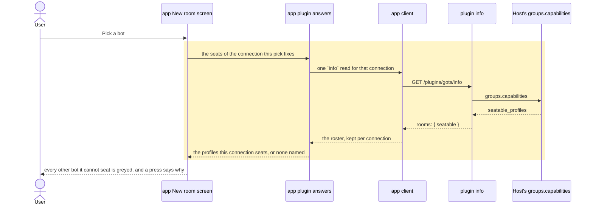

# A room offers only the bots its Host's connection seats

## Goals

- **G1** Starting a room with two of my Host's bots stops failing with `member 1 profile 'ops': only a
  host-scoped connection seats a served profile without an entry`: the picker offers only the bots the
  connection the room is made from can seat, and says why the rest are greyed.

## Non-goals

- Changing the Host's room rules, or making a profile-bound connection host-scoped.
- Seating a bot that is not linked to Gots.
- Telling the reader which `hosted_rooms.profiles` entry would make a bot seatable: that is the Host's
  configuration, not the app's to advise on.
- Filtering a room's own roster, its chat list row, or any screen but the picker the room is started in.

## Change map

| Layer | Status | Goals | Tested at |
|---|---|---|---|
| Host's `groups.capabilities` (`seatable_profiles`) | affected | G1 | `plugin/tests/test_rooms.py` (the fake Host's answer) |
| plugin room seam (`plugin/rooms.py`) | changed | G1 | `plugin/tests/test_rooms.py` |
| plugin `info` (`plugin/__init__.py`) | changed | G1 | `plugin/tests/test_rooms.py` |
| Hermes internals pin (`.github/scripts/check-hermes-internals.py`) | changed | G1 | itself |
| app client (`app/src/lib/hermes.ts`) | changed | G1 | `app/scripts/test-new-room.tsx` |
| app plugin answers (`app/src/lib/features.ts`) | changed | G1 | `app/scripts/test-new-room.tsx` |
| app room seats rule (`app/src/lib/room-seats.ts`) | new | G1 | `app/scripts/test-room-seats.mjs` (unit) |
| app New room screen (`app/src/components/room/new-room-screen.tsx`) | changed | G1 | `app/scripts/test-new-room.tsx` (component) |

## Flows

### F1: A user picks the first bot, and the picker says which others it can hold (changed). Test: "a bot this Host's connection can't seat is not a pick"

### F2: A room is made from the seats that survived the picker (unchanged). Test: "a room started from the blank screen opens on its own name and takes the first message"

The create is the one already there: `POST /rooms` → `groups.create` as the first bot's connection. The
Host's refusal still comes back in the Host's own words for anything the picker could not know.

## Steps

1. **The Host's roster reaches the app.** `groups.capabilities`'s `seatable_profiles` is read once by the
   plugin's room seam, answered on `info` as `rooms.seatable` (null where the Host names none), and pinned
   in the internals check. Goals: G1. After: none. Layers: plugin room seam, plugin `info`, Hermes
   internals pin. Check: `python3 -m unittest plugin.tests.test_rooms -v` — the new case red first, then
   green. Done.
2. **The picker holds only what the connection seats.** The client reads `rooms.seatable`, the plugin
   answers store keeps it beside the features for that connection, and the New room screen greys a bot
   whose profile the first pick's connection does not seat, saying so on a press. Goals: G1. After: 1.
   Layers: app client, app plugin answers, app room seats rule, app New room screen. Check:
   `node --test --import ./scripts/component-hooks.mjs scripts/test-new-room.tsx` — red now, green after,
   with `scripts/test-room-seats.mjs` pinning the rule itself. Done.

## Decisions

- **The roster rides `info`, not a new route.** `info` already probes `groups.capabilities` on every app
  open, so the roster costs no second Host call, and the screen already reads that answer for the
  connection it is about. Made by the agent.
- **A bot the connection cannot seat is greyed and answers a press, not hidden.** A row that silently
  disappears is a room the user can't understand; the picker already greys another Host's bots and says
  why on a press, so the same gesture carries one more reason. Made by the agent.
- **The roster applies to the connection the first pick fixes, not the Host's origin.** A Host's origin
  can hold several connections and the Host seats per connection — the reported failure is exactly two
  bots of one origin on two of them. Made by the agent.
- **A Host that names no seats filters nothing.** `seatable_profiles` is a newer field; an older Host
  keeps today's picker and its own refusal at create, which is still passed through in its words
  (ADR 0115). Made by the agent.
- **The cause, as proven.** `gateway/session_hosted_members.py` refuses a member naming a served profile
  on a profile-bound connection with exactly the user's sentence; the Host's own test
  (`test_capabilities_name_exactly_the_profiles_this_caller_can_seat`, #141178) shows a bound connection
  is answered `['default']` while the host-scoped one is answered every served profile, and that its own
  picker reads that roster. Gots' tree has no read of `seatable_profiles` at all. Made by the agent.
- **The arena was skipped**, as the wtf skill directs for a proven cause: the bug's cause settles the
  shape, and the change is one field through three existing layers. Made by the agent.

## Risks

- **A connection that seats only its own bot cannot hold a two-bot room at all.** That is the reported
  case: `gotsfather`'s connection seats `gotsfather`, and `ops` is served by the same gateway on another
  connection. The screen will show one seat and grey the rest; the remedy is the Host's — a
  `hosted_rooms.profiles` entry naming `ops`, or a host-scoped connection, which the Desktop holds and
  Gots does not.
- **The roster is remembered until a create the Host refuses.** It is read once per connection, as every
  feature answer is, so a profile parked on the Host after the read still shows as seatable. The Host's
  refusal at create is unchanged and still says so in its own words; it re-reads that connection's
  `info` rather than forgetting it, so the picks stay seated while the Host is asked again and the
  answer that lands replaces the one it contradicted. A read still in flight when the re-read began is
  dropped rather than written, an answer naming neither features nor a roster is not kept at all, and
  the typed message comes back to the field for the retry.
- **A Host answered in process filters nothing.** Only the gateway's `groups.capabilities`
  (`gateway/session_group_controls.py`) fills `seatable_profiles`; `tui_gateway/methods_groups.py`'s own
  handler for the same call answers without it, so a Host the plugin reaches through that dispatcher
  offers every bot until Hermes adds the field there — out of this repository's scope.

## Not now

- A line for a Host whose connection seats fewer than two bots, saying the room cannot be made here.
- A per-row reason from the Host: `seatable_profiles` names the profiles it seats, not why the others are
  out.
- Offering a host-scoped connection for rooms, which is a Host capability this plugin does not have.
