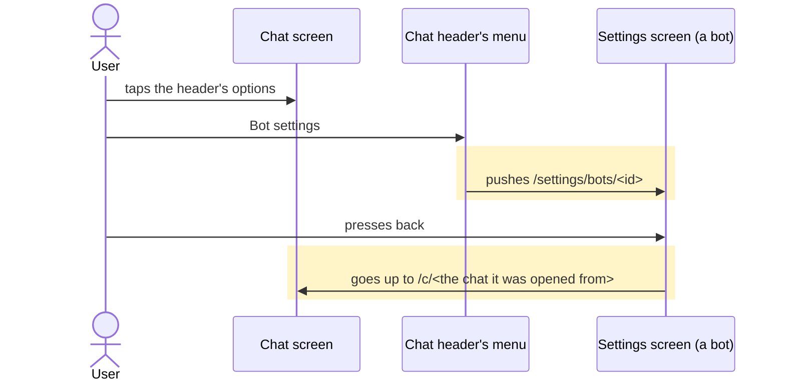
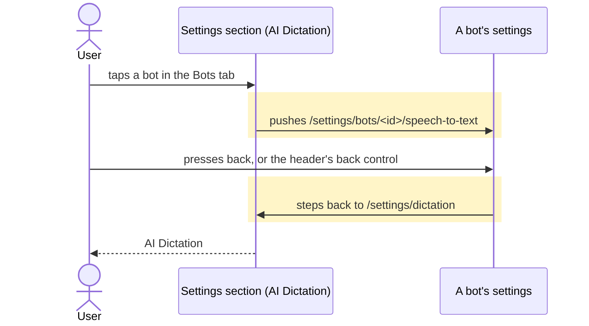
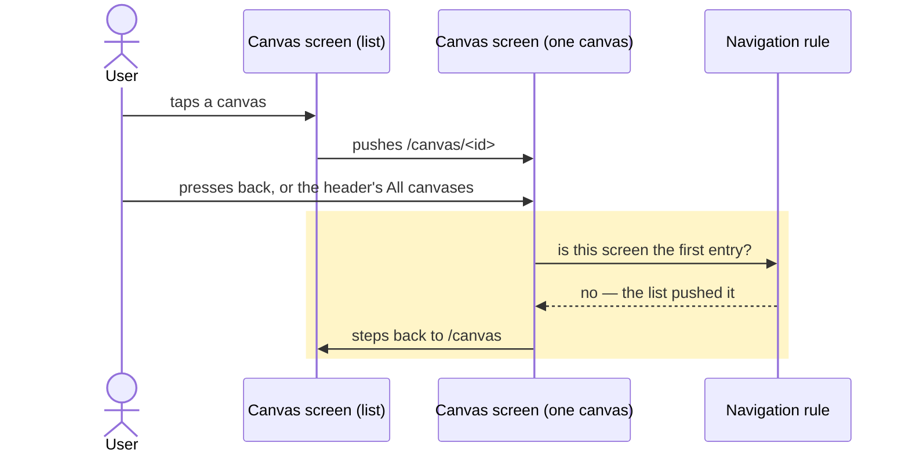

# Back returns to the screen behind you, not to a canonical root

## Goals
- **G1** Settings > AI Dictation > Bots > a bot, and back returns to AI Dictation — on a phone, and on
  a tablet or laptop where the Settings menu and the section share one screen and the bot's settings
  takes the menu's place.
- **G2** A bot's chat, its header's `Bot settings`, and back returns to that bot's chat — the menu
  item opens that bot's settings, and the way there is a step in rather than a fresh start.
- **G3** From the Canvas list, a canvas and back returns to the list; a canvas the menu opened (a
  pinned row) is a root, so back there leaves the app.

## Non-goals
- The drawer's own rows: each opens a top-level screen as the only entry, and back from one leaves
  the app. That is the rule G3 keeps for a pinned canvas, and it stays.
- The screens that already go up to the screen behind them — a chat thread, a project, a meeting, a
  mission, a session, and a bot's page on a phone. None of them changes.
- The Canvas phone flow (#934): it will read this rule rather than restate it.

## Change map
| Layer | Status | Goals | Tested at |
|---|---|---|---|
| Chat header's menu (`components/chat/chat-actions.tsx`) | changed | G2 | the menu item's navigation type over a memory history |
| Bot picker and the composer's `/settings` (`components/chat/bot-picker.tsx`, `chat-composer.tsx`) | changed | G2 | the chat menu's test covers the rule the three doors share; the picker and the command are the same `navigate` and no test drives them |
| Settings screens (`routes/settings.tsx`) | changed | G1 | the wide case of the `bot-settings` browser flow, and the two-pane back control |
| Canvas screen (`routes/canvas.tsx`) | changed | G3 | its header control, and the back rule it registers |
| Navigation rule (`lib/nav.ts`) | changed | G3 | the rule itself over a stubbed history depth |
| Android back handling (`lib/native.ts`) | changed | G1 G3 | `pressBack`, the press's order, over a mounted screen; the Capacitor listener itself is not driven |

## Flows
### F1: a bot's chat opens its settings, and back returns to the chat (new). Test: "the chat's Bot settings is a step in"

### F2: Settings > AI Dictation > a bot, and back returns to AI Dictation (changed). Test: the wide case of `pnpm e2e bot-settings`

### F3: a canvas opened from the Canvas list, and back returns to the list (new). Test: "a canvas the list opened goes up to the list on back"

The canvas the menu opened follows F3's shape with the last two messages replaced: the drawer's row
opens it as the only entry, the rule answers that it is, and the press is left to the app, which
leaves the app. Its test is named in F3's step.

## Steps
1. **The regression tests.** The chat's `Bot settings` is asserted to be a step in — a push naming
   that bot's settings — and the canvas screen's header control to be a step back to the list. The
   navigation rule is exercised over a stubbed depth: a screen pushed onto another answers that it
   handles the press and goes up; one that is the first entry answers that it does not. Goals: G1
   G2 G3. After: none. Layers: chat header's menu, canvas screen, navigation rule. Check: red before
   the change (`REPLACE:/settings/bots` where a push to the bot's own screen is expected; `PUSH:/canvas`
   where a step back is expected; no rule to answer), green after.

   Done.

2. **A way into Settings from inside the app is a step in.** The chat's `Bot settings` opens that
   bot's settings; the bot picker's `Link a bot` and the composer's `/settings` open Settings the
   same way, one rule for the three. `/new` stays a root. Goals: G2. After: 1. Layers: chat header's
   menu, bot picker, composer. The Settings menu is a step in too, now that a chat can open it, and
   steps back to that chat rather than arming the app's exit. Check: Step 1's chat test green, the
   menu's own guard test green, the component suite green.

   Done.

3. **A Settings screen steps back to the screen behind it.** The two-pane bot's back control steps
   back instead of replacing itself with the Settings menu, and a bot's pages answer Android's back
   at every width rather than only on a phone. Goals: G1. After: 1. Layers: Settings screens,
   navigation rule. Check: the wide case of `pnpm e2e bot-settings`, extended with the dictation
   recipe — back from a bot's page opening at `/settings/dictation` lands on `/settings/dictation`
   (red today: `/settings`) — and the phone case still landing on the list and then the menu.
   The flow's own geometry assertion fails on a clean `main` in this sandbox, so the recipe was also
   run as a browser probe at 1024px and 1440px: `/settings/dictation` before the press, and the same
   address after it, where `main` answers `/settings`.

   Done.

4. **The canvas screen steps back to the list.** Its header control and its delete take the way up
   rather than a new entry, and it answers Android's back when the list opened it, leaving the press
   to the app when the menu did. Goals: G3. After: 1. Layers: canvas screen, navigation rule. Check:
   Step 1's canvas test and the rule's test green; the browser probe over the mock showing a canvas
   opened from the list at one step in and the list again after the press, at 390px.

   Done.

## Decisions
- **A screen the drawer opens stays a root; a screen opened from inside the app is a step in.** This
  is the user's own rule, stated both ways in the request, and it is what makes a pinned canvas
  leave the app while a listed one comes back to the list.
- **`Bot settings` opens that bot, not the Settings menu.** The item names the bot, and the user's
  expectation is that back returns to that bot's chat; the menu is one row further, where the
  sidebar already leads on a wide screen.
- **The canvas rule answers by depth, the Settings screens by layout.** A pinned canvas is the
  drawer's own row, so it is the first entry; a Settings section is its own screen on a phone and
  the same screen as the menu from `lg`, which is what `separate` already says.
- **A deep link is left as it is.** A Settings page that is the first entry still replaces itself
  with its parent; a canvas that is the first entry leaves the app, as every top-level screen does.
- Proved by running: at 1024px and 1440px, Settings > AI Dictation replaces the entry (`idx 0`), a
  bot's row pushes (`idx 1`), and the bot screen's back control landed on `/settings` instead of
  `/settings/dictation`; a bot's chat > `Bot settings` landed on `/settings/bots` at `idx 0`, the
  chat gone from the history; a canvas opened from the list sits at `idx 1` and its header control
  pushed a third entry.
- Refuted: that `up`/`depth` misread the history — a chat thread and a Settings page on a phone both
  returned to their parents; refuted: that a drawer row fails to collapse the stack.

## Risks
- `Bot settings` now adds an entry where it used to collapse one, so back from a bot's settings goes
  to the chat rather than leaving the app. A reader who wanted the Settings menu from there has the
  sidebar on a wide screen and one more back press on a phone.
- On a phone, a Settings section is a screen and a step; from `lg` the same address is the menu's own
  screen, so back there leaves the app. That asymmetry is the layout's and is what the report asks
  for at a root.
- `depth()` reads the router's own index out of `history.state`; a history the app did not write
  (a WebView restore that drops entries) reads as a root, and back then leaves the app.

## Not now
- A shared guard helper for every pushed screen: the ones that already go up keep their own.
- `/new` and the home shortcut, which are roots on purpose.
- The canvas phone flow (#934).
