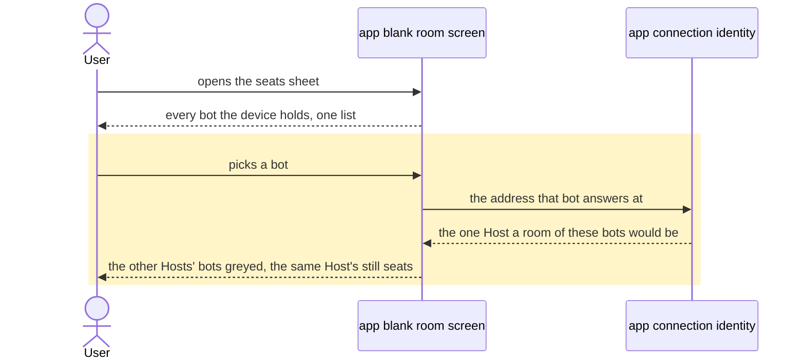

# A bot room's composer, its seat list and its sheet heading match the rest of the app

## Goals

- **G1** The margins and padding around a bot room's composer are the ones a normal chat and a coding
  session have today.
- **G2** The seats picker lists every bot on the device with no Host picker; the first bot picked fixes
  the Host, and every bot of another Host greys out.
- **G3** The seats sheet's heading is the heading a bottom drawer has everywhere else in the app.

## Non-goals

- Cross-host rooms (the Host declares no method that spans two gateways, ADR 0115).
- Editing a room's roster after it is made.
- A Host name on each greyed row.
- The seats pill's own wording.

## Change map

| Layer | Status | Goals | Tested at |
|---|---|---|---|
| app blank room screen (`app/src/components/room/new-room-screen.tsx`) | changed | G1, G2, G3 | `app/scripts/test-new-room.tsx` |
| app connection identity (`app/src/lib/connection.ts`) | changed | G2 | `app/scripts/test-new-room.tsx` (through the screen) |
| app layout constants (`app/src/lib/layout.ts`) | affected | G1 | `app/scripts/test-new-room.tsx` |

`COMPOSER_SLOT` already exists for exactly G1 — "the foot every chat screen gives its composer" — and
the blank room is the one screen that never used it.

## Flows

### F1: A user picks the room's seats (happy path, changed). Test: "the first bot picked chooses the Host, and another Host's bots grey out"

No flow crosses layers for G1 and G3: both are one screen's markup.

## Steps

1. **The blank room's composer stands in the app's one composer slot.** Goals: G1. After: none.
   Layers: blank room screen, layout constants. Check:
   `node --test --import ./scripts/component-hooks.mjs scripts/test-new-room.tsx`, the case "the blank
   room's composer stands in the foot every chat screen gives it" — red now, green after — then
   `pnpm e2e room-lifecycle` for the gutters themselves. Done.
2. **One seat list for every Host, and the first pick fixes the Host.** Goals: G2. After: none.
   Layers: blank room screen, connection identity. Check: the same command, the cases "every bot the
   device holds is listed, whatever Host it is on" and "the first bot picked chooses the Host, and
   another Host's bots grey out" — both red now, green after. Done.
3. **The seats sheet heads like every other drawer.** Goals: G3. After: none. Layers: blank room
   screen. Check: the same command, the case "the seats sheet heads its body the way every drawer
   does" — red now, green after. Done.

## Decisions

- **A Host is the address its bots answer at (`new URL(baseUrl).origin`), not `connectionKey`.** Made
  by the agent. `connectionKey` folds the api key and the path into the identity, so bots of one
  gateway split into separate "Hosts" — and the picker labelled each one by `new URL(baseUrl).host`,
  so three keys printed three identical pills. Proven by running the app's own two rules over three
  bots of one address: 3 distinct connection keys, 1 distinct label.
- **The Host pills go entirely, instead of being relabelled.** Made by the user (their request, item
  2): list the bots, and let the first pick say which Host the room is.
- **The rule line moves from the header into the sheet's body.** Made by the agent: the header is the
  title alone in every other drawer, and this sheet's rule is body copy.
- **A greyed row names no Host, and pressing it says why.** Made by the user (Q2): grey alone, and a
  press answers with one short toast — "A room holds one Host's bots. Unpick the first bot to change
  Host." — because a row that greys out and then does nothing reads as a broken app. It is
  `aria-disabled`, not `disabled`, so the press still reaches it.
- **Three slices rather than one test-then-fix pair.** Made by the agent: the request names three
  separate defects with three separate causes, and each has its own red case.

## Risks

- The gutter is geometry, so the pixel result is the browser pass's: `test-new-room.tsx` pins that the
  composer stands in the one slot, and `pnpm e2e room-lifecycle`'s shots are where the widths are
  seen.
- Origin is coarse: two gateways behind one proxy address count as one Host here. Accepted, because a
  room's members have to answer at one address.
- A device whose bots span Hosts changes Host by unpicking its only seat: no other Host's row is
  pressable while one is seated.

## Not now

- A Host name on each greyed row, from this session.
- The seats pill's wording, from this session.
- Cross-host rooms, from ADR 0115.
