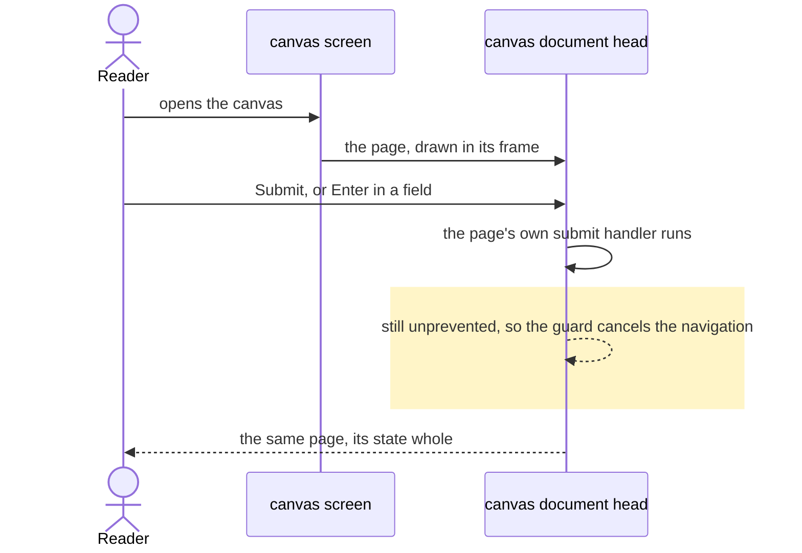
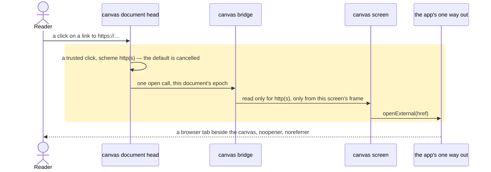
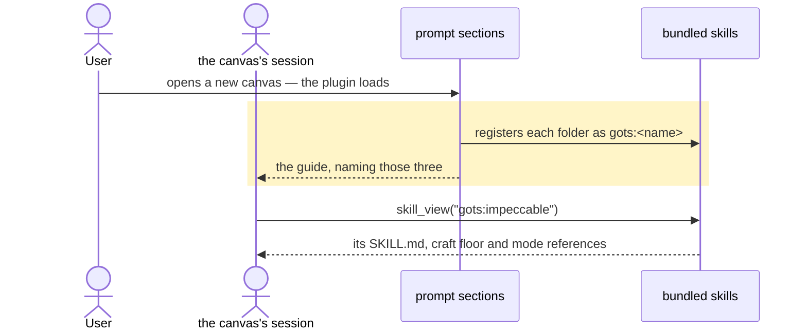
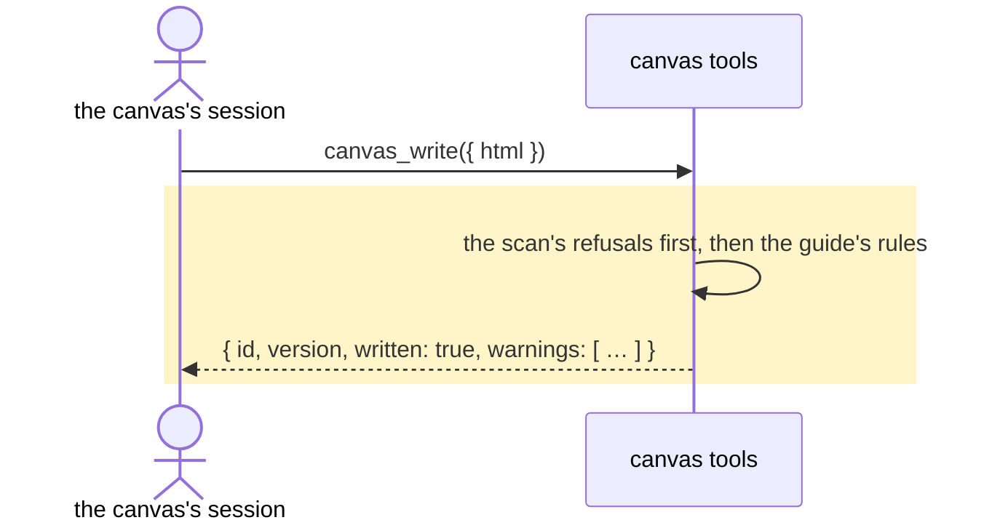

# A canvas is designed by its user first, and its page cannot navigate away

## Goals

- **G1** A user's own aesthetic wins before anything Gots says: a named look, brand, palette, font or
  reference is the design, and the Gots floor — one surface, the tokens, 390px first, 44px targets,
  empty/loading/error states, no explanatory copy — fills only what the user leaves unsaid.
- **G2** A canvas session can load `gots:impeccable`, `gots:web-design-guidelines` and
  `gots:transitions-dev`, bundled inside the plugin and registered with `ctx.register_skill`, and the
  guide names them so a session knows what it may load.
- **G3** `DESIGN.md` at the repo root, authored from the app's own CSS tokens, layout measures and
  components, that the `@google/design.md` linter passes with no error and no warning, and shipped as
  a byte-identical copy inside the plugin.
- **G4** A canvas's guide names the sandbox's traps, and two of them stop costing the page: a `<form>`
  submit keeps the page it was on and the page's own handler still runs, and a link to another site
  opens in the app on the user's click, for http(s) only, with no opener.
- **G5** `canvas_write` and `canvas_edit` answer with the guide's own rules as warnings — never a
  refusal, never a lost version — so a bot that broke one is told before the user sees it.
- **G6** The change ships: the plugin's and the app's versions bump together, the two plugin version
  files agree, and an ADR records the guide's order, the skills and the two fixes.

## Non-goals

- impeccable's detector engine, its `/impeccable` commands and its live mode (A2).
- transitions-dev's previews and any runnable example of a transition (A2 ships the collection).
- `web-design-guidelines`' fetch of the upstream rules when it runs (A2).
- A fourth skill for `DESIGN.md`, or for the guide itself.
- Any loosening of the canvas CSP: `form-action 'none'` stays, and no `allow-popups`.
- A consent dialog, a stored grant, or a fallback popup for opening a link.
- Renaming the bridge's transport, or splitting its calls from its intents.
- Re-making the app's own screens to match `DESIGN.md`.
- A browser flow for canvas in `app/scripts/e2e` (there is none today).

## Change map

| Layer | Status | Goals | Tested at |
|---|---|---|---|
| `prompt sections` (`plugin/openui.py`) | changed | G2 | `plugin/tests/test_openui.py` |
| `bundled skills` (`plugin/skills/<name>/`) | new | G2 | `plugin/tests/test_canvas_artifacts.py` |
| `design spec` (`DESIGN.md`, `plugin/canvas/DESIGN.md`) | new | G3 | the design-md linter; `plugin/tests/test_canvas_artifacts.py` |
| `canvas guide artifact` (`plugin/canvas/prompt.txt`) | changed | G1, G4 | `app/scripts/test-canvas-document.mjs` |
| `canvas document head` (`app/src/lib/canvas-document.ts`) | changed | G4 | `app/scripts/test-canvas-document.mjs` |
| `canvas bridge` (`app/src/lib/canvas-bridge.ts`) | changed | G4 | `app/scripts/test-canvas-bridge.mjs` |
| `canvas screen` (`app/src/routes/canvas.tsx`) | changed | G4 | `app/scripts/test-canvas-screen.tsx` |
| `the app's one way out` (`app/src/lib/native.ts`) | affected | G4 | `app/scripts/test-canvas-screen.tsx` |
| `canvas tools` (`plugin/canvases.py`) | changed | G5 | `plugin/tests/test_canvases.py` |
| `the app's theme` (`app/src/index.css`) | affected | G3 | the linter (read, never edited) |
| `release` (`plugin/plugin.yaml`, `plugin/dashboard/manifest.json`, `app/package.json`) | changed | G6 | `plugin/tests/test_plugin_versions.py`, `.github/scripts/release.test.mjs` |
| `canvas document` (a bot's stored HTML) | affected | G4, G5 | `app/scripts/test-canvas-document.mjs`, `plugin/tests/test_canvases.py` |
| `docs` (`AGENTS.md`, `plugin/README.md`, `docs/adr/0122-…`) | changed | G6 | none — the claims it makes are held by the rows above |

## Flows

### F1: A reader submits a canvas's form and the page stays where it is (changed). Test: "a form submits in place"

Before: the submit was a navigation the policy refused, and the reader was left on a refusal with the
page's state gone.

### F2: A reader taps a link to another site and the app opens it (new). Test: "a tapped link opens in the app, once, with no opener"

### F3: A canvas session is told the guide, and the guide names what it can load (changed). Test: "the canvas section names the skills it can load"

### F4: A bot writes a canvas and is told what the guide would say (changed). Test: "a write answers with the guide's warnings"

## Steps

1. **A design spec the app and a canvas both read.** Author `DESIGN.md` at the root from `index.css`
   (both modes, the radius steps), the layout measures (640/672, the 1024px breakpoint), the 390px
   phone and 44px targets, and the components' shape (pill actions, cards, sheets, no explanatory
   copy) — canonical section order, colours referenced by component rather than repeated literals, hex
   and negative letter-spacing quoted, and every colour that carries ink written as a tint plus ink
   pair so the linter's `textColor`-against-`backgroundColor` check can read it. Ship the same bytes at
   `plugin/canvas/DESIGN.md`. Goals: G3. After: none. Layers: design spec, the app's theme (read, not
   edited). Check: the linter — `node …/@google/design.md/dist/index.js lint DESIGN.md` (the same CLI
   as `npx -y @google/design.md`, whose shim is not executable here) — red first (no file), then
   `errors: 0, warnings: 0`; and `plugin/tests/test_canvas_artifacts.py`'s copy case, red first, green
   on equal bytes.

2. **The three skills, bundled.** Vendor impeccable curated to `SKILL.md`, `craft-floor.md`, its mode
   references and an Apache-2.0 `NOTICE` (A2); the whole transitions-dev collection with its
   `LICENSE.txt` and `_root.css` (A2); `web-design-guidelines`' `SKILL.md` with its rules vendored in
   place of the fetch (A2). Each folder read-only, no engine, no script, no live command; each
   `SKILL.md` keeping its own `name` and a one-line trigger description, and transitions-dev keeping
   its licence line. Goals: G2. After: none. Layers: bundled skills. Check:
   `python3 -m unittest plugin.tests.test_canvas_artifacts -v` — red first (no `plugin/skills/`), green
   on: three folders, each `SKILL.md`'s `name` matching its directory, no `.py`/`.js`/`.mjs`/`.sh` and
   no shebang anywhere under `plugin/skills/`; and `scan_plugin(Path("plugin")).verdict` still `safe`.

3. **The three skills, registered.** In `plugin/openui.py` — the module that already owns what a
   canvas session is told — a tuple of the three names, and inside the existing `register(ctx)` one
   `getattr(ctx, "register_skill", None)` guard and one call per folder, each wrapped so a host that
   predates the API, or a folder that is missing, logs and leaves the plugin loading. Goals: G2.
   After: 2. Layers: prompt sections, bundled skills. Check:
   `python3 -m unittest plugin.tests.test_openui -v` — a recording ctx receives `impeccable`,
   `web-design-guidelines` and `transitions-dev` with paths that exist; a ctx without the method still
   leaves `register()` returning; one folder removed under a patched path logs and registers the other
   two (red: nothing is registered today).

4. **A form submits in place.** A non-capture `submit` listener on `window`, in a head script beside
   the no-peer script and before the page's own scripts, cancelling the default only when the event
   arrives still unprevented — so every handler the page put on the form, on a field or on `window` has
   run and kept its own behaviour, and a page that prevented the submit itself is left alone.
   `form-action 'none'` stays. Goals: G4. After: none. Layers: canvas document head. Check:
   `app/scripts/test-canvas-document.mjs` — "a form submits in place" red first (no listener), green
   after: run the guard's source in `vm` over a fake window, register the page's handler first, then
   dispatch a submit and assert the handler ran, the guard ran after it, and `preventDefault` was
   called once; an already-prevented submit is not cancelled twice.

5. **A tapped link opens in the app.** A click listener in the same head script: on a trusted click
   over the nearest `a[href]` whose resolved protocol is http or https, cancel the default and post one
   `{ method: "open", url }` call — a sibling of the page's existing `canvas.read`, not a
   `canvas.data.*` method, and not exposed on `window.canvas`, so a click is the only way to ask. The
   bridge's `readCall` accepts it only for an absolute http(s) URL, the handler answers it once per
   call and never for another window, and the screen opens it through the app's one way out
   (`openExternal`: the platform's browser on Android, `window.open(href, "_blank",
   "noopener,noreferrer")` on the web). `#hash`, relative, `mailto:`, `javascript:`, `data:` and
   `blob:` never leave the frame. Goals: G4. After: 4. Layers: canvas document head, canvas bridge,
   canvas screen, the app's one way out. Check: `app/scripts/test-canvas-bridge.mjs` — "a tapped link
   opens in the app, once, with no opener" red first, green after: `readCall` refuses a non-http(s)
   scheme and a relative href, a handled call reaches the host once, and a message from another window
   opens nothing; `app/scripts/test-canvas-screen.tsx` — a stubbed opener is called once with `_blank`
   and `noopener,noreferrer`, and a click on `#top` or `mailto:` posts nothing and is not cancelled.

6. **The guide, rewritten: the user first, Gots second, the traps named.** Rewrite
   `plugin/canvas/prompt.txt`, which stands at 3,975 of the host's 4,000 characters, so every added
   line is paid for by cutting prose elsewhere: the user's brief wins first and plainly, then one
   surface and a real hierarchy, the tokens and compiled classes, 390px first with 44px targets and
   16px typed text, the three states, no explanatory copy; then `gots:impeccable`,
   `gots:web-design-guidelines` and `gots:transitions-dev` by name and when each is worth loading, and
   `DESIGN.md` beside the guide; then what the sandbox does to a page — a form's submit is cancelled
   in place so handle it, an http(s) link opens in the app so use one when the reader should leave, and
   nothing loads from outside. No new `--word` appears in prose: the drift test reads every
   `--([a-z-]+)` in the guide as a claimed token. Goals: G1, G4. After: 2, 3, 4, 5. Layers: canvas
   guide artifact, prompt sections. Check: `cd app && node --experimental-strip-types --test
   scripts/test-canvas-document.mjs` — "the canvas section names the skills it can load" red first,
   green after: the guide's `--token` set is still exactly `TOKENS`, its `data-canvas-lib` set exactly
   `LIBRARIES`, its `canvas.data.*` set exactly `BRIDGE_METHODS`, its length under 4,000, and it names
   the three skills — each resolving to a `SKILL.md` under `plugin/skills/<name>/` — both traps and
   `DESIGN.md`.

7. **A write answers with what the guide would say.** `warnings(html)` beside the scan in
   `plugin/canvases.py`: three rules over the stored markup, each one sentence — a colour written as a
   literal instead of a token, a `<form>` with no submit handler anywhere in the document, and a fixed
   width past 390px. They ride the answer both `canvas_write` and `canvas_edit` already build (the one
   answer envelope, gaining a `warnings` list that is empty today), the version is written either way,
   and the tools' descriptions say the field is advice. Goals: G5. After: none. Layers: canvas tools,
   canvas document. Check: `python3 -m unittest plugin.tests.test_canvases -v` — "a write answers with
   the guide's warnings" red first (no `warnings`), green after: a hardcoded colour warns and the
   version still stores; a form with no handler warns; a clean page answers `warnings: []`; an edit
   carries the same.

8. **The release carries the change.** Bump `plugin/plugin.yaml` to `0.114.0` and reconcile
   `plugin/dashboard/manifest.json` to the same version (they read 0.113.0 and 0.112.0 today, since
   #960 bumped only the first), and bump `app/package.json` because `app/**` moved and the release gate
   refuses an app that moved without one. `MIN_PLUGIN_VERSION` stays `0.113.0`: nothing the app now
   relies on is newer than what it already requires. Write it down: `AGENTS.md`'s canvas bullet,
   `plugin/README.md`'s canvas paragraph, and
   `docs/adr/0122-a-canvas-is-designed-by-its-user-first.md` (0122 being the next free number)
   recording the guide's order, the three skills, the spec and the two sandbox fixes. Goals: G6.
   After: 1 to 7. Layers: release, docs. Check:
   `python3 -m unittest plugin.tests.test_plugin_versions -v` red first (the two files disagree), green
   after on one version; `.github/scripts/release.test.mjs` green, and a release dry run naming both a
   plugin and an app version.

## Decisions

- **The user's aesthetic is rule one; the Gots floor fills only what they leave unsaid.** Made by the
  user (A1), because a canvas is the user's page and a house style that overrules a named look is a bug.
- **Vendor the whole transitions-dev collection with its `LICENSE.txt`; curate impeccable to `SKILL.md`,
  `craft-floor.md`, its mode references and an Apache-2.0 `NOTICE` with no engine, scripts or live
  commands; register all three with `ctx.register_skill`.** Made by the user (A2).
- **`DESIGN.md` at the root, its copy inside the plugin.** Made by the user (A3, B2), because a plugin
  installed without the repo still has to carry the spec.
- **Warnings, never refusals, on `canvas_write` and `canvas_edit`.** Made by the user (B1).
- **Registration lives in `plugin/openui.py`'s existing `register()`, not in a new module.** Made by
  the agent, because that module already owns what a canvas session is told, and a second module would
  be a second call site to keep in step.
- **The form guard runs after the page's own handlers, not before.** Made by the agent, because a
  capture-phase guard cancels the thing the change exists to allow.
- **A link opens through `openExternal`, not `window.open` in the route.** Made by the agent, because
  on Android it is the platform's browser that opens, and a WebView's `window.open` need not.
- **The open call is a sibling of `canvas.read` and is not on `window.canvas`.** Made by the agent, so
  a click is the only way a page can ask, and the bridge's counted method list stays as it is.
- **The three warning rules are the guide's own rules, and only ones markup can decide.** Made by the
  agent, because a warning a bot cannot act on is noise, and a 44px target or an empty state cannot be
  measured from a string.
- **The two version files are reconciled as part of the bump.** Made by the agent, because the manifest
  has lagged since #960 and a release that names one version in two files cannot be checked.

## Risks

- **The guide has 25 characters of headroom** (3,975 of 4,000, counted in characters). Over the cap the
  section is dropped whole, `canvas_ready()` goes false and the app hides Canvas: a ten-character
  overflow is a feature outage, not a wording problem.
- **The drift test's token regex reads prose.** Any `--word` written in the guide joins the asserted
  set, so one sentence naming a token that is not in `TOKENS` fails the app's gate.
- **The vendored prose is scanned as plugin code.** The install scanner runs `skills_guard`'s pattern
  set over `.md`, so a vendored page that shows a shell line or says "fetch this URL" can move the
  verdict off `safe`; the fix is rewording, never an exemption.
- **A tab opened from a message handler can be popup-blocked on the web**, because the reader's
  activation does not survive the post to the parent. Android opens through the native browser and is
  not affected; on a desktop browser the link can still appear dead, and nothing tells the reader.
- **A canvas page can ask to open links while it is on screen.** The gates are the trusted click and the
  scheme, not a question to the reader; if that trade is wrong later, it needs a grant row per canvas,
  which is a schema change.
- **`form.submit()` from a script raises no event**, so nothing cancels it; the policy refuses the
  navigation and the page survives, and the guide says to submit from a handler.
- **The vendored skills go stale quietly.** They are snapshots of three upstreams with no updater and no
  version in the guide.
- **`DESIGN.md` copies facts the app owns.** A token rename or a measure touches the CSS, the canvas
  theme and both spec copies; the copy test fails the build, which is the right place but still four
  files for one value.
- **The version bump lands on drift that predates this work**, and `app/package.json`'s bump is
  `0.1.0-beta.1` on a `0.1.0-beta`, so a release cut mid-flight shows a larger jump than this change
  explains.

## Not now

- impeccable's engine, detector CLI and `/impeccable` commands, from A2.
- transitions-dev's previews and a runnable demo page, from its `LICENSE.txt`.
- `web-design-guidelines`' live fetch, from A2.
- A fourth skill holding `DESIGN.md`, from the settled list of three (A2).
- A consent dialog, a stored grant, or a blocked-popup fallback, from this plan's link gate.
- Renaming the bridge's transport, splitting calls from intents, and a table of head parts, from the
  refactors this change does not need.
- Generating the guide from `DESIGN.md`, or linting `DESIGN.md` in CI, from G3's scope.
- Applying `DESIGN.md` to the app's screens, from G3's scope.
- A Playwright flow for canvas in `app/scripts/e2e`, from the suite having none.
