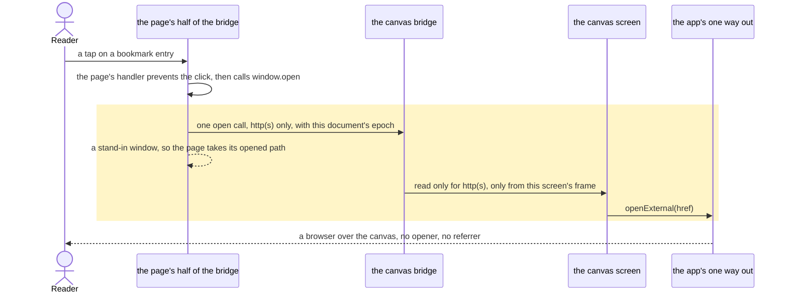
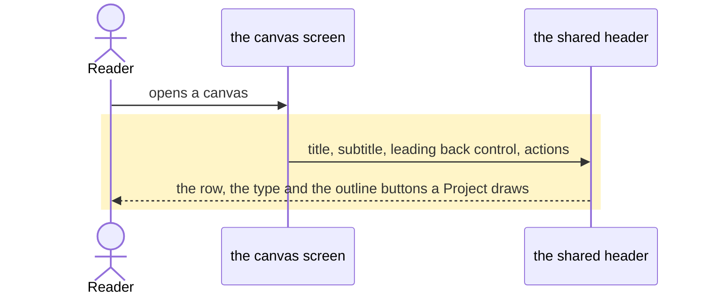

# A canvas opens its links, and its top bar is the Project's

## Goals
- **G1** Tapping a link in a canvas opens it in the app — including a page that opens its own links with `window.open`, which today is refused by the frame's sandbox and copied to the clipboard instead.
- **G2** The canvas screen's top-bar icons are styled like Projects › Project's: the same outline, blurred, round buttons and the same back control.

## Non-goals
- Letting the frame navigate itself to another site: `frame-src 'self'` and the page's own `default-src 'none'` stay.
- Opening schemes other than absolute `http(s)`: `mailto:`, `javascript:`, `data:`, `blob:` and relative links stay the page's own business.
- A prompt step or a download for a link: the platform's browser (Android) or a tab (web) is the whole of it.

## Change map
| Layer | Status | Goals | Tested at |
|---|---|---|---|
| The page's half of the bridge (`app/src/lib/canvas-bridge.ts`) | changed | G1 | `scripts/test-canvas-bridge.mjs` |
| The canvas screen (`app/src/routes/canvas.tsx`) | changed | G1, G2 | `scripts/test-canvas-screen.tsx`, `scripts/test-canvas-offline.tsx` |
| The shared header (`app/src/components/chat/chat-header.tsx`) | changed | G2 | `scripts/test-canvas-screen.tsx` |
| The app's one way out (`app/src/lib/native.ts`) | affected | G1 | `scripts/test-canvas-screen.tsx` |

## Flows

### F1: A reader taps a link a canvas's own script opens (changed). Test: "a page's own window.open asks the app once, and only for http(s)"

### F2: The canvas screen's header is the Project's header (changed). Test: "the canvas's top bar is Project's top bar"

## Steps
1. **The page's own `window.open` is the app's open call.** The page's half replaces `window.open` in the head, before the page's own scripts: an absolute `http(s)` URL posts one `open` call and returns a stand-in window (truthy, `closed: false`, `focus`, `close`, settable `opener`); anything else returns `null` and posts nothing. The app's `readCall` keeps enforcing the scheme. Goals: G1. After: none. Layers: the page's half of the bridge. Check: a new `test-canvas-bridge.mjs` test runs the script over a page realm, asserts one `open` call for `https://…`, a truthy stand-in, and nothing for `javascript:`, a relative URL and no argument. Done.
2. **The canvas's top bar is drawn by `ChatHeader`, as a Project's is.** The screen stops drawing its own `<header>`: it passes the title, the subtitle (`profile · v<n> · away words`, still carrying `data-canvas-offline`), a `BackButton` labelled "All canvases", and Undo and the options button as `variant="outline"` icon buttons with `size-11 rounded-full bg-background/80 backdrop-blur`, as the Project's menu is. `ChatHeader`'s `subtitle` widens to a node so the offline status keeps its own element. Goals: G2. After: 1. Layers: the canvas screen, the shared header. Check: a new `test-canvas-screen.tsx` test asserts `[data-slot="header-row"]` with the title, and actions whose buttons carry the outline and blur look; `test-canvas-offline.tsx` stays green. Done.

## Decisions
- **Proven cause: the page's own open never reaches the app.** A real Chromium tap on the user's "Kept" canvas (its current version read from the host store, `canvasDocument`‑wrapped, the parent running `bridgeHandler`) logged no `open` call, opened no tab, and left the page's own toast "Link copied — paste it into your browser." Its delegated click handler calls `preventDefault()` and then `window.open`, which the frame's sandbox refuses (returning `null`) and which the bridge's click listener deliberately skips as already-answered. Made by the agent.
- **The stand-in window.** A page branches on `window.open`'s answer — Kept copies the URL when it is falsy. The stand-in keeps a page's own "opened" path; a page that writes into the returned window gets nothing, which is the cost of a tab the app owns. Made by the agent.
- **No `allow-popups` on the frame.** It would let a page open windows the app cannot see, and on Android WebView `window.open` opens nothing anyway (Capacitor's WebView has no multi-window client), so the app's door stays the only one. Made by the agent.
- **The header is reused, not restyled.** A second copy of the row would drift from the Project's; the shared `ChatHeader` is what keeps them the same. Made by the agent.
- **`subtitle` widens to a node.** The canvas's offline words are a `role="status"` element the tests and the reader already rely on, and a string would flatten it. Made by the agent.

## Risks
- A canvas's script can ask for an http(s) URL to open on any `window.open` call it makes, tap or not — it could already `postMessage` the same call; what is enforced is the scheme and the frame, as ADR 0122 says.
- The stand-in window is not a window: it has no `document`, so a page that writes into it throws where a window would have kept the write.
- On a device still running a build older than #990, links stay inert until that build updates: the page half shipped there, this only reaches the pages that open links themselves.

## Not now
- Protocol-relative `//host/path` links, from the frames the hunt read.
- A browser-tier e2e flow for a link tap; the unit test plus the Chromium probe stand in for now.
- Telling a canvas's guide that `window.open` reaches the app; the plugin prompt is at 18 characters of headroom.
