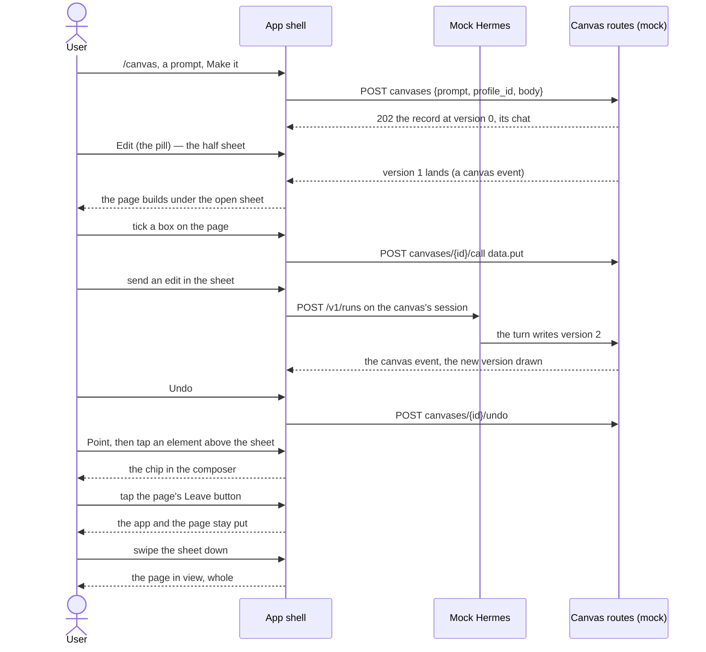

# A canvas is held end to end on a phone

## Goals

- **G6** One flow, `pnpm e2e canvas`, drives the whole phone loop against the mock Hermes at 390px:
  a canvas made from a prompt, its page landing under a half sheet that is already open, a box
  ticked on that page, the sheet's Edit, an edit landing with the box still ticked, Undo, a point
  tagged on the page while the sheet is open, a page that sets `location` to an outside URL staying
  put, and the sheet swiped down to leave the page in view.

## Non-goals

- A laptop leg (the split at 1024px is #932's and the component tier's).
- Any new canvas behaviour: the flow proves what #960–#976 landed, and the mock is brought up to the
  shapes those tickets made real.
- Re-recording the screenshots the flow takes.

## Change map

| Layer | Status | Goals | Tested at |
|---|---|---|---|
| e2e registry (`app/scripts/e2e/cli.mjs` `FLOWS`) | changed | G6 | `app/scripts/test-e2e-registry.mjs` |
| E2E flow (`app/scripts/e2e/canvas.mjs`) | new | G6 | `pnpm e2e canvas` |
| Mock Hermes (`app/scripts/mock-canvas.mjs`, `app/scripts/mock-hermes.mjs`) | changed | G6 | `pnpm e2e canvas` |
| App shell (`app/src/routes/canvas.tsx`, `app/src/components/popup.tsx`) | affected | G6 | `pnpm e2e canvas` |
| Docs (`docs/e2e-flow-audit.md`, `docs/adr/0114-…`, `GLOSSARY.md`, `AGENTS.md`) | changed | G6 | `app/scripts/test-e2e-registry.mjs` (audit row) |

## Flows

### F1: A phone makes, ticks, edits, undoes, points and leaves a canvas (new)

## Steps

1. **The flow is written and registered, and fails where the mock cannot follow it.** Adds
   `app/scripts/e2e/canvas.mjs`, its `FLOWS` key and its audit row. Goals: G6. After: none.
   Layers: e2e registry, e2e flow, docs. Check: `pnpm e2e canvas` red, naming the mock's missing
   canvas chat. Done.
2. **Mock Hermes draws the canvas's chat, a page with a box and a way out.** The canvas's create
   merges the chat record `triage.open_thread` would (id, profile, session, `canvasId`, title marked
   `titleEdited`), the mock page keeps a ticked box in the canvas's data through the bridge, and a
   `Leave` button sets `location` to an outside URL. Goals: G6. After: 1. Layers: Mock Hermes.
   Check: `pnpm e2e canvas` green through the box and the location leg. Done.
3. **Mock Hermes edits the canvas when its chat is sent to.** A turn on a canvas's session writes
   version 2 of the page (the mock's stand-in for `canvas_edit`) and notes the canvas event, so the
   sheet's send redraws the page under it with the box still ticked; Undo walks the pointer back.
   Goals: G6. After: 2. Layers: Mock Hermes, App shell (the snapped sheet's content fills its visible
   stop, so the chat's composer is on the screen at half height). Check: `pnpm e2e canvas` green
   through the edit and Undo. Done.
4. **The phone's own geometry is asserted.** The sheet is non-modal — no scrim, no `aria-modal`, the
   page above it pressable — the tapped box and the pointed element are above the sheet's top edge,
   the frame is `sandbox="allow-scripts"` with the policy first in its head, and a real one-finger
   swipe down on the sheet's handle leaves it, the page then filling the screen. Goals: G6. After: 3.
   Layers: e2e flow, App shell. Check: `pnpm e2e canvas` green end to end. Done.
5. **The docs say what the flow holds.** The audit row's argument (why a stay: sandbox, geometry, a
   real gesture, a host's own versions), the counts it moves, ADR 0114 noting the outside-URL leg is
   now measured, and the glossary's canvas sheet row naming the flow. Goals: G6. After: 4. Layers:
   docs. Check: `node --experimental-strip-types --test scripts/test-e2e-registry.mjs` green. Done.

## Decisions

- **The mock edits a canvas from its chat rather than the flow calling the host directly.** Made by
  the agent: the claim is the phone loop, so the edit has to travel the app's own send and the
  canvas event that follows it, which is what the plugin's `canvas_edit` leaves behind.
- **The location leg taps a button rather than loading a page that leaves on its own.** Made by the
  agent: a page that navigates on load would race the frame's own first paint, and the claim is that
  the app holds when the page tries, which a tap pins to one moment.
- **The flow runs only at 390px.** Made by the agent: G6 is the phone flow; the laptop's split is
  another ticket's and another tier's.

## Risks

- The mock's page is the one every canvas flow will draw; other flows that ask for a canvas now see
  a box and a Leave button they did not have. No flow does yet.
- Chromium blocks the frame's outside navigation through the app's own `frame-src 'self'`; a browser
  that did not would fail this leg, which is the claim ADR 0114 says is unchecked in Safari.
- The mock has no `canvas_edit`: it writes a version on any settled turn in a canvas's chat and puts
  the turn's words in the page, so the flow proves the app re-reads a version and draws it, not that
  the host refused or accepted an edit. The plugin's scan refusals (secret, >256 KB, incomplete
  document, an outside resource) are unrepresented — plugin-tier work, its own ticket.
- A page that navigates while it is still parsing fires one load, already the browser's error page,
  so it is never drawn at all and the redraw cannot reach it. A page that reloads itself spends the
  one redraw and is then told so. ADR 0114 and the glossary say exactly that.
- A tick written as a version lands can be drawn from the device's copy before the write's answer
  arrives; it corrects on the next version. The flow awaits the write's own answer, so it cannot see
  the race.
- The on-screen keyboard is outside the flow (Playwright has none): iOS, which ignores
  `interactive-widget=resizes-content`, may hold the composer behind it. Android resizes `dvh`.
- The composer offers Point at the full stop too, where no part of the page is on screen and the arm
  has nothing to land on. An affordance for another ticket.

## Not now

- A tablet or laptop leg of the same loop, from #932.
- Canvas background updates (B3) and storage queued while the host is away (B6), from #920.
