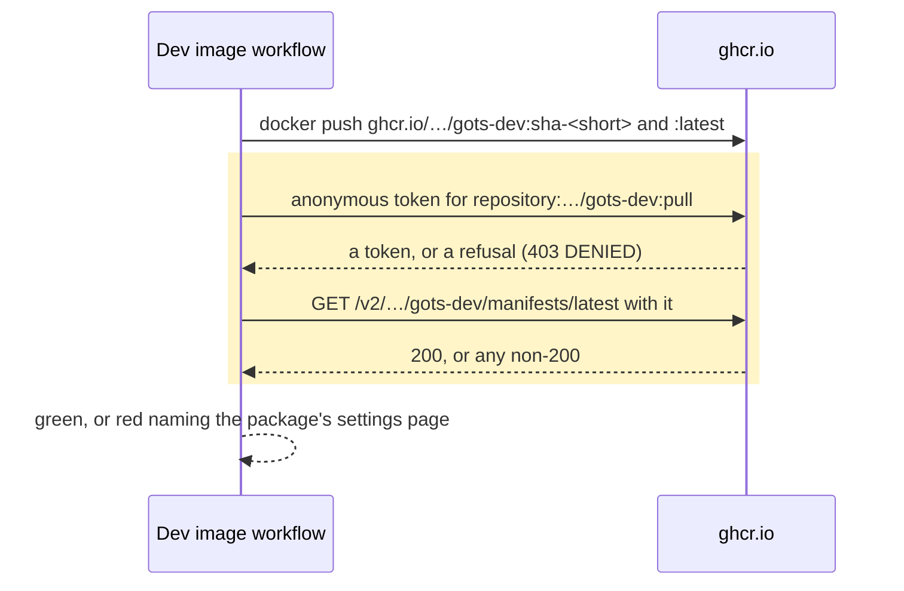
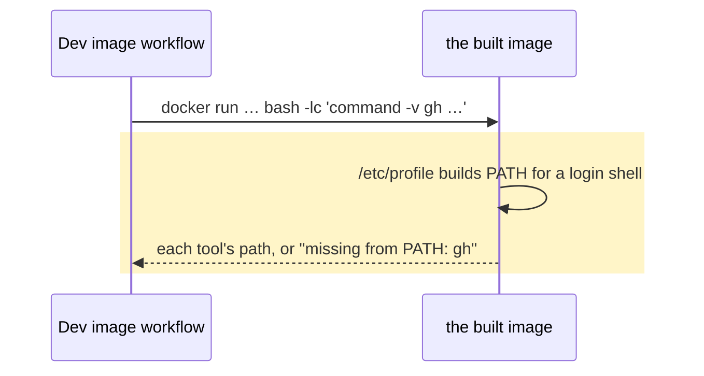

# The dev image is public, and proves it carries gh

## Goals
- **G1** `docker pull ghcr.io/thehaseebahmed/gots-dev:latest` works for a machine that is not logged in, so the
  sandbox that runs Gots — `docker_image: ghcr.io/thehaseebahmed/gots-dev` in the host's Hermes config — gets the
  current image instead of the stale local copy it runs today.
- **G2** The image's own verification proves `gh` and the rest of the tools the image promises resolve from a login
  shell, so an image without `gh` on `PATH` cannot be published again.

## Non-goals
- Flipping the package's visibility from CI: the token this environment holds (`gotsfather`) has no admin on a package
  owned by `thehaseebahmed`, so the click is the owner's (see Decisions).
- Pinning the sandbox to a digest, or otherwise editing the Hermes config outside this repository.
- A `.devcontainer` file that owns the container invocation, one owner for the toolchain versions, and a non-root
  image — all three are decisions of their own, recorded in `fixes.md` and #230's notes.

## Change map
| Layer | Status | Goals | Tested at |
|---|---|---|---|
| The registry probe (`.github/scripts/ghcr-public.sh`) | new | G1 | its own run against a public control |
| Image distribution (`.github/workflows/dev-image.yml`) | changed | G1 G2 | `bash .github/scripts/ghcr-public.sh …` and the smoke run |
| Contributor docs (`CONTRIBUTING.md`) | changed | G1 G2 | read-through against the workflow's tags |

## Flows
### F1: what was published is proved pullable (changed). Test: `ghcr-public.sh` against `gots-dev` (red) and a public package (green)

### F2: a tool the image promises is callable (changed). Test: the smoke run in the Verify step

## Steps
1. **The probe: is this image pullable without credentials?** A script that asks ghcr.io for an anonymous pull token and
   the tag's manifest, exiting 0 with the manifest's digest and 1 with the package's settings URL. Goals: G1. After: none.
   Check: red before the flip — `bash .github/scripts/ghcr-public.sh ghcr.io/thehaseebahmed/gots-dev:latest` exits 1
   naming the settings page — green after it (a digest), with `ghcr.io/renovatebot/renovate:latest` green as the control
   and an unpublished name red.

   Done.
2. **A publish proves it.** The Dev image workflow runs the probe over every tag it pushed, on the paths that publish —
   a `main` push or a dispatch. Goals: G1. After: 1. Check: step 1's command is the step's command; a pull request
   publishes nothing and is skipped by the same condition Publish uses.

   Done.
3. **The image proves its tools.** The Verify step runs `bash -lc` inside the image and fails on the first tool that is
   missing, naming it. Goals: G2. After: none. Check: the same command in this container — a stale build of the same
   image — reports `missing from PATH: gh`, which is the failure it has to catch; the green half is observed on this
   branch's first CI run, since this container has no docker.

   Done.
4. **`CONTRIBUTING.md` says what the image carries and what a refused pull means.** Goals: G1 G2. After: none. Check:
   read-through — the tool list names the GitHub CLI, and the pull section says the package is public and links the
   settings where that was changed.

   Done.

## Decisions
- **The visibility flip is the package owner's, not the workflow's.** Made by the agent, because the token available
  here (`gotsfather`) gets `404` from `PATCH /users/thehaseebahmed/packages/container/gots-dev`, while the registry
  refuses an anonymous pull for a package nobody may read (`403 DENIED` at the token leg, `401` from the manifest
  without one) and grants it for a public control — the API cannot make a package its user does not own public.
- **The pullability probe runs where something publishes.** Made by the agent: on a pull request nothing is pushed, so
  the probe would test the package as it stands and go red for a reason the pull request cannot fix.
- **The smoke run uses a login shell (`bash -lc`).** Made by the agent: Debian's `/etc/profile` replaces `PATH` for
  login shells, the trap the Dockerfile already records for `python3`, so the harsher shell is the honest one.

## Risks
- The flip happened by hand while this branch was being written: the package's `tags/list` answered anonymously, and
  the probe went green on `sha256:ce2ba35…`. This change is what keeps it true, and what goes red the day it is undone.
- The probe depends on ghcr.io's anonymous token endpoint. If that changes shape, the step fails and prints the URL
  rather than passing quietly.
- This pull request cannot replace a copy someone already has: the sandbox still runs its stale image, so one
  `docker pull` is needed before `gh` appears in it.

## Not now
- `.devcontainer/devcontainer.json`, from `fixes.md` — "No artefact owns the container invocation".
- One owner for the toolchain versions, from `fixes.md` — "The toolchain versions have no single owner".
- A non-root image, from #230's notes for reviewers.
