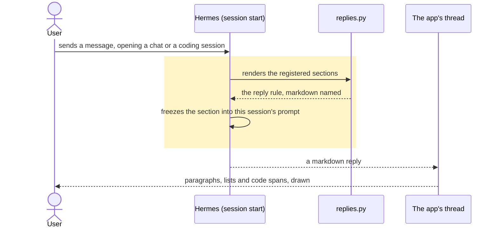

# A reply comes back as markdown, in every Gots session

## Goals
- **G1** A reply is written as markdown, with paragraphs broken by a blank line, lists where there are three or more points or steps, code spans for commands and paths, and a heading only where a long reply needs scanning — in a plain chat and in a coding session alike.

## Non-goals
- Any change to the app's renderer. It already draws paragraphs, `ul`/`ol`, code spans, fences and headings; the reply that reaches it is what is wrong.
- A change to Hermes itself. The hint that says "assume plain text" is the host's, and a plugin may not rewrite it.
- A switch per bot for how replies are formatted.
- Changing the plain-chat `PLAN_HINT` or the project session's `instructions`.

## Change map
| Layer | Status | Goals | Tested at |
|---|---|---|---|
| System-prompt section (`plugin/replies.py`, registered by `plugin/__init__.py`) | new | G1 | `plugin/tests/test_replies.py` |
| Every session's prompt (Hermes renders the section once per session) | affected | G1 | the same test, and an open chat's prompt carries the section |

## Flows
### F1: a session is started and its reply is written (changed). Test: "a session is told to write markdown"

The hint that says "assume plain text" is in the prompt's stable tier; a section renders in the volatile tail, after it, so the rule is the last thing the run is told about formatting.

## Steps
1. **The regression test.** A test that the plugin registers a section, that its text names a blank line between paragraphs, a list, a code span and a fence, and that it fits inside the host's 4,000-character cap — a section over the cap is dropped whole, not truncated. Goals: G1. After: none. Layers: the section. Check: `python3 -m unittest plugin.tests.test_replies -v` — red now, because `plugin.replies` does not exist; green after step 2.

   Done.

2. **The rule every session is told.** Add `plugin/replies.py`: the section's text and a guarded `register_section(ctx)` that hands it to Hermes under its own id, answering `False` where this host predates the call rather than failing the plugin. Wire it beside `platform_gots.register_section` in `plugin/__init__.py`. Write the decision down where the repo keeps them — an ADR, `AGENTS.md`'s feature bullet and `plugin/README.md`'s list — because the next reader of the api_server hint will otherwise "fix" this back. Goals: G1. After: 1. Layers: the section, registration, docs. Check: step 1's test green; then `python3 -m unittest discover -s plugin/tests -t .`, and `.github/scripts/scan-plugin.py` over `plugin/`.

   Done.

## Decisions
- **The cause is the host's api_server hint, confirmed by reading the running prompt.** `agent/prompt_builder.py:716` reads *"You're responding through an API server. The rendering layer is unknown — assume plain text. No markdown formatting (no asterisks, bullets, headers, code fences). Treat this like a conversation, not a document."* That is the paragraph this session's own prompt carries, and this session is an api_server run like every Gots run. Nothing the plugin tells a run contradicts it: `grep -rn markdown plugin/prompt_builder.py plugin/platform_gots.py plugin/openui/prompt.txt` found one line, about a table's cells.
- **The renderer is not the cause, refuted.** `app/src/components/chat/markdown.tsx` splits a reply into blocks and draws each through `react-markdown`, and its classes give `ul` a disc and `ol` a decimal. A reply written as markdown is drawn as markdown today.
- **The instructions are not being dropped, refuted.** The project session's instructions still arrive (`plugin/prompt_builder.py`'s sections are in this session's prompt); they simply say nothing about formatting.
- **A system-prompt section, not a line in `prompt_builder`.** Made by the agent: a plain chat has no worktree, so `session_prompt` is never built for it and `instructions` carry only the app's `PLAN_HINT`; a section is the one seam that reaches every session — chat, coding, and AFK's own run — and Hermes renders it after the platform hint, so it is the last word. It is also the seam `openui` and a routine's delivery already use, and this host takes it: this session's prompt carries `## Plugin Context: gots_routines`.
- **The section names no path, branch or issue.** Made by the agent: it is fixed text, so every session's prompt shares it and the cache holds.
- **The renderer is left alone.** Made by the user (Q2): a lone newline turned into a paragraph break would invent structure the model did not write, and the user's own messages are drawn by the same renderer.
- **The text says the app renders markdown and that the plain-text default does not apply here.** Made by the agent: the hint is not wrong in general, only in this app, and a model told both needs the contradiction resolved in words rather than left to prompt order.

## Risks
- A prompt is guidance, not enforcement. The model can still answer in one block; what changes is that it is now told markdown once per session, and nothing tells it otherwise.
- Hermes freezes a section into a session's prompt when the session starts, so a chat already open keeps the plain replies it was told to write until a new one opens.
- A host older than `register_system_prompt_section` takes no section: `register_section` answers `False`, the plugin keeps serving every route, and that bot's replies stay as they are. This host is newer, since its prompt carries other sections.
- The section is one more thing in every prompt, at about 700 characters, charged on every turn of every chat.

## Not now
- A renderer rule that turns a single newline into a paragraph break, from the wall-of-text symptom. It would invent structure the model did not write, and the user's own messages depend on the same renderer keeping their newlines.
- Rewording Hermes's api_server hint upstream, from the same finding.
- A per-project Prompt clause about formatting, from the AFK path: the project's Prompt is the method of the work, and this rule is the bot's, not a project's.
