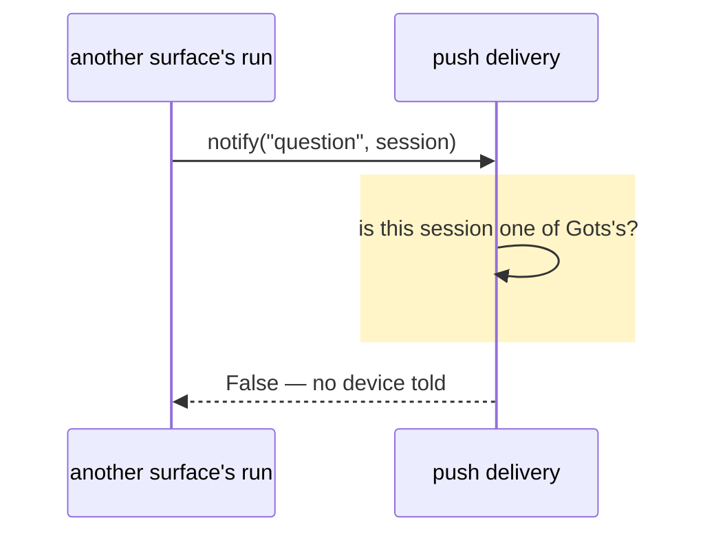

# No notification for a session that isn't Gots's

## Goals

- **G1** No notification arrives for a session that isn't one of Gots's chats — only a Gots chat's
  approval, question, plan or run news reaches the devices.

## Non-goals

- Per-client notification settings.
- Filtering the app's own change stream (`events.note`), which is not a push.

## Change map

| Layer | Status | Goals | Tested at |
|---|---|---|---|
| push delivery (`plugin/push.py`) | changed | G1 | `plugin.tests.test_push_kinds.Scope` |
| approval hook (`plugin/events.py`) | affected | G1 | `plugin.tests.test_push_kinds.Scope` |
| clarify tool (`plugin/clarify.py`) | affected | G1 | `plugin.tests.test_push_kinds.Scope` |

## Flows

### F1: a question in a session that isn't Gots's (changed). Test: `class Scope`



## Steps

1. **Regression test: a session that isn't Gots's is not pushed.** Goals: G1. After: none. Layers:
   push delivery. Check: `python3 -m unittest plugin.tests.test_push_kinds.Scope -v` — red before
   step 2, green after. Covers a Gots id, another surface's id, and a compressed chat whose
   unprefixed child walks to its `gots-` root. Done.
2. **Gate `notify` on Gots's own sessions.** Goals: G1. After: 1. Layers: push delivery, approval
   hook, clarify tool. Check: that command green, plus `plugin.tests.test_push_kinds` and
   `plugin.tests.test_approval_notice`.

## Decisions

- **The gate lives in `push.notify`, not in the callers.** Made by the agent: every push path funnels
  through it, and `clarify` hands it no path or context to check with.
- **A session is Gots's when the app's id prefix is on it or on its compression root.** Made by the
  agent: the app mints every chat id with that prefix, and `sessions.chat_session` already
  distinguishes compression from a delegation fork, so a child never inherits its parent's push.
- **Arena skipped** (no new layer, two steps, no big decision, one defensible shape).

### Evidence

A temp profile with one subscribed phone, `push.send` recorded:

```
gots chat   : (True, [{'kind': 'question', 'session_id': 'gots-abc'}])
other client: (True, [{'kind': 'question', 'session_id': 'sess_9f2c41'}])
approval in : 1 push(es)
```

Confirmed hypothesis: every push path funnels through `push.notify`, which accepted any Hermes
session id; `clarify.ask` passes whatever session it runs in, and `events._is_api_session` marks
every `api_server` session as Gots's. Refuted: tightening only `events._is_api_session` — it would
fix approvals and leave questions leaking.

## Risks

- A future Gots surface that mints session ids another way would go silent; the regression test pins
  the prefix and the compression root as the contract.

## Not now

- Tightening `events._is_api_session`, from this hunt: redundant once `notify` gates, and it would
  not cover `clarify`.
- Any app-side filtering of an unexpected `session_id`, from YAGNI.
