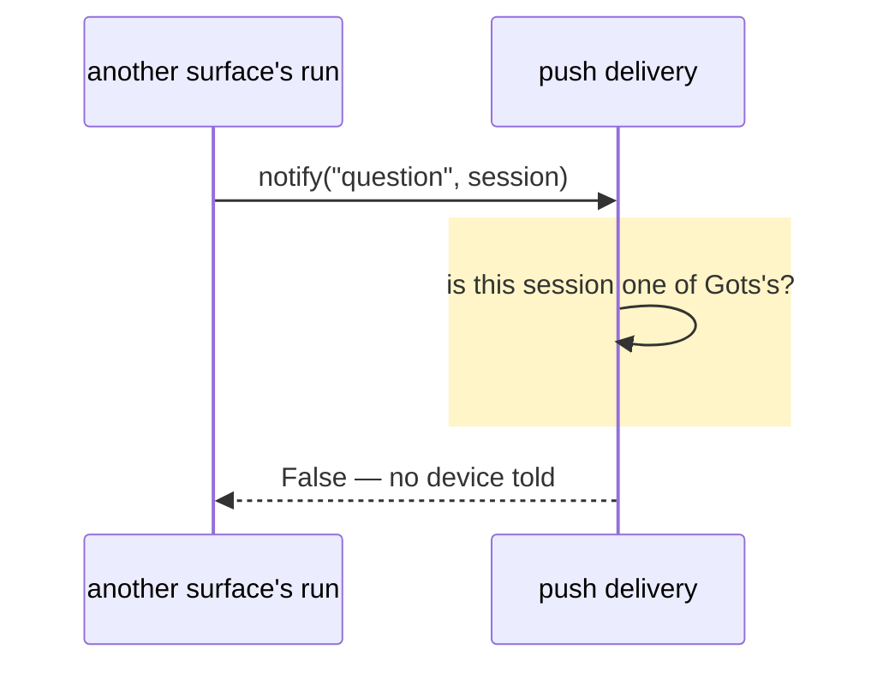

# No notification for a session that isn't Gots's

## Goals

- **G1** No notification arrives for a session that isn't one of Gots's chats — only a Gots chat's
  approval, question, plan or run news reaches the devices.

## Non-goals

- Per-client notification settings.
- Filtering the app's own change stream (`events.note`), which is not a push.

## Change map

| Layer | Status | Goals | Tested at |
|---|---|---|---|
| push delivery (`plugin/push.py`) | changed | G1 | `plugin.tests.test_push_kinds.Scope` |
| session ancestry (`plugin/sessions.py`) | changed | G1 | `plugin.tests.test_push_kinds.Scope`, `.Turns`, `plugin.tests.test_progress.ProgressTest` |
| run news (`plugin/alerts.py`) | changed | G1 | `plugin.tests.test_push_kinds.Turns` |
| progress reminders (`plugin/progress.py`) | changed | none — a reminder, not a push | `plugin.tests.test_progress.ProgressTest` |
| approval hook (`plugin/events.py`) | affected | G1 | `push.notify`'s gate (`plugin.tests.test_push_kinds.Scope`) |
| clarify tool (`plugin/clarify.py`) | affected | G1 | `push.notify`'s gate (`plugin.tests.test_push_kinds.Scope`) |

## Flows

### F1: a question in a session that isn't Gots's (changed). Test: `class Scope`



## Steps

1. **Regression test: a session that isn't Gots's is not pushed.** Goals: G1. After: none. Layers:
   push delivery. Check: `python3 -m unittest plugin.tests.test_push_kinds.Scope -v` — red before
   step 2, green after. Covers a Gots id, another surface's id, and a compressed chat whose
   unprefixed child walks to its `gots-` root. Done.
2. **Gate `notify` on Gots's own sessions.** Goals: G1. After: 1. Layers: push delivery, approval
   hook, clarify tool. Check: that command green, plus `plugin.tests.test_push_kinds` and
   `plugin.tests.test_approval_notice`. Done.
3. **Review fixes: the ancestry a push follows, and a store that can't answer.** Goals: G1. After: 2.
   Layers: push delivery, session ancestry. Check: `python3 -m unittest
   plugin.tests.test_push_kinds.Scope -v` — the delegation case red before the change (it expected a
   push and got none), green after — then `plugin.tests.test_push_kinds` and `python3 -m unittest
   discover -s plugin/tests -t .`. `sessions.is_chat` answers a session's ancestry in one read-only
   recursive query, bounded by `COMPRESSION_DEPTH` and waiting at most 0.25 s on a locked store;
   `push._gots_chat` asks it, so compression and a subagent's fork both count (an app-minted id
   answers inside the predicate, before the store is opened), and a store that can't answer drops
   the push quickly instead of stalling the hook. Done.
4. **Converge the session predicates.** Goals: G1 for a turn's news; none for the reminders (a
   reminder is not a push). After: 3. Layers: push delivery, run news,
   progress reminders, session ancestry. Check: `python3 -m unittest plugin.tests.test_progress -v`
   and `python3 -m unittest plugin.tests.test_push_kinds -v` — the compressed chat's reminder and
   the delegated child's failed turn red before the change — then `python3 -m unittest discover
   -s plugin/tests -t .`. `sessions.is_chat` answers an app-minted id before opening the store, so
   every caller pays nothing on the common path; `push._gots_chat` is only that call and no longer
   keeps a prefix branch of its own. `alerts.turn_finished` asks `sessions.is_chat` rather than its
   own prefix check, so a compressed child's and a subagent's news reach the chat's devices.
   `progress._session` keeps the fast prefix return and, for an unprefixed id, asks whether its
   compression root is prefixed: a delegation fork stops that walk, so a subagent's reply — which
   reaches its parent, not the user — still gets no reminder. Done.

## Decisions

- **The gate lives in `push.notify`, not in the callers.** Made by the agent: every push path funnels
  through it, and `clarify` hands it no path or context to check with.
- **Every session kind is gated, not only the four G1 names.** The rule sits where every kind meets
  the store: `SESSION_KINDS` is the list — a question, an approval and a plan, a chat's run news, its
  pull request's checks and merge, an AFK pull request and a routine's message — so all of them are
  held to "one of Gots's chats", not just the news G1 named.
- **Q1: a subagent's session notifies as its parent chat's.** Made by the user: a clarify question or
  an approval raised inside a subagent has to arrive as its chat's news. `push.session_title`,
  `push._chat`, `push.muted` and `alerts.turn_finished` all resolve that child to the parent chat
  already, so session identity follows the same ancestry: a session is a Gots chat's when its own id
  carries `ID_PREFIXES` or any ancestor does — compression and a subagent's fork alike. A delegation
  child of a session that isn't Gots's still drops. `sessions.chat_session` is left as it was: run
  keying stops at a fork on purpose, because the run is the child's own.
- **Q2: a store that can't answer still drops the push.** Made by the user: missing, empty, corrupt or
  locked, the answer is "not a chat's" — fail closed, as before — but the question is one read-only
  query with a short busy timeout, so a locked store answers in 0.25 s rather than holding the hook
  thread for the 2 s `sessions.chat_session` waits.
- **Q3: the other two session checks converge on the same rule.** Made by the user, chosen over
  leaving them: `alerts.turn_finished` kept its own prefix check, which missed a subagent's failed
  turn, and `progress._session` kept one that missed a compressed chat's child. One rule for which
  session is a chat's, rather than three copies that drift.
- **Q4: converged properly, not identically.** Made by the user: `alerts.turn_finished` follows
  `sessions.is_chat` (any ancestry), because a compressed child's and a subagent's news are the
  chat's own. `progress._session` follows compression only: a delegated child's reply reaches its
  parent rather than the user (its `_delegate_from` fork stops `chat_session`'s walk), so a subagent
  still gets no reminder. The difference is the point, not an oversight.
- **Arena skipped** (no new layer, no big decision, one defensible shape).

### Evidence (before the fix)

A temp profile with one subscribed phone, `push.send` recorded:

```
gots chat   : (True, [{'kind': 'question', 'session_id': 'gots-abc'}])
other client: (True, [{'kind': 'question', 'session_id': 'sess_9f2c41'}])
approval in : 1 push(es)
```

Confirmed hypothesis: every push path funnels through `push.notify`, which accepted any Hermes
session id; `clarify.ask` passes whatever session it runs in, and `events._is_api_session` marks
every `api_server` session as Gots's. Refuted: tightening only `events._is_api_session` — it would
fix approvals and leave questions leaking.

## Risks

- A future Gots surface that mints session ids another way would go silent; the regression test pins
  the prefix and the ancestry as the contract.
- A store that can't answer drops the push (Q2): a chat on a profile whose `state.db` is mid-restore,
  empty, corrupt or held by a writer loses its news until the store answers. The trade is the user's
  ruling — a push sent for a session that isn't a chat's is the leak G1 forbids, and one missed is
  recovered from the app when it opens.

## Not now

- Tightening `events._is_api_session`, from this hunt: redundant once `notify` gates, and it would
  not cover `clarify`.
- Any app-side filtering of an unexpected `session_id`, from YAGNI.
