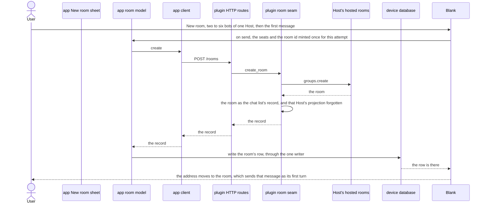
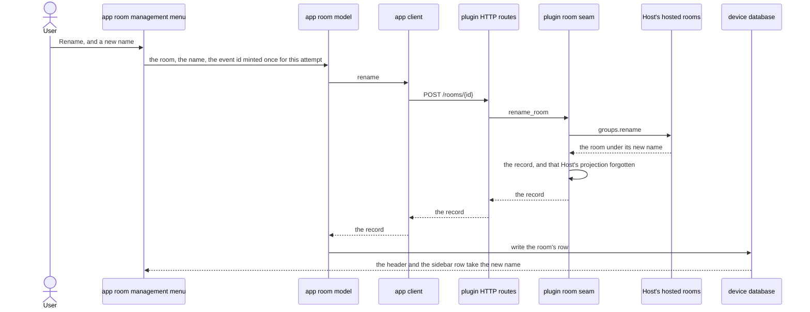
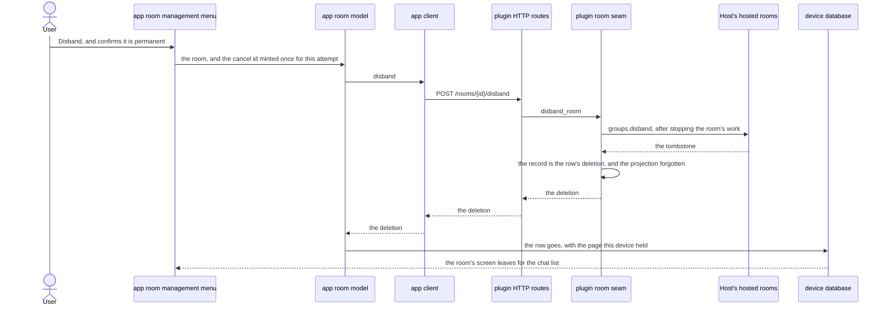
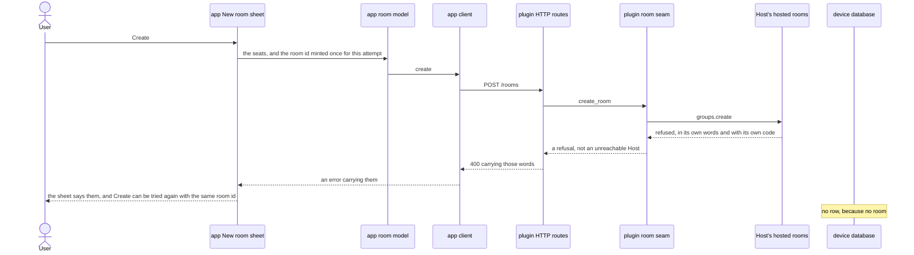

# Rooms you can start, rename and disband from the Gots app

## Goals

- **G1** Start a room from the app: a name and two to six linked bots of one Host, chosen there; the
  Host's `groups.create` is the truth; the new room can be opened and used at once.
- **G2** Rename a room from the app.
- **G3** Disband a room from the app: the Host stops the room's work then tombstones it; the row and
  the room's screen leave this device at once, and every other device through the projected deletion.

## Non-goals

- Editing a room's roster after creation.
- A room picture.
- Muting a room.
- A room's own settings page.
- Threads inside a room.
- Archiving a room instead of disbanding it.
- Seating a bot that is not linked to Gots.
- Cross-host rooms.
- Issue #939's own non-goals: triage routing, routines posting into rooms, an activity view,
  per-member compress history, a room log in the vault.

## Change map

| Layer | Status | Goals | Tested at |
|---|---|---|---|
| device database (`app/src/lib/db.ts`) | changed | G1, G3 | `app/scripts/test-rooms-list.tsx` (component) |
| sync merge (`app/src/lib/sync.ts`) | changed | G1, G2, G3 | `app/scripts/test-rooms-list.tsx` |
| app chat actions (`app/src/components/chat/chat-actions.tsx`) | changed | — | `app/scripts/test-chat-next-mount.tsx` |
| app room model (`app/src/lib/rooms.ts`) | changed | G1, G2, G3 | `app/scripts/test-room-writes.tsx` (component, new) |
| app client (`app/src/lib/hermes.ts`) | changed | G1, G2, G3 | `app/scripts/test-room-writes.tsx` |
| plugin HTTP routes (`plugin/__init__.py`) | changed | G1, G2, G3 | `plugin/tests/test_rooms.py` |
| plugin room seam (`plugin/rooms.py`) | changed | G1, G2, G3 | `plugin/tests/test_rooms.py` |
| plugin features (`info`) | affected | G1, G2, G3 | `plugin/tests/test_rooms.py` (the advertised rows) |
| Host's hosted rooms | affected | G1, G2, G3 | `plugin/tests/test_rooms.py` (the fake Host's recorded params) |
| app chat list / entry point (`app/src/components/conversation-list.tsx`) | changed | G1 | `app/scripts/test-new-room.tsx` (component, new) |
| app New room sheet | new | G1 | `app/scripts/test-new-room.tsx` |
| app room management menu (a room's own, mounted by the room screen) | new | G2, G3 | `app/scripts/test-room-actions.tsx` (component, new) |
| app room screen (`app/src/components/room/room-chat.tsx`) | changed | G2, G3 | `app/scripts/test-room-actions.tsx` |
| mock server (`app/scripts/mock-rooms.mjs`, `mock-hermes.mjs`) | changed | G1, G2, G3 | `pnpm e2e room-lifecycle` |
| e2e (`app/scripts/e2e/room-lifecycle.mjs`) | new | G1, G2, G3 | itself |
| e2e registry (`docs/e2e-flow-audit.md`) | changed | G1, G2, G3 | `pnpm test` (the registry check) |

The three lifecycle routes and `rooms_write` exist already; this plan gives them their first client,
their first record-shaped answer, and the one place each control is drawn.

## Flows

### F1: A user starts a room from the sidebar, and it opens (new). Test: "a room started from the blank screen opens on its own name and takes the first message"

The row the write writes is the row the next projection would write, so the first merge after it
changes nothing.

### F2: A user renames a room from its own menu (new). Test: "a rename is one event under the id the app minted, and the header takes the Host's name"

### F3: A user disbands a room, and the room goes (new). Test: "disband asks first, and the room's row goes as the Host's deletion"

A second device follows the same sequence from the chat-list merge onwards: the plugin projects the
disbanded room as the row's deletion and the merge takes the row away. That half exists today and is
proved by "a room the Host disbands leaves the device that merged it" (`test-rooms-list.tsx`).

### F4: A Host refuses the roster (new edge). Test: "a roster the Host refuses is said in its own words, and nothing is written"

A refused rename and a refused disband are the same sequence from the menu, proved by "a refusal keeps
the room as it was, in the Host's words" (`test-room-actions.tsx`).

## Steps

1. **Preparatory refactor: one writer of a room's row.** The merge's room branch — the row's clock, the
   deletion, the tombstone it clears — moves into the device database as the one function that writes a
   room's row, and `applyChats` calls it for every entry that is a room. Prepares: 3, 4, 5, 6.
   After: none. Layers: device database, sync merge. Check: `app/scripts/test-rooms-list.tsx` —
   "a second merge of an unchanged record writes nothing" and "a room the Host disbands leaves the
   device that merged it" — green before and after.

   Done.

2. **Preparatory refactor: the one-field rename dialog and the permanent-action confirm leave
   `ChatActions`.** `ChatActions` owns both shells welded to a chat, a profile and the usage sheet; a
   room's menu needs the same two shells and none of the chat. Reshape: the rename dialog and the
   confirm shell become components that take their own labels, field and callbacks, and `ChatActions`
   composes them as it does today. Prepares: 5, 6. After: none. Layers: app chat actions.
   Check: `app/scripts/test-chat-next-mount.tsx` — "the header's options rename a chat and delete it,
   as the current screen's do" — with `test-chat-header.tsx`, green before and after.

   Done.

3. **A lifecycle write is one call that answers the room's row.** The seam takes the roster in the
   app's spelling and hands the Host its own (`member_id`, `display_name`), and answers every write
   with the room's chat-list record — the Host's own clock, name and roster where its answer names
   them, the request's where it does not, the seam's clock only as the last resort — forgetting that
   Host's cached projection as it writes. The plugin's create, rename and disband routes answer that
   record rather than the Host's room object. The room model mints the ids (room, event, cancel),
   builds a write's intent from a name and a list of seats, and names the bot the write goes through
   (`roomAnswerer` over the roster, the app's existing rule); the client gains the three verbs and
   parses the record; the model writes it through step 1's writer. Goals: G1, G2, G3. After: 1.
   Layers: plugin HTTP routes, plugin room seam, plugin features (affected), Host's hosted rooms
   (affected), app room model, app client, device database.
   Check: `plugin/tests/test_rooms.py` — "a create reads the roster in the app's words" and "every
   write answers the room's record, not the Host's room" — red then green, with the existing create,
   rename and disband cases updated to the app's spelling; `app/scripts/test-room-writes.tsx` — "a
   create's answer is written as the room's row, and a retry is the same room" and "a write forgets
   the Host's projection" — red then green.

   Done.

4. **A room can be started from the app.** The sidebar gains a Rooms section, drawn after the chats or
   bots and ranked by its own order, whose last row is New room — the place the link-a-bot row held —
   drawn only where some bot the device holds answers `rooms_write` (ADR 0127). A room is listed in that
   section and nowhere else. It opens a blank room at `/new-room` rather than a sheet (ADR 0125): no record, no Host call, and the composer's own pill picks the seats — the Host
   when the device holds more than one writable one, the bots of that Host, two to six, and the line
   that the members cannot change later. The first send mints the room's id, creates it on the Host
   under a name derived from its seats, writes the row the Host answers, and moves the address to
   `/c/<id>`, where the room's screen sends that message as its first turn. The mock stops refusing
   creation, serves it, and refuses a roster under two or over six in the Host's own words so the
   wire's refusal is exercised.
   Goals: G1. After: 3. Layers: app chat list / entry point, app blank room, mock server, e2e,
   e2e registry.
   Check: `app/scripts/test-new-room.tsx` — "a room started from the blank screen opens on its own name
   and takes the first message", "the seats hold the room at two, and the send is refused before that"
   and "a host that cannot write offers no New room" — red then green;
   `app/scripts/test-main-navigation.tsx` — "no New chat button beside the bots" stays true, and a New
   room is drawn there — red then green; `app/scripts/e2e/sidebar-collapse.mjs`, which reads the
   footer's controls by name in both rails; and `pnpm e2e room-lifecycle`'s create leg, red on the
   mock's 405 and green after.

   Amended after 4 landed: the sheet this step described was replaced by the blank room (ADR 0125), so
   the refusal F4 covered is the create's answer held by the blank screen, not a sheet's; and the
   footer's control became the Rooms section's New room row, with the seat picker drawn as Settings
   draws a bot's row — its picture, its name and the model it answers with (ADR 0127). The e2e leg:
   `pnpm e2e room-lifecycle` — green.

   Done.

5. **A room can be renamed from its own menu.** A room's screen mounts a menu of its own — one control
   in the header's actions slot, gated on the bot that answers for the room, drawn only where that bot
   advertises `rooms_write` — holding Rename, which asks for the name in step 2's dialog with a pending
   state and says the Host's refusal where it asked. The header and the sidebar row take the new name
   when the Host answers, never before. The mock renames the room and moves its record.
   Goals: G2. After: 2, 3, 4. Layers: app room management menu, app room screen, app room model, app
   client, mock server, e2e, e2e registry.
   Check: `app/scripts/test-room-actions.tsx` — "a rename is one event under the id the app minted, and
   the header takes the Host's name", "a refusal keeps the room as it was, in the Host's words", "a host
   that cannot write draws no menu" — red then green; `pnpm e2e room-lifecycle`'s rename leg.

   The e2e leg: `pnpm e2e room-lifecycle` — green.

   Done.

6. **A room can be disbanded from its own menu, and the room goes.** The menu's second control asks
   first, saying it is permanent and that the Host stops the room's work; Disband sends the cancel id
   with the room, the row leaves this device as the Host's deletion the moment the Host answers, and
   the screen leaves for the chat list with it. A room whose row goes while it is open — a disband on
   another device, or a merge landing first — leaves to the list rather than falling to the chat
   screen's "gone" chat. The mock disbands, tombstones the room and answers it as a record's deletion.
   Goals: G3. After: 2, 3, 5. Layers: app room management menu, app room screen, app room model, app
   client, device database, sync merge, mock server, e2e, e2e registry.
   Check: `app/scripts/test-room-actions.tsx` — "disband asks first, and the room's row goes as the
   Host's deletion" and "a room open on a device leaves when its row goes" — red then green;
   `pnpm e2e room-lifecycle`'s disband leg, the row gone from the sidebar and still gone after a
   reload; `app/scripts/test-rooms-list.tsx` stays green, proving another device's row leaves by the
   projection.

   The e2e leg: `pnpm e2e room-lifecycle` — green.

   Done.

## Decisions

- **The scope is the lifecycle — create, rename, disband — and nothing else.** Made by the agent: the
  scope question put to the user went unanswered, so this is the reading this plan commits to, and the
  four questions it asked are answered here rather than left open; every breadth item became a
  non-goal.
- **A room is managed in its own header menu, not in the chat's options.** Made by the agent: the
  chat's options write a chat's title edit, its resolve state and its model, none of which a room has —
  its name is the Host's, its work is the Host's, and it runs no model of its own — so a room-only menu
  is smaller than four of five items hidden in a component every chat screen mounts.
- **Every lifecycle write goes through the bot the room's roster answers with, and that bot's
  `rooms_write` is the gate.** Made by the agent: it is the rule the app already applies to reading and
  sending in a room (ADR 0115), so "which bot does this write go through" needs no second rule; for a
  create the roster is known before the call, so its carrier is that same answer computed over the
  seats about to be seated.
- **A write answers the room's chat-list record — the entry the list projects — not the Host's room
  object.** Made by the agent: one vocabulary and one writer then serve both paths, and the app neither
  invents a clock nor re-spells a roster. Nothing reads today's answers (the app has no lifecycle
  client), so the wire is free to change.
- **Every lifecycle write forgets that Host's cached projection.** Made by the agent: the plugin keeps
  a Host's rooms for two seconds (`PROJECTION_TTL`), so a rename or a disband followed by a merge would
  land the older record over the newer one — the old name back, or the retired row back — until the
  entry expired. One line at the seam, beside the write that invalidated it.
- **The app mints the room's id, the rename's event id and the disband's cancel id, once per attempt
  intent, so a retry is the same room, the same rename and the same stop.** Made by the agent: the
  plugin refuses a create with no id and the Host is idempotent on each, which is the only thing that
  makes a retry after a dropped answer safe.
- **The app mints each seat's member id and derives its handle from the bot's profile name.** Made by
  the agent: the Host declares no handle-allocation method, so asking the user for a handle would be a
  naming policy invented in the app; a profile name is already unique on its Host, and the Host's
  refusal stays the authority on uniqueness and on the reserved words.
- **A create opens the room at once, from the record it answered.** Made by the agent: seeding from
  the Host's own record is not a guess the projection corrects — it is the row the projection would
  have written — so the room opens with its name and roster and the next merge finds nothing to change.
- **A rename writes nothing until the Host answers.** Made by the agent: a room's name is the Host's, so
  a row saying the new name before the Host had it would be this device's claim about another machine's
  room; the dialog says it is saving.
- **A disband removes the row through the same writer as the projection's deletion, and the screen
  leaves at once.** Made by the agent: the answer is already the Host's tombstone, and waiting for a
  merge would leave the user looking at a room they had just ended.
- **No local tombstone is written for a disbanded room, and none is carried back.** Made by the agent: a
  room is never carried as a chat (`localChats` skips them), so a `chat:` tombstone would push a
  deletion for a row the plugin's store never had, and the Host's own deletion is the authority on
  every other device.
- **The one place a room is started is the sidebar's footer, in both layouts.** Made by the agent: a
  room is a row of the Recents list and of the bots list alike, and the footer is the block both layouts
  share; New room on a bot's row would say a room belongs to that bot, which is what ADR 0115 decided it
  does not. The footer's create control is drawn only in the Recents branch today, so the bots layout
  gains one — the alternative, a second create control in the header beside Search, would put "start a
  thing" in two places on one screen.
- **A room's own lifecycle flow is its own e2e flow, with its own audit row.** Made by the agent: create,
  rename and disband are geometry and a live Host round-trip that no component tier can measure, and
  folding them into `rooms` would not say which part broke. `room-lifecycle` runs all three against the
  test host and proves the row a reload finds is gone.
- **The intents, the ids and the gate live beside the room model, in `room-writes.ts`.** Made by the
  agent, correcting the plan's first answer (that they live in `rooms.ts`): the node tier loads the room
  model through `chat-owner.ts` with no bundler's aliases, so a model importing the client cannot be
  read there — `test-chat-owner.mjs` failed the moment it did. The model keeps what a room is (the
  answerer, the members line, the pictures, the seats), and the module beside it keeps what a room does.

## Risks

- The scope reading is the agent's, because the gate went unanswered. If "manage" was meant to include
  pinning, muting or archiving, those are non-goals here and the plan grows by their steps rather than
  changing shape.
- A Host whose `groups.create` answer names no clock or no roster leaves the record's `at` to the seam's
  clock and its roster to the request until the next projection corrects it: the room is right, its
  row's time may be the plugin's rather than the Host's for one merge.
- A derived handle that collides with a reserved word (`all`, `everyone`) or with the Host's own rule
  can only be refused, not fixed in the sheet: the sheet says the Host's words and the user has to
  change the profile's name to get past it.
- The footer changes shape: `app/scripts/e2e/sidebar-collapse.mjs` reads a fixed list of footer controls
  by name in both rails, `app/scripts/test-main-navigation.tsx` asserts no New chat button beside the
  bots — still true, but now read next to a New room — and `app/scripts/e2e/bot-threads.mjs` and
  `screens.mjs` read the sidebar's frames, so all four move with this step.
- A room created on one device reaches another only through the projection: up to the plugin's two
  seconds of cached answer plus the next sync pass, not at once.
- The gate is an answer the app may not have yet: a Host briefly away answers nothing about its
  features, so the menu and the New room control are absent rather than refused — the settled rule, but
  it reads as a missing control for a moment.
- A rename on a slow Host keeps the old name on screen until the answer lands, because nothing is
  written optimistically.
- A chat-list merge already in flight when a write lands can carry the room's older record and put the
  old name — or, for a disband, the row — back for one merge; the next merge, reading an uncached Host,
  puts it right.
- "The roster cannot change later" is a promise the app makes on the Host's behalf: if the Host ever
  grows a roster method, that sentence is wrong and nothing here would notice.

## Not now

- Editing a room's roster after creation, because the Host declares no roster method; the sheet says so
  where the members are chosen.
- A room picture, muting, a room's settings page, threads in a room, archiving instead of disbanding,
  seating an unlinked bot, cross-host rooms — declined breadth.
- #939's non-goals: triage routing, routines posting into rooms, an activity view, per-member compress
  history, a room log in the vault.
- Managing a room from its sidebar row (a long-press menu): one place a room is managed.
- An optimistic rename, which may come back if the Host's round trip reads as slow in practice.
- Undoing a disband: the Host's tombstone is final.
- Reading the Host's whole profile list to seat a member this device holds no bot for: it would seat a
  member nothing here can reach or draw a picture for.
