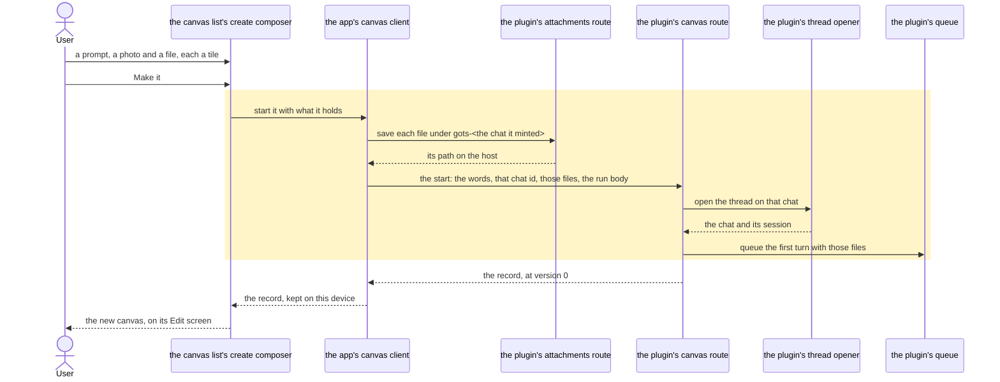
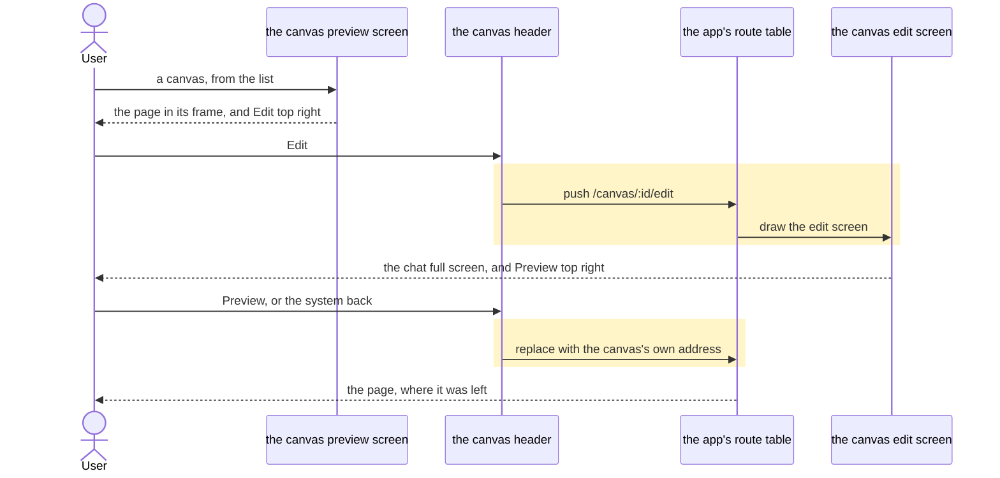
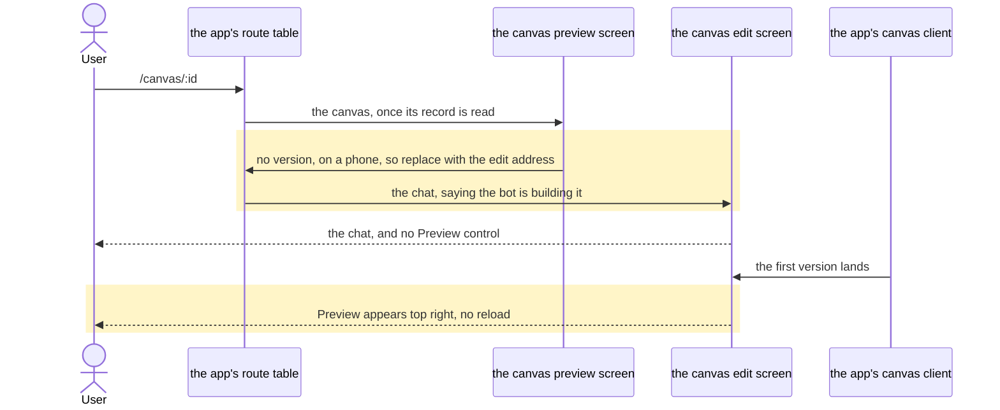

# A canvas is a page you look at and a chat you build it in, each with its own address

## Goals
- **G1** The phone's edit chat is a full-screen page, not a bottom drawer.
- **G2** A canvas with no version yet opens on Edit; from the first version on, one control in the header flips between Preview and Edit.
- **G3** A canvas that already has a version opens on Preview, with Edit in the header.
- **G4** A canvas can be started with a photo, a camera shot or a file attached to its prompt.
- **G5** The flip is one control, named for the screen it goes to, a 44px target, labelled for a screen reader.
- **G6** Edit is its own address: back from Edit returns to Preview, and a reload or a deep link lands on the same screen.
- **G7** Nothing to preview is said honestly: while the canvas has no version the Edit screen says the bot is building it, and the Preview control appears the moment the first version lands, with no reload.
- **G8** Starting a canvas with files follows the composer's existing intake: the same count and size caps, the same inline-or-host road, the same refusal sentences, and tiles the user can remove before sending.
- **G9** A file the bot must open with its own tools is saved on the host as part of starting the canvas, so the first queued turn already carries it.
- **G10** Desktop keeps today's page-beside-chat lane on the preview route — the full-screen Edit page is the phone's.
- **G11** Component tests cover both defaults, the flip, back, and starting a canvas with an attachment; typecheck and lint pass.

## Non-goals
- An Edit entry straight from the canvas list.
- A canvas's chat opened from elsewhere landing on the Edit page.
- The canvas tile drawing the picture the canvas was started from.
- A full-screen Edit page on desktop.
- Any redesign of the preview frame, the bridge, the consent dialog or the canvas's data.

## Change map
| Layer | Status | Goals | Tested at |
|---|---|---|---|
| the canvas preview screen (`CanvasView`, `routes/canvas.tsx`) | changed | G1, G3, G5, G6, G10 | `app/scripts/test-canvas-screen.tsx` |
| the canvas edit screen (new `CanvasEdit`) | new | G1, G2, G5, G6, G7 | `app/scripts/test-canvas-screen.tsx` |
| the canvas header (one row, drawn by both screens) | new | G3, G5, G6, G7, G10 | `app/scripts/test-canvas-screen.tsx` |
| the canvas's chat surface (the chat record, its providers, `ChatBody`, the settled-turn re-read) | new | G1, G3, G10 | `app/scripts/test-canvas-screen.tsx` |
| the app's route table (`App.tsx`) | changed | G6 | `app/scripts/test-canvas-screen.tsx` |
| the canvas list's create composer (`CanvasPage`) | changed | G4, G8 | `app/scripts/test-canvas-create.tsx` |
| the app's canvas client (`startCanvas`) | changed | G4, G9 | `app/scripts/test-canvas-create.tsx` |
| the app's plugin client (`createCanvas`) | changed | G9 | `app/scripts/test-canvas-create.tsx` |
| the plugin's canvas route (`create_canvas`) | changed | G9 | `plugin/tests/test_canvases.py` |
| the plugin's canvas record (`canvases.create`) | changed | G9 | `plugin/tests/test_canvases.py` |
| the plugin's thread opener (`triage.open_thread`) | changed | G9 | `plugin/tests/test_canvases.py` |
| the plugin's attachments route (`upload_attachment`) | affected | G8, G9 | `app/scripts/test-canvas-create.tsx` |
| the composer's intake (`AttachMenu`, `prepareIntake`, `AttachmentTile`) | affected | G4, G8 | `app/scripts/test-composer-intake.tsx` |
| the phone's browser flow (`app/scripts/e2e/canvas.mjs`) | affected | G1, G11 | `pnpm e2e canvas` |
| the repo's own notes (`AGENTS.md`) | affected | G11 | none — a row describing the screens |

## Flows

### F1: a reader starts a canvas from a prompt, a photo and a file (new). Test: "a canvas start saves its files under its own session and hands them to the host"

### F2: a reader flips between Preview and Edit on a phone (new). Test: "a phone's canvas opens on Preview and Edit is an address with a way back"

### F3: a reader opens a canvas the bot is still building (changed). Test: "a canvas with no version opens on Edit and gains Preview when the first version lands"

## Steps
1. **Preparatory refactor: the canvas's header and its chat are each one piece.** The header row `CanvasView` draws today — back, title and subline, Undo, the menu, and the slot the flip will take — becomes one component, and the chat it draws — the record, `CanvasPointsProvider`, `PreviewerProvider`, `useChatSurface`, `ChatBody` and the settled-turn `refreshCanvas` — becomes another. The preview mounts both exactly as it does today, phone pill and sheet included: this step moves shape, not behaviour. Prepares: 3. After: none. Layers: the canvas preview screen, the canvas header, the canvas's chat surface. Check: `test-canvas-screen.tsx` — the frame's sandbox, Undo, the lane at 1200px and the back-button tests — green before and after. Done.
2. **The host starts a canvas on the chat it is handed, with the files already saved for it.** The create route takes a `chat_id` and the file records the caller saved; `triage.open_thread` accepts that chat id instead of minting one, deriving the session from it as it does today; `canvases.create` opens the canvas on it and queues the first turn with those files instead of today's empty list. A caller that names neither keeps today's behaviour. The prompt stays the human words, so the canvas is still titled by them; the markers ride only in the run body. Goals: G9. After: none. Layers: the plugin's canvas route, the plugin's canvas record, the plugin's thread opener. Check: `plugin/tests/test_canvases.py` — a create naming a chat and two file records answers a canvas whose chat is that id and whose title is the prompt's own words, whose queued first turn lists both files, and whose run body is the caller's; a create naming neither still mints its own chat and queues no files. Red before, green after. Done.
3. **The phone's edit chat is a page of its own.** `canvas/:id/edit` is registered beside `canvas/:id` and draws the header and the chat surface full screen; the preview keeps its frame and options, loses the pill and the sheet, and its header gains the corner control naming Edit, while the edit screen's names Preview. Both screens set their own back guard — the edit screen's returns to the canvas's address, the preview's to the list — so the hardware back lands where the corner control goes. On a wide screen the edit address replaces itself with the canvas's own address, which already draws the lane, and no corner control is drawn there. The reader's scroll position survives the flip. Goals: G1, G3, G5, G6, G10. After: 1. Layers: the app's route table, the canvas preview screen, the canvas edit screen, the canvas header, the canvas's chat surface. Check: `test-canvas-screen.tsx` — "a phone's canvas opens on Preview and Edit is an address with a way back", at 390px and at 1440px: a canvas with a version opens on the frame, the corner's Edit pushes the edit address, that address draws the chat with no frame and its corner pushes back, the system back from either screen returns to the other, and the wide screen keeps its lane at either address. Red before, green after. Done.
4. **A canvas opens on the screen its version earns.** A canvas with no version, on a phone, replaces its own address with the edit one — a replace, never a push, so back cannot ping-pong — and the edit screen says the bot is building it in the tile's own words. The corner's Preview is drawn from the version, so it is absent until the first version lands and appears from the same live record the frame is drawn from. Goals: G2, G3, G7. After: 3. Layers: the canvas preview screen, the canvas edit screen, the canvas header. Check: `test-canvas-screen.tsx` — "a canvas with no version opens on Edit and gains Preview when the first version lands": at version 0 the address becomes the edit one with the building sentence and no Preview control; a version landing through the live change draws the control with no reload; the wide screen stays on its lane. Red before, green after. Done.
5. **A canvas can be started with a photo, a camera shot or a file.** The create composer takes the composer's own `AttachMenu` and stages what it takes through `prepareIntake`, `pickRoad`'s refusals and `AttachmentTile`, each tile removable before the press. The press mints one chat id, derives the session from it (`gots-<chat id>`, the pair the host itself uses), saves each file under it with the route that already exists, builds the run body's content with `wireContent` — a marker naming each host path, a photo inline too — and leaves the prompt the words alone. It hands the chat id and the saved file records to the create call and, only once the host has answered by its own record, opens the canvas's own address — which then decides which screen a canvas opens on; a refusal leaves the tiles where they are. Goals: G4, G8, G9, G11. After: 2, 3. Layers: the canvas list's create composer, the app's canvas client, the app's plugin client, the plugin's attachments route. Check: `test-canvas-create.tsx` — "a canvas start saves its files under its own session and hands them to the host": a photo and a file are staged as two tiles, one is taken off, and the press saves only what is left under the one session its chat names, then posts a create whose prompt is the bare words, whose chat id is that session's, whose files carry the host's paths and whose run body holds the marker; red before, green after. Then `pnpm --dir app typecheck`, `pnpm --dir app lint`, `pnpm --dir app test:component`, `pnpm --dir app test:unit` and `pytest plugin/tests/test_canvases.py`. Done.

6. **The phone's own browser flow walks the two screens.** The canvas flow in `app/scripts/e2e/canvas.mjs` still clicks the Edit pill and drives a half-height sheet, a control this change deleted; it becomes the flow the two screens deserve — a canvas made from the prompt lands on its edit screen saying the bot is building it, Preview appears with the first version and draws the frame, a box ticked on the page is kept by the host, an edit sent from the edit screen lands as a new version, Preview is where Undo is pressed, and a page that leaves is refused and drawn again. Pointing is not part of it: the round trip step 7 adds is two addresses and a chip, which the component tier holds (`test-canvas-screen.tsx`), and nothing about it needs a browser. The `src/routes/canvas.tsx` row in `AGENTS.md` follows, since it still describes the pill and the sheet. Goals: G1, G11. After: 5. Layers: the phone's browser flow, the repo's own notes. Check: `pnpm e2e canvas` — red before (it fails on `[data-canvas-edit-pill]`, which no longer exists), green after (its own passes name each screen it walked). Done.

7. **A phone can point at the page from its chat.** The edit screen's `+` sends the reader to the canvas with pointing armed and a line saying so; one tap on an element returns them to the chat with that element as a chip above the field, which the next message carries and whose cross removes it. The element rides a hand-over taken once, so a point the reader removed cannot come back, and a canvas with no page offers no Point row at all. Goals: G1, G6. After: 3, 4. Layers: the canvas preview screen, the canvas edit screen, the canvas's chat surface, the composer's point chips. Check: `test-canvas-screen.tsx` — the `+` sheet's Point row replaces the address with the canvas's own plus `?point=1`; the page opened that way says `Tap an element on the page` and its Cancel returns to the chat; a point from its own frame replaces the address with the edit one and draws the chip; the chip's cross clears it; a canvas with no version has no Point row. Red before, green after. Done.

## Decisions
- **Desktop keeps the side-by-side chat lane; the full-screen Edit page is the phone's.** Made by the user (Q1), because the request named only the bottom drawer.
- **The two screens are two routes, not one screen with a mode.** Made by the agent, because G6 asks for an address each, and the app's rule is a route per screen rather than a second navigation model beside the router's.
- **The version-0 default is a replace.** Made by the agent, because a pushed default would leave the page behind it, and back would be sent to Edit again.
- **The prompt and the run body are two different strings.** Made by the agent, because the host titles a canvas and its chat from the prompt, so a marker line in it would become the canvas's name; the markers ride only in the body.
- **The app mints the canvas's chat id and derives its session, saving the files before the create call.** Made by the agent, because the host names a canvas's session after its chat, so only the caller can save a file under the session the first turn will name; carrying the bytes in one request would cap a start's files at the plugin's 10 MB, well under the 9 MB a chat's file is allowed.
- **The marker line stays written by the app.** Made by the agent, because `lib/attachment-text.ts` is its only writer today, and a second writer in Python would be a format with two homes.
- **The create composer wires the intake's own pieces rather than a shared staging component.** Made by the agent, because the create screen sends nothing a chat sends (no steer, no queue, no draft), and the policy that must not drift — the caps, the roads, the refusal sentences — already lives in shared modules.
- **The app navigates by the record the host answers, not by the chat id it minted.** Made by the agent, because a plugin older than this change mints its own chat id, and the canvas that opens must be the one the host holds.
- **Both screens set their own back guard.** Made by the agent, because the guard is per screen today and a hardware back from Edit would otherwise leave the canvas for the list.
- **Pointing from the edit screen is a round trip through the page.** Made by the agent at the user's request, because a point is a tap on a page and a phone cannot draw the page and the chat at once: the row sends the reader to the preview armed, and the tap returns them to the edit screen with the element as a chip they can remove or send with.
- **The flip replaces the edit entry, so back cannot stack.** Made by the agent, because Preview and Edit are one canvas's two screens rather than two places: a push either way would leave the screen behind it for the next back press to land on, so back would flip between them instead of leaving the canvas.
- **The create opens the canvas's own address, so one screen decides what the reader sees.** Made by the agent, because the rule that a canvas with no version opens on Edit is the preview's (G2), and a composer that sent a phone straight to the chat would be a second owner of it; the desktop lands on the same address and takes its lane from the same rule.
- **The edit screen carries the preview's options menu.** Made by the agent, because on a phone a canvas with no version opens on Edit and has no preview to reach, so that menu is the only place it can be renamed, pinned, archived or deleted at all.
- **The create screen holds the composer's ten-file cap.** Made by the agent, because a start's files are one message's files — the same intake, the same ten, the same refusals — and a second number on this screen would be a cap that drifts from the composer's.

## Risks
- Pointing from the edit screen costs a trip through the page, and the frame is drawn again on the way back: a form half-typed inside the page does not survive it.
- Flipping to Edit unmounts the frame, so anything the canvas kept only inside its own page (a half-typed field, not its data on the host) is gone when the reader returns; the version and the scroll position are what return.
- A start refused after its files were saved leaves them under a session no canvas names: there is no delete route, and nothing sweeps a session that never existed.
- A plugin older than this change ignores the chat id and the files: the canvas still opens (by the host's own chat), and the markers' paths still resolve, but the queued turn carries no file tiles.
- The phone's header now carries back, the title, Undo, the flip and the menu, which crowds a 320px screen.
- A reader holding the address of a canvas that never got a version now lands on its chat rather than its page.

## Not now
- An Edit entry straight from the canvas list, from the user's declined breadth.
- A canvas's chat opened from elsewhere landing on the Edit page, from the same list.
- The canvas tile drawing the picture the canvas was started from, from the same list.
- A full-screen Edit page on desktop, from the same list.
- Pasting or dropping a file onto the create field: only the `+` menu's three sources are asked for.
- A host-side sweep for a refused start's saved files: the risk is accepted instead.
