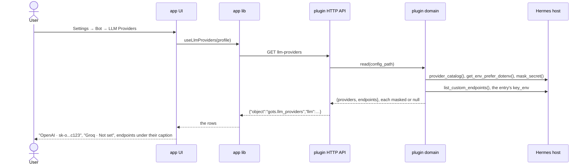
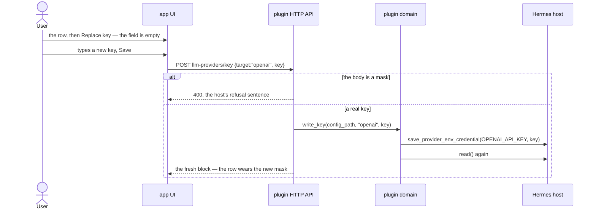
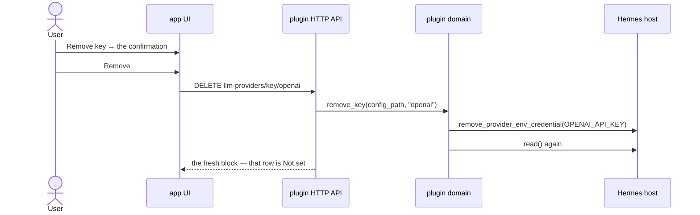
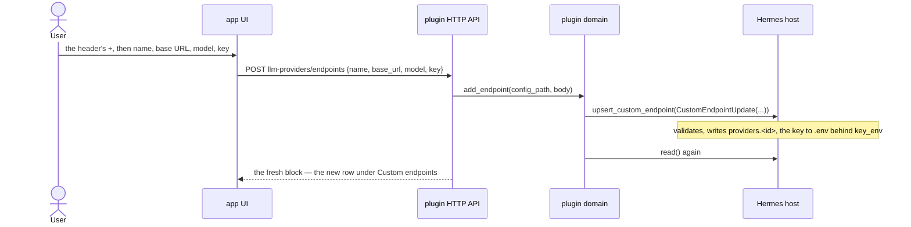

# LLM Providers: a bot's provider keys, never leaving the host

Settings → Bot gains **LLM Providers**: one row per API-key provider this bot's Hermes knows, showing
its key as its first 4 and last 4 characters or *Not set*; one row per custom OpenAI-compatible
endpoint with its name, base URL and key masked the same way. A key can be replaced, a provider's key
removed after a confirmation, and an endpoint added, replaced or removed — the last of those refused
while the bot's model runs on it.

The full key never leaves the host: the plugin sends `mask_secret`'s own output, and a body whose key
*is* a mask is refused as a write.

## Goals

- **G1** The page lists the host's API-key providers, one row each, saying which provider it is and
  either that no key is set or the key as its first 4 and last 4 characters with the middle elided.
- **G2** A provider's key can be replaced from the page; the old one is gone everywhere it was readable.
- **G3** A provider's key can be removed after a confirmation; the row then reads not set.
- **G4** Custom endpoints appear on the page with their name, base URL and masked key; their key can
  be replaced; an endpoint can be removed — deleting the endpoint and its key — and that removal is
  refused, with a sentence saying to switch the model first, while the bot's model runs on it.
- **G5** A custom endpoint can be added from the page with a form: name, base URL, model, key.

## Non-goals

- A "test this key" probe before saving.
- OAuth / subscription-account providers (the catalog's `accounts` tab). API keys only.
- Several keys for one provider — Hermes's credential-pool rotation entries. One slot per provider.
- Showing which provider the bot's current model runs on, or any "use this one" mark.
- Revealing, copying or downloading a full key anywhere in the app. Ever.
- Editing an endpoint's base URL or model after it is created.

## Change map

| Layer | Status | Goals | Tested at |
|---|---|---|---|
| `app` UI — `bot-tabs.ts`, `bot-settings.tsx` (the page's entry, its icon, its gate, its branch) | changed | G1–G5 | `app/scripts/test-bot-settings-list.tsx` |
| `app` UI — `components/bot-llm-providers-tab.tsx` (the page, a slot's screen, the key form, the confirmations) | new | G1–G5 | `app/scripts/test-bot-llm-providers.tsx` |
| `app` UI — `bot-subs.ts` (a page that holds items names its own test) | changed | G1–G4 | `app/scripts/test-bot-subs.tsx` |
| `app` lib — `lib/llm-providers.ts` (the block's types, a row's words, what a key form will submit) | new | G1–G5 | `app/scripts/test-llm-providers.mjs` |
| `app` lib — `lib/hermes.ts` (the five calls) | changed | G1–G5 | `app/scripts/test-bot-llm-providers.tsx` |
| plugin HTTP API — `__init__.py` (five routes, `llm_providers` in `info`) | changed | G1–G5 | `plugin/tests/test_llm_providers.py` |
| plugin domain — `llm_providers.py` (the read, the two key verbs, the two endpoint verbs, the refusal) | new | G1–G5 | `plugin/tests/test_llm_providers.py` |
| plugin domain — `credentials.py` (one credential read: presence and mask), `speech.py` importing it | new | — (step 2) | `plugin/tests/test_speech.py` |
| plugin release — `plugin.yaml`, `dashboard/manifest.json` | changed | — | `plugin/tests/test_plugin_versions.py` |
| mock host — `app/scripts/mock-hermes.mjs` (the five routes, faked) | changed | G1–G5 | the same paths `test-bot-llm-providers.tsx` fakes |
| Hermes host import — `provider_catalog`, `credential_lifecycle`, `config`/`OPTIONAL_ENV_VARS`, `agent.redact`, `web_routers.config_env` + `web_models` | affected | G1–G5 | `plugin/tests/test_llm_providers.py` (host modules planted) |

### The surface

**Five routes.** A key is one resource with one address, whatever kind of row owns it: a provider's
catalog slug, or an endpoint's `custom:<id>`.

```
GET    llm-providers                    the whole block
POST   llm-providers/key      {target, key}
DELETE llm-providers/key/{target}
POST   llm-providers/endpoints {name, base_url, model, key}
DELETE llm-providers/endpoints/{id}     409 endpoint_in_use when the model runs on it
```

One read answers both lists, and every write answers that same fresh block, so the page has one
loading state, one refusal banner and no cache:

```json
{ "object": "gots.llm_providers",
  "llm": {
    "providers": [
      { "slug": "openai", "label": "OpenAI", "description": "…", "masked": "sk-o...c123" },
      { "slug": "groq",   "label": "Groq",   "description": "…", "masked": null } ],
    "endpoints": [
      { "id": "local-llama", "name": "Local Llama", "base_url": "http://127.0.0.1:8080/v1",
        "model": "llama-3.1-8b", "masked": "llam...0a1f" } ] } }
```

- `providers` is `provider_catalog()` filtered to `tab == "keys"` with a non-empty
  `api_key_env_vars`; the slot is `api_key_env_vars[0]`, and a catalog entry with no key env var is
  no row (a slot that can never leave *Not set* is a control that writes nothing). The catalog is
  read, never restated.
- **Presence is the mask.** There is no `key_set` boolean: a row's value is the mask string or
  `null`. Two facts about one credential can disagree; one cannot.
- `masked` is `agent.redact.mask_secret(value)` and nothing else — head 4, tail 4, and `***` for
  anything under its 12-character floor. The app renders the string it was handed and never derives
  one. `mask_secret`, not `redact_key`, whose empty case is the display string `"(not set)"`.
- `endpoints` is `list_custom_endpoints()`'s rows — the host's own list, legacy `custom_providers`
  entries and a bare `provider: custom` slot included — with each row's mask read from the value its
  `key_env` names, else from a plaintext `api_key` its entry still carries. The list's own
  `api_key_preview` is `"${KEY_ENV}"` for a key-env entry, so it is never the mask.
- A host whose modules don't import advertises no `llm_providers`, so the page is absent rather than
  empty; the routes answer 501 if called anyway.

**Writes.**

- A provider's key: `save_provider_env_credential(env_var, key)` / `remove_provider_env_credential(env_var)`.
  Not `save_env_value`: the lifecycle reconciles the `config.yaml` mirrors, the env-seeded
  `credential_pool` entries and the provider's model-cache rows that would otherwise keep
  authenticating with the rotated key.
- An endpoint: the host's own `upsert_custom_endpoint(CustomEndpointUpdate(…))` and
  `delete_custom_endpoint(id)` — module-level functions, lazy-imported inside the handler. The
  plugin composes no `providers.<id>` of its own: that writer already validates, merges onto an
  existing entry, converts a legacy row, puts the key in `.env` behind `key_env` and clears a
  plaintext `api_key` on the same write.
- A key replace on an endpoint sends only the typed key. The plugin fills `name`, `base_url` and
  `model` from the host's own list, so the app can never rewrite a field it does not own.
- A body whose `key` is a mask — `***`, a `xxxx...xxxx` shape, a `«redacted…»` sentinel — is refused
  (400) on the host's own `is_redacted_credential_preview` rule. A stale build or a `curl` can call
  these routes as easily as the page can.
- Removing an endpoint asks `list_custom_endpoints()` first: a row with `is_current` answers 409
  `endpoint_in_use` with the sentence naming the endpoint, and nothing is written. Deleting first and
  letting the host detach the main-model mirror would silently unpick the bot's model.

**Screens.** The page is a `Screen` of two `Group`s under two `Caption`s — *Providers* and *Custom
endpoints* — with a `+` in the header for the add form. A row is a `ValueRow`: its label, and its
mask or `Not set` (which `ValueRow` already draws for an empty value). Every row opens a slot screen
(a `detail` sub-screen, per ADR 0055): the mask, *Replace key*, and either *Remove key* or, for an
endpoint, its base URL and model as muted rows and *Remove endpoint*. The key form starts empty and
its Save is dead until it holds something that is not a mask, so a mask can never be submitted.

## Flows

### F1: the page reads both lists (new). Test: "a provider with a key shows its first and last four, one without shows Not set"



### F2: a provider's key is replaced (new). Test: "replacing posts the typed key and the row reads the new mask"



An endpoint's key replace is this sequence with `target: "custom:<id>"` and the host's
`upsert_custom_endpoint` in place of the lifecycle; it is not drawn again.

### F3: a provider's key is removed (new). Test: "Remove asks first, and the row reads Not set"



### F4: an endpoint is added (new). Test: "the plus opens a form and the endpoint lands as a row"



### F5: removing an endpoint, and the one refusal (new). Test: "removing the endpoint the model runs on is refused and deletes nothing"

```mermaid
sequenceDiagram
  actor User
  participant UI as app UI
  participant API as plugin HTTP API
  participant Domain as plugin domain
  participant Host as Hermes host
  User->>UI: Remove endpoint → the confirmation → Remove
  UI->>API: DELETE llm-providers/endpoints/local-llama
  API->>Domain: remove_endpoint(config_path, "local-llama")
  Domain->>Host: list_custom_endpoints()
  alt the row is is_current
    API-->>UI: 409 endpoint_in_use, "This bot's model runs on Local Llama. Switch the model first."
    Note over UI: the sentence stays on the screen; the row is still there
  else any other endpoint
    Domain->>Host: delete_custom_endpoint(id)
    API-->>UI: the fresh block — the row is gone
  end
```

### F6: a plugin too old for this page (new)

It is the sequence every gated page already has — `info` advertises no `llm_providers`, so the card
draws no row and an address into the page lands on the bot's own page — so it is not drawn again. Its
test is step 4's "an older plugin draws no LLM Providers row", beside the existing GATED loop in
`test-bot-settings-list.tsx`.

## Steps

1. **Preparatory refactor (app): a page's icon and its gate live in one table.** `PAGE_ICONS` and
   `PAGE_FEATURES` become one exhaustive `PAGE_META: Record<BotTab, {icon, feature?}>`, so a page
   cannot gain an icon without a gate, or a gate without an icon. Prepares: 4. After: none.
   Layers: `app` UI. Check: `pnpm test` over `test-bot-settings-list.tsx`, `test-bot-pane.tsx`,
   `test-bot-rows.tsx` — green before and after, no test edited.

   Done.

2. **Preparatory refactor (plugin): one credential read.** `plugin/credentials.py` holds `KEY_ENV`,
   `env_lookup()`, `present(name)` and `masked(name)`; `speech.py` imports `present` and its `stt`
   payload keeps `key_set` and gains nothing. Prepares: 4–9. After: none. Layers: plugin domain.
   Check: `python3 -m unittest plugin.tests.test_speech` — green before and after.

   Done.

3. **Preparatory refactor (app): a page that holds items names its own test.** `botSubOf`'s
   `holds: "items"` branch stops calling Speech-to-text's `providerHasPage` for every page and takes
   the test from the page's own entry, so a second page can hold items. Prepares: 4. After: none.
   Layers: `app` UI — sub-screens. Check: `pnpm test` over `test-bot-subs.tsx` — green before and
   after, including "a name the page doesn't hold names nothing".

   Done.

4. **The page lists providers, and a key never leaves the host.** `plugin/llm_providers.py` with
   `read()`, its `FEATURES` gate and the one `GET` route (its `endpoints` list is empty until step 7);
   `info` advertises `llm_providers`; `plugin.yaml` and `dashboard/manifest.json` go to `0.115.0`;
   `lib/llm-providers.ts` and `lib/hermes.ts` read the block; the page draws the providers card; the
   mock serves the route. Goals: G1. After: 1, 2, 3. Layers: plugin domain, plugin HTTP API, plugin
   release, mock host, `app` lib, `app` UI. Check: `plugin/tests/test_llm_providers.py` — "read masks
   and never sends a key" (the planted value is absent from the serialized payload; eleven characters
   mask as `***`) — and `test-bot-llm-providers.tsx` — "a provider with a key shows its first and
   last four, one without shows Not set" and "an older plugin draws no LLM Providers row".
5. **A provider's key is replaced.** `write_key` refuses a mask shape, routes the write through
   `save_provider_env_credential` and answers the fresh block; the slot screen's Replace form starts
   empty and its Save is dead until the field holds a non-mask. Goals: G2. After: 4. Layers: plugin
   domain, plugin HTTP API, mock host, `app` lib, `app` UI. Check: `test_llm_providers.py` — "a
   submitted preview is refused and nothing is written" — and "replacing posts the typed key and the
   row reads the new mask", whose faked boundary asserts the body holds the typed key and never the
   mask that was on screen.
6. **A provider's key is removed.** `remove_key` goes through `remove_provider_env_credential` and
   answers the block; the slot screen asks first with `ConfirmDestructive`. Goals: G3. After: 4.
   Layers: plugin domain, plugin HTTP API, mock host, `app` lib, `app` UI. Check:
   `test_llm_providers.py` — "a removal asks the lifecycle, not `remove_env_value`" — and "Remove asks
   first, and the row reads Not set", where Cancel writes nothing.
7. **Custom endpoints appear, and their key can be replaced.** The read learns
   `list_custom_endpoints()` and each row's mask; the page gains the second caption and its rows; the
   slot screen draws Base URL and Model muted; `write_key` resolves `custom:<id>` to the host's
   `upsert_custom_endpoint` with the stored name, base URL and model and the typed key. Goals: G4.
   After: 4, 5. Layers: plugin domain, plugin HTTP API, mock host, `app` lib, `app` UI. Check:
   `test_llm_providers.py` — "an endpoint's key lands in its own env var and the config keeps
   `key_env`", and a legacy plaintext `api_key` is gone from the entry after the write — and "an
   endpoint row shows its base URL and its key masked, and its key can be replaced".
8. **An endpoint can be added.** `POST llm-providers/endpoints` calls the host's own upsert with the
   four fields; the host's refusal (a missing base URL or model, a duplicate id) is shown in its
   words. The page's `+` opens the form as a sub-screen. Goals: G5. After: 7. Layers: plugin domain,
   plugin HTTP API, mock host, `app` lib, `app` UI. Check: `test_llm_providers.py` — "an added
   endpoint lands in providers.<id> with its key in .env" and "a missing base URL writes nothing" —
   and "the plus opens a form and the endpoint lands as a row".
9. **An endpoint can be removed, refused while it runs the model.** `remove_endpoint` answers 409
   `endpoint_in_use` when the list says the row is current, else calls the host's delete; the page
   shows the host's sentence in place and keeps the row. An ADR records why a credential is a page
   here rather than a row of General's. Goals: G4. After: 7. Layers: plugin domain, plugin HTTP API,
   mock host, `app` lib, `app` UI, docs. Check: `test_llm_providers.py` — "removing the endpoint the
   model runs on raises and deletes nothing" and "another endpoint is deleted" — and "removing the
   endpoint the model runs on is refused and deletes nothing"; then `python3 -m unittest
   plugin.tests.test_plugin_versions` — green.

## Decisions

- **The mask is made on the host; a mask is never a write; replace and remove go through the
  credential lifecycle; the list is the host's catalog; an unset key is listed and can be set; remove
  asks first; no key reaches a log or a toast; the page is gated so an older plugin keeps today's
  page.** Made by the user (Q1), because a mask a client builds is a mask a client can unbuild, and
  `.env` alone leaves mirrors authenticating with the old key.
- **On a custom endpoint, Remove deletes the endpoint and its key, and is refused while the bot's
  model runs on it.** Made by the user (Q2), because switching a model is a model-picking decision.
- **A custom endpoint can be added with a name, base URL and model.** Made by the user (Q3).
- **One key route pair with a `custom:<id>` target, rather than a route per kind of row.** Made by
  the agent: replace and remove are the same two verbs over two stores, and the plugin resolves the
  target, so the app never learns which store a row lives in.
- **The plugin calls Hermes's own `upsert_custom_endpoint` / `delete_custom_endpoint`; it composes
  no `providers.<id>` of its own.** Made by the agent: they are module-level functions of the host's
  own config router, and the alternative — copying the entry's shape into the plugin — is a second
  writer of a shape the Dashboard, `hermes model` and the runtime all read. The import is lazy (so a
  process without FastAPI never touches it) and the feature is gated on it, so a Hermes that renames
  them loses the page rather than breaking.
- **Presence is the mask; there is no `key_set` field.** Made by the agent: Replace needs the mask
  anyway, and two facts about one credential can disagree.
- **No `is_current` field on the wire and no "in use" mark.** Made by the agent: the mark is a
  non-goal and would go stale; the refusal at the write is the same fact, checked when it matters.
- **`PAGE_META` for icons and gates, and the render chain stays a chain of early returns.** Made by
  the agent: merging the two tables removes the way a page ends up half-registered; merging the
  render chain would change General's keyed conditions for no requirement.
- **No shared route ladder with `general.py`/`speech.py`.** Made by the agent: those closures serve
  one dotted `config.yaml` key and keep exactly as they are; this module's five routes have their own
  body rules and their own two helpers.
- **`MIN_PLUGIN_VERSION` does not rise.** Made by the agent: the page degrades cleanly to today's.

## Risks

- **A provider whose key lives only in a `config.yaml` mirror reads Not set** even though it
  authenticates — the presence read is `get_env_prefer_dotenv`, the same read Speech-to-text makes.
  Replacing the key here heals it.
- **Removing the key the bot's model runs on leaves the bot unable to answer.** No guard is asked
  for, and the page cannot mark the provider without the non-goal. The confirmation names the
  provider, not the consequence.
- **A key shorter than 12 characters masks as `***`**, so two short keys look alike. That is
  `mask_secret`'s floor, and the reason Replace — never the mask — is how a key is compared.
- **Importing the host's config router ties the plugin to three function signatures.** They are
  lazy-imported and gated; a rename costs the page, not the plugin.
- **The endpoint's mask is a second read** (`key_env` → the value), because the host's list reports
  `"${KEY_ENV}"` rather than a mask. A row whose key env is named but unset reads Not set, which is
  the truth.
- **The mock is a hand-written second copy of the payload**, kept minimal (two providers, one
  endpoint) and is not a test tier.
- **Adding an endpoint records Hermes's provider-setup metric**, because the host's own writer does.

## Not now

- A "test this key" probe, from the non-goals; Hermes's `/api/providers/custom-endpoints/validate`
  is the host half a later plan could borrow for endpoints only.
- OAuth and subscription accounts, several keys per provider, a "current provider" mark, revealing or
  copying a key, and editing an endpoint's base URL or model — all from the non-goals.
- An endpoint's `api_mode`, `context_length`, discovered `models` catalogue and `make_default`; the
  form writes the four fields the user asked for, and the rest is the Dashboard's.
- Promoting a legacy `custom_providers` row on read: that happens on its first write, which is the
  host writer's own rule.
- Folding `speech.py`'s presence read onto a mask: the transcription page must never hold a value.
