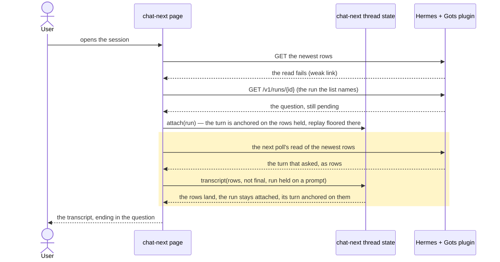

# A code session opened on a waiting question shows the turn that asked it

## Goals

- **G1** Opening a code session that already has a question waiting on it shows the transcript between
  the last message I saw and the question, not just the question.

## Non-goals

- No change to the older chat screen (`src/routes/chat.tsx`): a bot that can be called opens on
  chat-next, which is where a waiting question is drawn today.
- No new browser flow: the defect is a reading rule, and ADR 0019 puts it in the component tier.
- No change to how often a chat at work reads, nor to the poll's pace; a run held on a prompt reads at
  the pace a busy chat already keeps.

## Change map

| Layer | Status | Goals | Tested at |
|---|---|---|---|
| chat-next page (`src/chat-next/page.tsx`, the poll's read while a run waits) | changed | G1 | `scripts/test-chat-next-waiting.tsx`, mounted page over the fake host |
| chat-next thread state (`src/chat-next/state.ts`, the reducer's reading rules) | changed | G1 | `scripts/test-chat-next-waiting.tsx`, mounted page over the fake host |
| chat-next tests (`scripts/test-chat-next-waiting.tsx`, and the harness's reading of a turn) | changed | G1 | the test file itself |

## Flows

### F1: a phone opening a session whose run waits on a question (changed). Test: "a read that failed at open still lands the turn that asked"

## Steps

1. **The regression test.** A component test that opens a device on a session whose run already waits
   on a question, with the first read of the transcript failing, and holds the page to the host's own
   view of the turn once the read answers again. Goals: G1. After: none. Layers: chat-next tests,
   chat-next thread state. Check: `node --max-old-space-size=1536 --test --test-force-exit --import
   ./scripts/component-hooks.mjs scripts/test-chat-next-waiting.tsx` (from `app/`) — red, on the turn
   the device missed being absent. Done.

2. **A read while the run waits.** The poll reads the transcript for a run held on a prompt, at the
   pace a busy chat already keeps, where before it looked at the run's status and nothing else. In the
   reducer, a transcript read that arrives while the run is held on a prompt is taken: the rows replace
   the thread's, the run stays attached, and its turn is anchored on the copy the rows now hold — so
   the stream's answer still draws on the same turn, and the turn the device missed is the transcript's.
   A run still at work keeps the stream as the turn, and its rows land when it ends, as today. Goals:
   G1. After: 1. Layers: chat-next page, chat-next thread state. Check: step 1's test, green; then the
   two browser flows that open a chat onto a waiting run (`pnpm e2e question-reload`, `pnpm e2e
   question-drop`) against the mock. Done.

## Decisions

- **The confirmed cause: a run held on a prompt refuses every transcript read, and the join's replay
  floor hides its own turn.** Made by the agent, from the loop below. `attach` anchors the streamed
  turn on the transcript's last turn and floors the replay at that turn's calls and words
  (`state.ts`, `attach`/`reach`), while `drawn` returns the transcript's copies until the floor is
  reached. The read that would bring the missed turn is refused, because `state.running` is true and
  the read is not final — and it stays true for as long as the question waits. The thread is then
  exactly what the device held, with the question's form beside it.
  - Proved with a component loop on the fake host: a first turn of six calls, a run started elsewhere
    that calls once and asks, the first read of the newest page failing, then fixed. The device drew
    `[{"user":"how much room is /var/log taking?","tools":6},{"user":"","tools":0}]` where the host
    held `[{"user":"how much room is /var/log taking?","tools":6},{"user":"ask me which logs count as
    old","tools":1}]`, and the same after the read answered again.
- **Only a run held on a prompt takes the read, not one at work.** Made by the agent, because while a
  run streams its rows are a partial writing of the turn it is drawing, and the stream is the wider
  copy; a wait writes nothing more, so the rows are complete as far as they go.
- **The page had to read at all.** Made by the agent, from the red run: while a followed run's stream
  is open the poll reads the run's status and nothing else, so the read the reducer was waiting for
  never happened. A run held on a prompt is quiet — that is what held means — so its poll reads the
  rows at the busy pace it already keeps, and stops when the answer takes the prompt away.
- **The harness counted the prompt's card as a turn.** Made by the agent: a question's card and an
  approval's are `<section>`s in the thread's own column (`main`), so `device.turns()` read the form
  as a third, empty turn and the scenario looked like it drew a turn too many. The helper now leaves
  out the prompt's sections; no other test changes, since none asserts with a prompt up.
- **The regression belongs at the component tier.** Made by the agent, per ADR 0019: the rule is
  about which rows the thread takes, which a page over the fake host can fail for that reason alone.

## Risks

- A read landing on a wait re-anchors the streamed turn on the transcript's copy, carrying the parts
  the stream already had. If a host kept writing the turn's rows only after the answer (the recorded
  v0.22.5 fixture shows it writes them at once, before and during the wait), the anchor stays the turn
  the rows do not hold, and the thread reads as it did before this change.
- The run stays attached (`running` true) so the answer's reply keeps streaming onto the same turn;
  a change that dropped the attachment here would end the live drawing of the reply after an answer.

## Not now

- **The streamed turn can be drawn as a copy of a turn it is not.** `attach` copies the transcript's
  last turn as its own, so a run joined before its rows land draws the previous request with the run's
  parts, until a read anchors it on the turn the rows hold. Fixing it needs an identity for a run's
  turn, which the events do not carry. From this hunt.
- **`replay.truncated` is ignored**, so a host whose replay dropped early events leaves the floor
  unreachable; `fixes.md` already defers the three-state `readRun` that would settle it.
- **The older screen's `reconcile` bails while a message streams** (`src/lib/history.ts`), which has
  the same shape of hole for a bot that cannot be called; separate, and not what this report sees.
