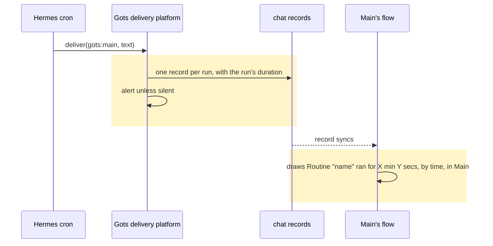

# A routine's reply shows in Main as a marker, not a message

## Goals
- **G1** A non-silent routine run delivered to `gots` leaves a marker in its bot's Main chat, reading `Routine "<name>" ran for X min Y secs`. The marker is not a message: it is never in the transcript and the bot never reads it.
- **G2** `gots` is the whole channel: no environment variable, no address. A new routine's `deliver` defaults to `gots:main`, and a job stored with any `gots…` ref keeps delivering.
- **G3** A non-silent delivery sends the existing alert, and tapping it opens the bot's Main.
- **G4** Tapping a marker opens the run's read-only transcript (accepted breadth).
- **G5** A marker lights Main's unread dot until Main is next read (accepted breadth).
- **G6** The per-run rows leave the bot's chat lists, flat layout included (accepted breadth).

## Non-goals
- Anything about a routine's words appearing in Main or reaching the model.
- A marker for a silent run, a failed delivery, or a delivery to another platform.
- Changing the Routines screen.

## Change map
| Layer | Status | Goals | Tested at |
|---|---|---|---|
| Plugin: Gots delivery platform | changed | G1, G2, G3 | `plugin/tests/test_platform_gots.py` driving `deliver` |
| Plugin: cron `deliver` default and prompt section | changed | G2 | `plugin/tests/test_platform_gots.py` driving the hook |
| Plugin: push target | changed | G3 | `plugin/tests/test_push_kinds.py` |
| App: Main's flow | changed | G1, G4, G5 | component test over a seeded Main |
| App: chat lists | changed | G6 | `scripts/test-chat-list.mjs` |
| App: push routing | changed | G3 | `scripts/test-push-*.mjs` |
| Chat record (synced) | affected | G1 | no schema change: `routine` rows already carry title, time, session |

## Flows
### F1: a routine delivers to Gots (changed). Test: "a delivered run is one marker in Main"

## Steps
1. **The delivery writes what a marker needs.** Goals: G1. After: none. Layers: Plugin delivery. Check: a test that a delivery's record carries the run's duration and publishes once per run, red then green.
2. **No environment variable, and `gots:main` is the default.** Goals: G2. After: 1. Layers: Plugin delivery, cron default. Check: a test that registering writes no `GOTS_HOME_CHANNEL` and the hook fills `gots:main` when `deliver` is omitted, red then green.
3. **Main draws the markers.** Goals: G1, G4, G5. After: 1. Layers: App Main's flow. Check: a component test that a seeded run record appears in Main in time order, opens the run on tap, and marks Main unread until read, red then green.
4. **Rows leave the lists.** Goals: G6. After: 3. Layers: App chat lists. Check: `test-chat-list.mjs` asserts no routine row in either layout, red then green.
5. **The alert opens Main.** Goals: G3. After: 2, 3. Layers: Plugin push, App push routing. Check: tests that a `routine_message` push resolves to the bot's Main.

## Decisions
- **Reuse the per-run chat record as the marker's data.** Made by the agent, because it is already synced, deduped per run and tombstoned, so no table, route or schema is added. The arena was skipped on facts 1 to 3 and the shared record being the one defensible shape (fact 4); say so if you want it run.
- **`gots:main` is the default.** Made by the user, because they asked for it. Hermes refuses a bare `gots` with no home channel, so the default is written into the job, not resolved by Hermes.
- **Marker wording.** Made by the user: `Routine "<name>" ran for X min Y secs`.

## Risks
- A run with no start or end in Hermes's ledger has no duration; the marker then reads `Routine "<name>" ran`.
- Hosts already holding `GOTS_HOME_CHANNEL` in `.env` keep it; it is simply unused.
- `MIN_PLUGIN_VERSION` rises, since an old plugin writes no duration.

## Not now
- Showing the routine's first line under the marker, from the old row design.
