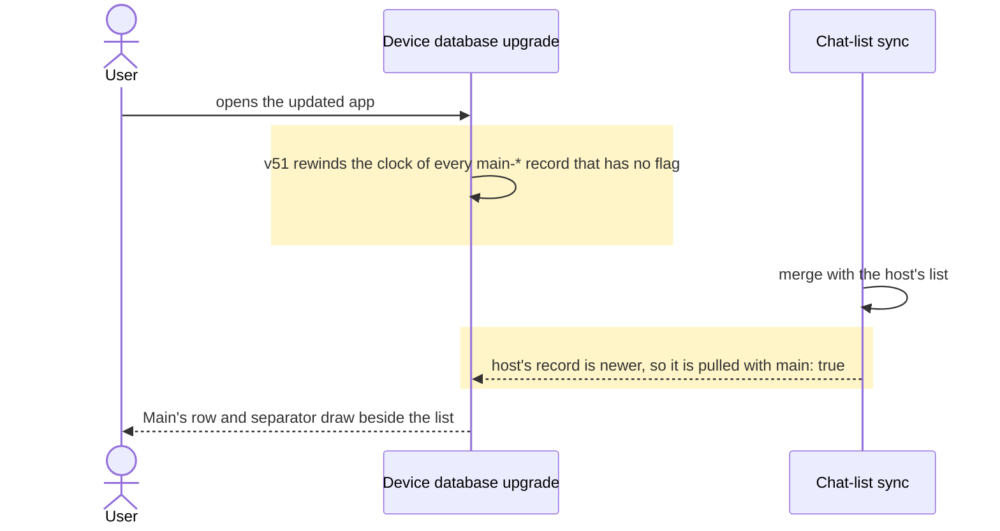

# A bot's two panes show its Main, under the bot's own bar, and the sidebar marks unread once

## Goals
- **G1** In the two-pane view I can see the Main chat row and the separators above my side chats, not only the side chats.
- **G2** In the two-pane view the list's header is the Main header of the one-pane view: the bot's face and name (opening its settings), not "Sidechats" with a back arrow.
- **G4** In the two-pane view Main's own bar drops its Side Chats control, since the list already stands beside it.
- **G3** On the sidebar the unread mark is the Unread Chats dot: one blue dot on the bot's head, expanded or collapsed.

## Non-goals
- Dropping the "N unread" words under the bot's name (Q3: kept).
- Changing the one-pane Side Chat List's bar ("Sidechats", back to Main).

## Change map
| Layer | Status | Goals | Tested at |
|---|---|---|---|
| Device database upgrade (`db.ts`) | changed | G1 | `scripts/test-main-upgrade.tsx` |
| Chat-list sync (`sync.ts`, `merge.ts`) | affected | G1 | `scripts/test-main-upgrade.tsx` |
| Side Chat List screen (`routes/side-chats.tsx`) | changed | G2 | `scripts/test-side-chats.tsx` |
| Sidebar bot rows (`conversation-list.tsx`) | changed | G3 | a sidebar component test |
| Chat bar (`chat-bar.tsx`) | changed | G4 | `scripts/test-bot-chats-pane.tsx` |

## Flows
### F1: a device that crossed v50 learns its Main again (changed). Test: "a Main the v50 upgrade stripped is pulled again on the next merge"

## Steps
1. **Regression test: a stripped Main is learned again.** Goals: G1. After: none. Layers: Device database upgrade, Chat-list sync. Check: in `test-main-upgrade.tsx`, a v49 device holding a flagged `main-<bot>-<session>` record (the plugin's current shape) is upgraded, then `mergeDocs` against the host's flagged copy at the record's original clock pulls it. Red today: the pull is `[]`. Done.
2. **Rewind the stripped Mains' clock so the host's record wins (fix at the cause).** Goals: G1. After: 1. Layers: Device database upgrade. Check: Step 1 green, the existing v50 test still green, and the side-chats e2e at 1440px still shows `main-row`. Commit names the cause: v50 cleared `main` from every `main-*` id, including the plugin's current `main-<bot>-<session>` ids, and an equal clock meant no merge ever restored it. Done.
3. **The lane's bar is the bot's.** Goals: G2. After: none. Layers: Side Chat List screen. At the split width with Main beside it, the list's bar is the bot's face and name linking to its settings, with the routines control. There is no back arrow, no "Sidechats" title and no count line. One pane keeps today's bar. Check: a test in `test-side-chats.tsx` at the split width that asserts the bot's name and a link to its settings in the lane bar, and no "Back to Main" button. Red, then green. Done.
4. **One blue dot on the bot's head.** Goals: G3. After: none. Layers: Sidebar bot rows. The expanded row draws the rail's dot (the `ItemRow` unread dot: blue, at the head's top-right) and drops the amber end-of-line dot. Check: a component test that expects exactly one `[data-unread]` per unread bot row, on the head, in both expanded and collapsed. Red, then green. Done.

5. **Main's bar beside its list carries no Side Chats control.** Goals: G4. After: 3. Layers: Chat bar. Check: in `test-bot-chats-pane.tsx` at the split width, Main beside the list has no `side-chats-button`, while one pane still has it. Red, then green.

## Decisions
- **Confirmed cause: the Dexie v50 upgrade.** Its filter is `id.startsWith("main-")`, but the plugin keys today's Mains `main-<bot>-<session>`, so the upgrade stripped them too. Its comment's promise that "the projection re-tells it" does not hold. The host's stored copy already carries the flag, so `carrying_main` keeps its clock. `mergeDocs` pulls only a strictly newer record, and the plugin's `merge` keeps only a strictly newer one, so the device and the host stay at one clock forever. Proved on a probe test that replays a v49 device holding `main-default-local-520cce5e` with `main: true` and runs the upgrade: `main` came out `undefined`, and `mergeDocs` against the host's flagged copy at the same clock returned `pull = []`. The user's device state agrees: all 8 bots hold a `main-*` "Bot Chat" record and none carries `main`.
- **Refuted: a pill or search hides the row.** Main is taken from the unfiltered rows.
- **Refuted: Main isn't listed.** `isListed` always lists Main.
- **Refuted: the width.** At 1440px every entry (launch, side chat cold, Main cold, the sidebar row) drew `main-row` and `main-separator` with fixture data. The user confirmed they are on the wide view (Q1).
- **Repair by rewinding the clock, not re-flagging on the device.** Made by the agent. The device can't tell which `main-*` record is Main (bot `zero` holds two). The host's projection is the one authority, so the device lets the host's record win. A retired Main still comes back unflagged, because the host strips the flag with a newer clock.
- **Lane bar: bot face and name, plus routines.** Made by the user (Q2).
- **Hide Main's Side Chats control in two panes.** Made by the user (Q extra).
- **Sidebar: blue dot on the head, always; keep the "N unread" words.** Made by the user (Q3).

## Risks
- Rewinding `changedAt` means a pending local edit to such a record, made at that same clock, would lose to the host's copy. This is safe because the host already holds the device's pre-upgrade push at that clock (its merge kept it), so the two copies differ only by the flag. This is inferred from the merge rules, not proven on the user's host.
- A `main-*` record the host never held is pushed back at clock 0. That is harmless: any real record outranks it.

## Not now
- Rewriting v50's comment and filter for devices still on v49. v51 repairs them right after v50 runs, so it is not needed for G1.
