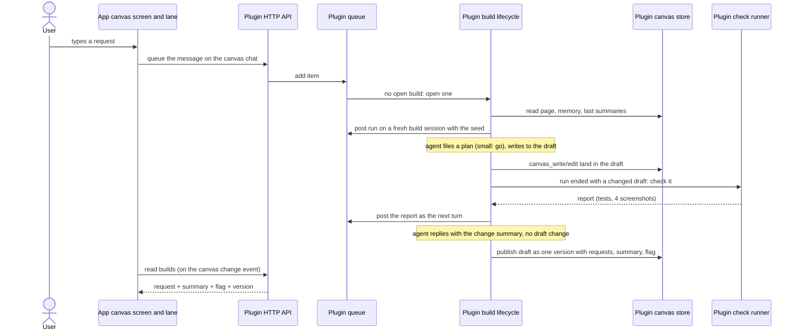
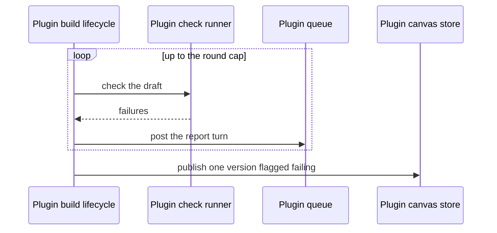
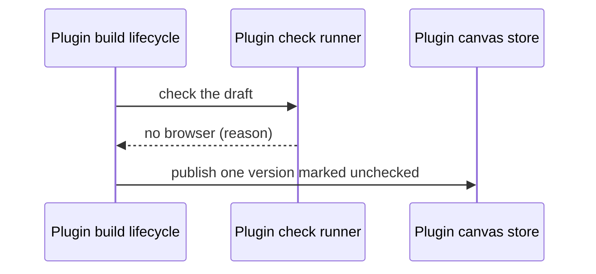
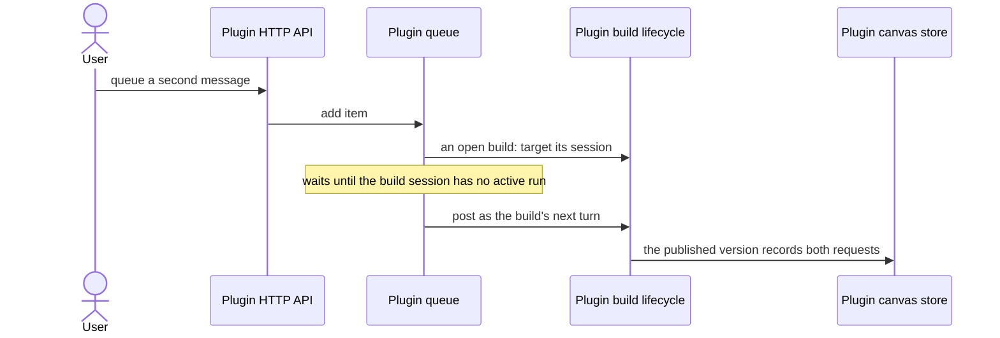
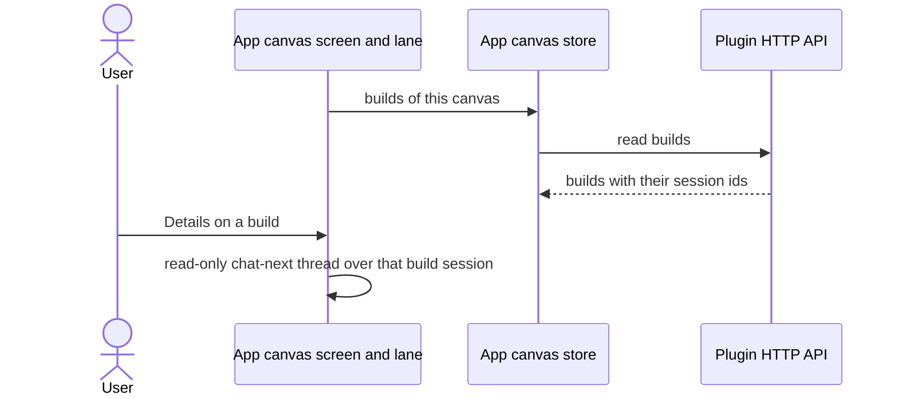
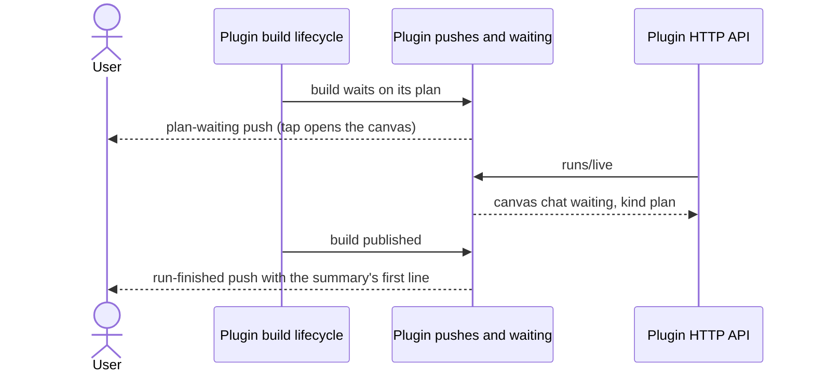

# A canvas request becomes a build: planned, checked on the rendered page, published once, and told back as a summary

## Goals
- **G1** Each request on a canvas starts a **build**: a fresh Hermes session seeded with what it needs (the page, the canvas's memory, past build summaries), not the whole chat history. A request sent while a build is open queues on that build.
- **G2** Every build is told a fixed base method in its system prompt (how to plan, break down, build, check), current on every build rather than frozen per canvas.
- **G3** Canvas coding best practices move out of the base prompt into a bundled skill loaded on demand.
- **G4** One folder per canvas in plugin data (plan, tests, memory, draft): deleted with its canvas, size-capped, never served to the page.
- **G5** A build's tests run against the rendered page before it publishes; failures go back to the agent.
- **G6** A plan step: the agent writes what will change and how it will be checked, and judges whether it waits for the user's approval (a vague or structural change waits, a clear tweak builds straight away). A message while a plan waits revises it; Approve builds it.
- **G7** A per-canvas memory file of requirements and decisions, read by every build.
- **G8** Screenshots at phone and tablet width, in light and dark, fed back to the agent while checking.
- **G9** The canvas lane stops drawing the chat transcript: it shows what is going on now while a build runs, and a summary of the changes when it ends. Progress reminders never reach a build. The summary is the context carried into later builds.
- **G10** Each version records the requests that made it and its change summary. The lane shows past builds as request + summary (+ check flag + version), newest at the foot; the raw transcript is behind Details.
- **G11** A fixed set of canvas prompts graded before and after the change, reported, never gated.

## Non-goals
- None declined by the user. Left alone: a canvas's data model beyond the build record, the sandbox (ADR 0114), the library catalogue, the Canvas list screen, project sessions' plan mode.

## Change map
| Layer | Status | Goals | Tested at |
|---|---|---|---|
| Plugin canvas store (`canvases`: record, versions, draft, scan/warnings, canvas tools) | changed | G1, G4, G6, G7, G10 | plugin unit tests over a real `gots.db` and a temp home |
| Plugin build lifecycle (new, beside `canvases`: the build record, its phases, seed, publish, stop) | new | G1, G5, G6, G9, G10 | plugin tests driving the hooks and the outbox with the loopback post patched |
| Plugin queue (`outbox`) | changed | G1, G6 | plugin test: a canvas chat's queued item dispatches into its build session |
| Plugin check runner (new: renders a draft through Hermes's browser backend, runs its tests, takes screenshots) | new | G5, G8 | plugin test with Hermes's browser layer planted in `sys.modules`; a probe on a real host |
| Plugin canvas check harness (new generated artifact: the app's frame document, class compile and library sources as one self-contained page) | new | G5, G8 | an `app/scripts` drift gate, like the canvas catalogue's |
| App canvas frame (`canvas-document`, `canvas-tailwind`, `canvas-library-sources`) | changed | G5 | existing `test-canvas-document.mjs` and `test-canvas-library-sources.mjs`; the harness drift gate |
| Plugin canvas guide (`openui` canvas section, generated from `canvas-guide.in.txt`) | changed | G2, G3 | `test-canvas-catalogue.mjs` (renders under the gate, names the skill) |
| Plugin bundled skills (`plugin/skills/`) | changed | G3 | plugin test that the skill registers with its frontmatter description |
| Plugin progress reminders (`progress`) | affected | G9 | plugin test: a build session gets no reminder at any level |
| Plugin pushes and waiting (`push`, `alerts`, `sessions.waiting` behind `runs/live`) | changed | G6, G9 | plugin test: a waiting build reports kind `plan` and pushes; a published build pushes once |
| Plugin HTTP API (canvas routes in `__init__`, `info`) | changed | G6, G9, G10 | plugin route tests; `info` advertises `canvas_builds`, `canvas_checks` |
| App canvas store (`lib/canvases.ts`) | changed | G9, G10 | component test over a seeded device with the host faked |
| App canvas screen and lane (`routes/canvas.tsx`, its chat lane) | changed | G6, G9, G10 | component test of the lane; `pnpm e2e` canvas flow against the mock |
| Mock Hermes (`scripts/mock-hermes.mjs`) | changed | G6, G9, G10 | the e2e canvas flow |
| Bench (`bench/canvas/`, new, beside `bench/dictation`) | new | G11 | `python3 -m bench.canvas` printing a record, never a gate |

## Flows
### F1: User asks for a small tweak; it builds, checks and publishes straight away (new). Test: "a small tweak builds, checks and publishes one version"


### F2: A plan waits; a message revises it; Approve builds it (new). Test: "a plan that waits is revised by a message and built on Approve"
```mermaid
sequenceDiagram
  actor User
  participant Lane as App canvas screen and lane
  participant API as Plugin HTTP API
  participant Queue as Plugin queue
  participant Build as Plugin build lifecycle
  participant Store as Plugin canvas store
  Queue->>Build: open build, post seeded run
  Note over Build: agent files a plan (structural: wait), turn ends
  Build->>Store: plan saved in the canvas folder, build waits
  Lane->>API: read builds
  API-->>Lane: plan with Approve and Stop
  User->>Lane: sends "make it blue too"
  Lane->>API: queue the message
  API->>Queue: add item
  Queue->>Build: build waits on a plan: post as a revision turn
  Build->>Store: revised plan saved, still waiting
  User->>Lane: Approve
  Lane->>API: approve the build
  API->>Queue: add the approval turn on the build session
  Queue->>Build: post approval; draft writes now allowed
  Note over Build: continues as F1 from the draft writes
```

### F3: Checks still fail after the fix rounds (new). Test: "a build whose checks keep failing publishes flagged failing"


### F4: A host with no browser backend (new). Test: "a build on a host with no browser publishes unchecked"


### F5: A request sent while a build is open (new). Test: "a request sent mid-build runs on the open build's session"


### F6: User opens a past build's transcript (new). Test: "the lane draws builds and opens a build's transcript from Details"


### F7: A waiting plan and a finished build reach a closed app (new). Test: "a waiting build pushes as a plan and a published build pushes once"


## Steps
1. **The plugin knows whether it can drive Hermes's browser.** Goals: G5, G8. After: none. Layers: Plugin check runner, Plugin HTTP API. A probe looks for the entry point a plugin can call into Hermes's browser layer (open a local page, set width and colour scheme, evaluate a script, screenshot) without starting a browser; `info` advertises `canvas_checks` only where it is found. The PR records a run on a real host with local Chromium. **If no plugin-callable entry exists, stop and ask the user** before steps 3 and 10, since every build would then publish unchecked (Q6). Check: plugin test with the layer planted in `sys.modules` reads ready, and with it absent reads not ready with the reason (red before the module exists). Done.
2. **Preparatory refactor: the frame document takes its inputs instead of reading the app.** Prepares: 3. After: none. Layers: App canvas frame. The document builder and the class compile take the theme tokens, the library sources and the compiler as arguments, the app passing what it reads today, so the same code can be bundled for the host. Check: `test-canvas-document.mjs` and `test-canvas-library-sources.mjs` green before and after, unchanged. Done.
3. **The plugin renders a canvas document the way the app draws it, and checks it.** Goals: G5, G8. After: 1, 2. Layers: Plugin canvas check harness, App canvas frame, Plugin check runner. A build script bundles the frame document builder, the class compile and the library sources into one self-contained harness page checked into `plugin/canvas/`, with a drift gate. The runner loads it with a document, a read-only snapshot of the canvas's data and a list of test scripts, and answers pass or fail per test, the console's errors, and screenshots at 390px and 768px in light and dark. Check: the drift gate fails on a stale artifact; a plugin test with the browser layer planted answers four screenshots and one failing test for a page that breaks it.
Done.
4. **A bench grades a fixed set of canvas prompts, and records today's baseline.** Goals: G11. After: 3. Layers: Bench. Fixed prompts (first builds and follow-up tweaks), each with its own fixed assertions, sent to a real host; the published page is graded with the step 3 runner (assertions passed, warnings, turns, wall time, screenshots kept for a person) and printed beside the machine, model and path, so a run is compared or refused as incomparable. The "before" run is made on today's single-session path and its stable half committed as the baseline. Check: `python3 -m bench.canvas --dry` prints a record from a canned page (red before the module exists); no CI gate reads it.
5. **Preparatory refactor: a version is committed from a given document with extra fields.** Prepares: 7. After: none. Layers: Plugin canvas store. The commit path `write` and `edit` share takes its document and optional per-version fields as inputs rather than reaching into the tool call. Check: the existing canvas plugin tests and the `scan`/`warnings` tests, green before and after. Done.
6. **Each canvas has a folder in plugin data.** Goals: G4. After: none. Layers: Plugin canvas store. Made with the canvas, removed with it, each file and the whole folder capped, and no route or bridge read reaches it. Check: plugin test that delete leaves no folder, an over-cap write is refused with the cap in its words, and no bridge read names a folder file. Done.
7. **A request becomes a build that publishes once.** Goals: G1, G9, G10. After: 4, 5, 6. Layers: Plugin queue, Plugin build lifecycle, Plugin canvas store, Plugin progress reminders, Plugin HTTP API, App canvas store, App canvas screen and lane. Behind the `canvas_builds` feature: the outbox dispatches a canvas chat's item into the canvas's open build session, or opens a build (a fresh `canvas-…` session and a build record) seeded with the page, the memory and the newest summaries, on the canvas's model pin. A build session's `canvas_write`/`canvas_edit` land in the draft and `canvas_read` reads it. When a run ends with nothing queued for the build, the draft is published as one version carrying every request the build took and the final reply as its summary. A run that fails or is interrupted ends the build `failed`, publishes nothing and keeps the draft for the next request. An app that predates the feature keeps today's one-session path. Check: plugin tests "a small tweak builds, checks and publishes one version" (checks stubbed absent here), "a request sent mid-build runs on the open build's session", "a build session gets no reminder at any level", and "a failed run publishes nothing"; Undo after one build moves back the whole build.
8. **A canvas remembers its requirements and decisions.** Goals: G7. After: 7. Layers: Plugin canvas store, Plugin build lifecycle. A memory tool, given to build sessions only, replaces the memory file in the canvas folder, and every build's seed carries it. Check: plugin test that a second build's seed holds what the first remembered, and the file is refused past its cap.
9. **A build plans first and waits for approval when the agent says so.** Goals: G6. After: 7. Layers: Plugin build lifecycle, Plugin canvas store, Plugin queue, Plugin HTTP API, App canvas store, App canvas screen and lane, Mock Hermes. A plan tool takes what will change, the checks (test scripts saved in the folder) and whether it must wait. Draft writes are refused until a plan is filed, and while one waits, by the hook the canvas session already blocks tools with. A message queued while it waits is posted as a revision turn; an approve route queues the approval turn; a stop route ends the build `stopped` with nothing published. The lane draws the plan with Approve and Stop in the composer's place. Check: plugin test "a plan that waits is revised by a message and built on Approve"; a draft write before a plan is refused; Stop publishes nothing.
10. **A build is checked on its rendered page before it publishes.** Goals: G5, G8. After: 3, 9. Layers: Plugin build lifecycle, Plugin check runner. When a build run ends with the draft changed since its last check, the runner checks the draft with the plan's tests and posts the report as the next turn, the four screenshots inline as image parts (paths only where the model takes no images). The loop ends when a turn changes nothing, or at the round cap, and the version is flagged passing, failing or unchecked. Check: plugin tests "a build whose checks keep failing publishes flagged failing" and "a build on a host with no browser publishes unchecked", and F1's test with the runner planted.
11. **Every build is told the base method; canvas craft is a skill.** Goals: G2, G3. After: 8, 9, 10. Layers: Plugin canvas guide, Plugin bundled skills. The guide's template becomes the design-first floor plus the method (file a plan, break into slices, write to the draft, test, read the screenshots, remember, end on a summary) and names a new bundled canvas-craft skill carrying the coding practices the guide holds today; rendered under the 3,980 gate. Check: `test-canvas-catalogue.mjs` fails on drift and passes with the skill named; the plugin test registers the skill with its frontmatter description.
12. **A waiting plan and a finished build reach a closed app.** Goals: G6, G9. After: 9. Layers: Plugin pushes and waiting, Plugin build lifecycle. A waiting build reports its canvas chat as waiting with kind `plan` on `runs/live`, so Waiting for input and the existing plan push cover it; a published build sends one run-finished push carrying the summary's first line; both obey the bot's and the canvas chat's mute, and a tap opens the canvas. Check: plugin test "a waiting build pushes as a plan and a published build pushes once", red then green.
13. **The lane shows builds, not the transcript.** Goals: G9, G10. After: 9, 10. Layers: App canvas store, App canvas screen and lane, Plugin build lifecycle, Plugin HTTP API, Mock Hermes. The plugin stamps a build's phase (planning, waiting, building, checking, publishing) and its latest activity on the build record and raises the `canvas` change kind. The lane draws past builds as request + summary + flag + version, newest at the foot, the open build's phase and activity line, and Details opening the build session read-only through chat-next's thread; a canvas from before builds keeps its old chat behind one Details row. Check: component test "the lane draws builds and opens a build's transcript from Details"; `pnpm e2e` canvas flow against the mock.
14. **The bench reports after.** Goals: G11. After: 4, 10, 11. Layers: Bench. The same prompts run through builds and each prompt's grade is printed beside the baseline with its delta; the PR states it. Check: `python3 -m bench.canvas` prints both columns for every prompt; reported, never asserted.

## Decisions
- **A new Hermes session per build; mid-build messages queue on it.** Made by the user (Q1), because a build should start from its seed, not the chat's history; a session per build also makes the guide current on every build (G2).
- **One version per build, from a draft published at its end; Undo undoes a build.** Made by the user (Q2), because a build is the unit the user asked for.
- **The agent judges whether a plan waits, first build included.** Made by the user (Q3, Q10), because only it knows how big the change is, and a clear first request should not wait on a closed app.
- **A message while a plan waits revises the plan.** Made by the user (Q4), because that is what answering a plan means.
- **The plugin runs tests and screenshots through Hermes's browser backend, verified first.** Made by the user (Q5), because a build must finish with the app closed and its checks must not depend on the agent choosing to run them.
- **No browser publishes "unchecked"; checks still failing publish flagged "failing".** Made by the user (Q6, Q7), because a build never stalls on its checks.
- **The transcript stays behind Details; past builds show request + summary.** Made by the user (Q8, Q9), because the lane is about what changed.
- **The host renders through a generated harness of the app's own frame code, megabytes and all.** Made by the user (Q11), because a page is only checked if it is drawn the way the app draws it.
- **A waiting plan and a finished build push.** Made by the user (Q12), because a build runs with the app closed.
- **The canvas chat record stays the request inbox; the outbox routes its items into builds.** Made by the agent, because it keeps the send path (model pin, drafts, start files, queue, mute) and needs no new request route. ADR: supersedes the "edited only through its own session" clause of ADR 0113.
- **A build ends when its run ends with nothing queued and no unchecked draft change; its final reply is the summary.** Made by the agent, because it reuses `on_session_end` and the reply the agent already writes, with no summary tool.
- **A failed or interrupted run publishes nothing and keeps the draft; Stop ends a build with nothing published.** Made by the agent, because the plugin publishes only what a completed build finished, and a waiting plan needs a way out other than Approve.
- **Build sessions are named `canvas-…`, outside `gots-…`.** Made by the agent, because progress reminders, the daily sweep and chat lists already ignore such sessions (G9's "ignored" for free); the two pushes it would also lose are added explicitly (step 12).
- **Screenshots reach the model as image parts of a report turn, not through `browser_vision`.** Made by the agent, because `/v1/runs` already takes inline images and no auxiliary vision model is needed.
- **Checks run after a run ends and report as the next turn, not inside a tool call.** Made by the agent, because a render of four screenshots inside a tool call can pass Hermes's tool timeout on a slow host. ADR, with the harness decision.
- **Three check rounds per build.** Made by the agent, because it bounds cost; a constant, easy to move.
- **Plan and memory are tools; the draft keeps the existing write tools.** Made by the agent, because the plugin must read the plan's wait flag and checks reliably, and `scan` stays on every write.
- **The base method rides in the guide section, craft in a bundled skill.** Made by the agent, because one place tells a build what it is, and moving craft out frees room under the 4,000-character cap.
- **Builds are gated on an `info` feature; older apps keep the one-session path.** Made by the agent, because the plugin ships ahead of the app.
- **The arena ran** (three runners, one judge); the base is the "least that works" candidate, with grafts from "reshape first" (the frame-document refactor, the plan-waiting push, the stop-and-ask probe) and "from scratch" (the `info` gate, Stop and its outcomes, every request on the version).  Made by the agent.

## Risks
- If step 1 finds no plugin-callable browser layer, every build publishes "unchecked" until Hermes offers one; G5 and G8 then wait on Hermes (step 1 stops and asks).
- The harness runs bot-written script in a browser on the Hermes host. It is the sandboxed frame document, but the host's browser is now an attack surface the page never had.
- The harness is a large checked-in artifact; a library update must regenerate it.
- A build costs more model calls than today's one turn: a plan, a report turn per check round, and four images each round.
- Tests run against a read-only data snapshot: a page that writes data is tested against memory, not the host.
- Existing canvases start their first build with empty memory and no summaries; what their old session knew stays in that transcript, behind Details.
- The method and the floor share the 4,000-character section cap; over it the section drops whole and Canvas hides.

## Not now
- Removing the one-session path once the app floor passes `canvas_builds`, from the "from scratch" candidate.
- Redo of an undone build, from the "from scratch" candidate.
- A memory or plan editor in the lane, from the "least that works" and "from scratch" candidates (the user revises by message, Q4).
- Visual diffs between versions' screenshots, from the "from scratch" candidate.
- Vision-model grading in the bench, from the "least that works" and "reshape first" candidates.
- Data writes, tool calls and consent inside the host harness, from the "least that works" candidate.
- Retrying a failed build from the lane, from the "least that works" candidate (send the request again).
- Carrying an old canvas's transcript into its first build's memory, from the "from scratch" candidate.
