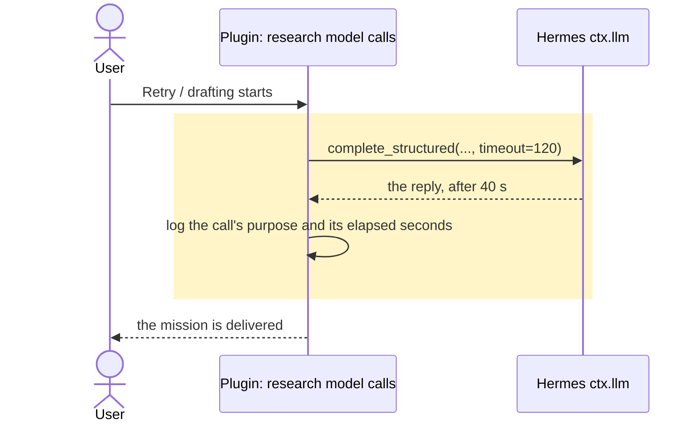
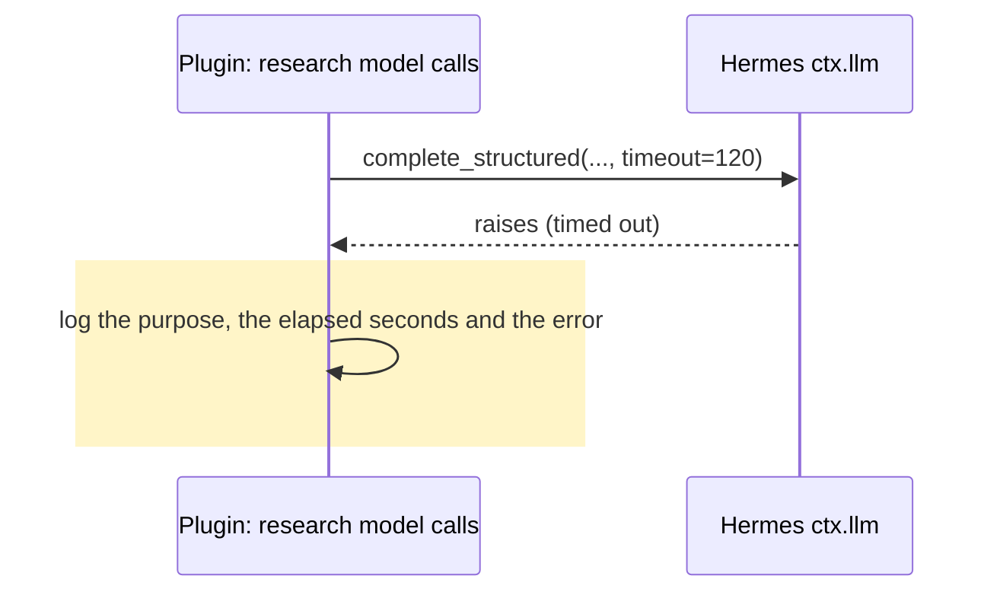

# Research and meeting model calls get two minutes instead of thirty seconds

## Goals
- **G1** Research missions and meeting notes stop failing with "The model call failed: Request timed out." when a provider takes longer than 30 s.
- **G2** Every Research and Meetings model call logs how long it took, whether it answered or failed, so the next failure says whether two minutes was enough.

## Non-goals
- Retrying in the plugin when a call times out (the user chose one 120 s timeout over a stepped 60/90/120 s design).
- Changing the dictation cleanup's time limit (it runs under its own `run_bounded` deadline, which the dictation bar waits on).
- "The judge tagged nothing" (open until a probe captures the judge's reply).

## Change map
| Layer | Status | Goals | Tested at |
|---|---|---|---|
| Plugin: research model calls (`_structured`) | changed | G1, G2 | `plugin/tests/test_research.py`, through a mission's drafting with the fake `ctx.llm` |
| Plugin: meetings model calls (`_structured`) | changed | G1, G2 | `plugin/tests/test_meetings.py`, through a meeting's writing step with the fake `ctx.llm` |
| Hermes `ctx.llm` (host) | affected | G1 | the debugging loop: a local OpenAI-compatible endpoint that answers in 40 s |

## Flows
### F1: A mission's judge waits for a slow provider (changed). Test: "every research model call carries the two-minute timeout"

A meeting's notes, topics and answers follow the same sequence through Plugin: meetings model calls. Test: "every meeting model call carries the two-minute timeout".

### F2: A model call fails (changed). Test: "a model call's elapsed time is logged when it fails"

A successful call logs the same way, at info level. Test: "a model call's elapsed time is logged when it answers". Meetings follow the same sequence.

## Steps
1. **A regression test that pins the timeout on every model call.** Goals: G1. After: none. Layers: Plugin: research model calls, Plugin: meetings model calls. Check: the tests "every research model call carries the two-minute timeout" and "every meeting model call carries the two-minute timeout", driven through the fake `ctx.llm` the suites already use, which records each call's kwargs, assert every recorded call carries `timeout=120`. Red today: no call carries `timeout`.
2. **Pass a 120 s timeout on every Research and Meetings model call.** Goals: G1. After: 1. Layers: Plugin: research model calls, Plugin: meetings model calls, Hermes `ctx.llm`. One constant, used by both `_structured` functions. Check: step 1's tests green; the full plugin suite passes (`python3 -m unittest discover -s plugin/tests -t .`); Hermes's install scan stays `safe` (`python3 .github/scripts/scan-plugin.py <hermes checkout> plugin`); and the debugging loop, driven through the plugin's real `_structured` against Hermes v0.23.2 and an endpoint that answers in 40 s, fails before and passes after. Commit message: `fix(research): give a plugin model call two minutes, not Hermes's 30 s default`.
3. **Log each model call's elapsed time, on success and on failure.** Goals: G2. After: 2. Layers: Plugin: research model calls, Plugin: meetings model calls. Each `_structured` times every `complete_structured` call on the monotonic clock and logs its purpose and seconds: at info when it answers, at warning with the error when it raises (Hermes's own audit line is written only on success and carries no time). Check: "a model call's elapsed time is logged when it answers" and "a model call's elapsed time is logged when it fails", with `assertLogs` on the module's logger, red then green, for both modules; the full plugin suite passes. Then bump the plugin to 0.123.1 in `plugin/plugin.yaml` and `plugin/dashboard/manifest.json`.

## Decisions
- **120 s per call, no plugin retry on a timeout.** Made by the user (option 1, after the stepped 60/90/120 s design was costed): Hermes already retries a timed-out request twice at the same budget (`auxiliary.transient_retries`, default 2), so the worst case is 3 requests and 6 minutes per call, against 9 requests and 13.5 minutes.
- **Log each call's elapsed time.** Made by the user ("include logging"), because 120 s is unmeasured.
- **The timeout rides on each call, not Hermes's config or a plugin-owned task.** Made by the agent: an explicit `timeout=` wins over every other setting (`_effective_aux_timeout`) and changes nothing else on the host.
- **Confirmed cause: Hermes's 30 s default on a request that only answers when complete.** A plugin call with no `timeout` and no `task` gets `_DEFAULT_AUX_TIMEOUT` (30 s); on an OpenAI-wire provider with no progress hook it is sent non-streamed, so the 30 s bounds the whole reply, and Hermes tries it three times. Proved with Hermes v0.23.2's real `ctx.llm.complete_structured` against a local endpoint: a 5 s reply passes in 8.9 s; 31 s and 40 s replies fail after 94.7 s with "The model call failed: Request timed out."; a 40 s reply with `timeout=300` passes in 41.6 s. The host matches: both timed-out missions run on the default profile's `stepfun` (OpenAI-wire), and the restrooms retry failed 94 s after Retry.
- **Refuted: a recent Hermes change.** The 30 s default and the non-streamed plugin path are identical in v0.22.5, 0.22.6, 0.22.7, 0.23.0, 0.23.1 and 0.23.2, and the plugin has never passed a timeout.
- **Refuted: the providers.** The limit alone reproduces the error against a local endpoint.
- **Refuted: the 429 on "Samsung A27 versus A15" is this bug.** It is the openai-codex plan's usage limit on another bot.
- **Refuted: "The judge tagged nothing" is a timeout.** That error needs the call to have returned and parsed; the restrooms mission's ids (`p1`–`p3`, `c1`–`c86`) are well-formed. Still open.
- **The dictation cleanup stays as it is.** Made by the agent: its own deadline already bounds it.

## Risks
- **120 s is unmeasured.** A compare judge on a long ledger may still pass it; step 3's log is what will tell.
- **A hung provider holds a mission longer:** up to 6 minutes per call, and a three-option Compare & decide makes seven calls in a row.
- **An abandoned non-streamed request may still be billed** by the provider. Not checked for stepfun or Ollama Cloud.
- **Blast radius: two functions.** Safe on every supported Hermes because `complete_structured` takes `timeout` in v0.22.5, the plugin's floor (read in that tag's `agent/plugin_llm.py`), so no `MIN_PLUGIN_VERSION` bump.

## Not now
- **The Egypt probe.** Once 0.123.1 is on the host: add one line logging the verdict reply after the `_structured("verdict", …)` call, restart the gateway, retry "Egypt visa on arrival eligibility" once, read the reply, remove the line and restart. Then plan the fix for "tagged nothing". From the hunt.
- **Show a 429 as a sentence**, not Hermes's raw JSON, on a mission's row. From the user's screenshot.
- **`max_tokens` never reaches the provider** unless its provider profile opts in (the loop's endpoint received none); it could cut long replies short. From the loop.
- **ADR "A plugin model call carries its own timeout"**, so the next model call added doesn't fall back to 30 s. From the hunt.
