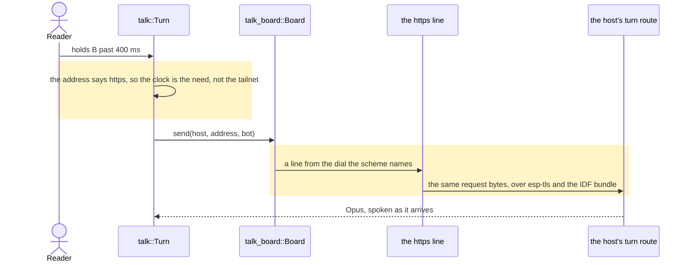
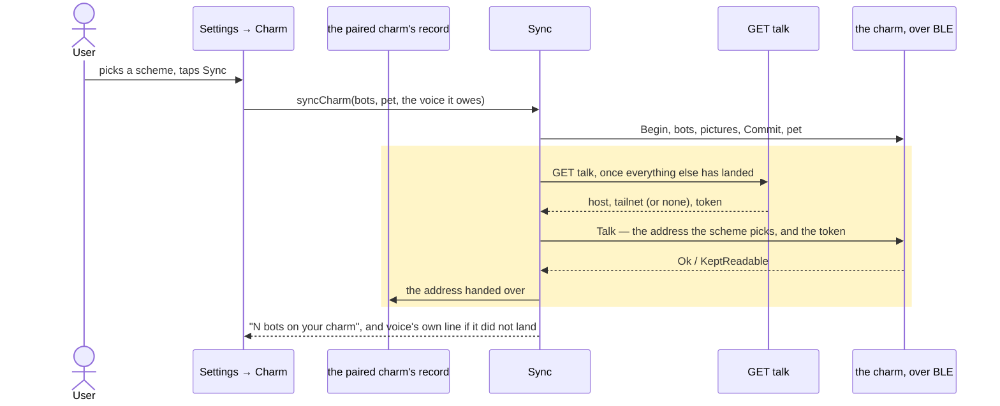
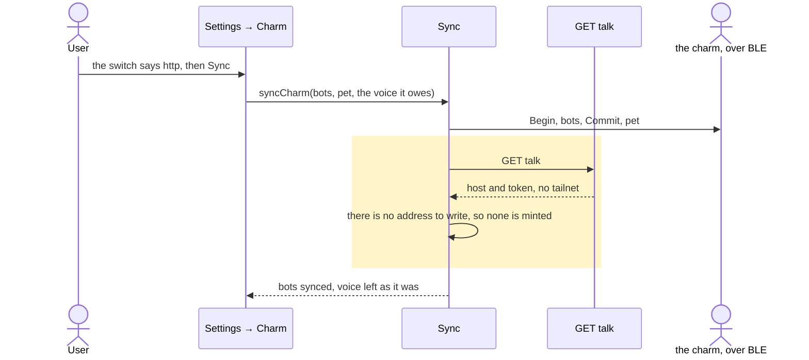
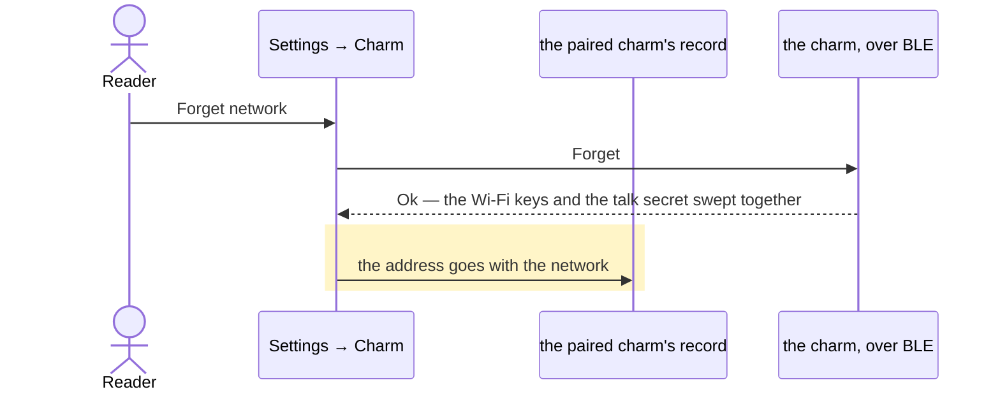

# The charm's voice: the reader picks http or https, and Sync hands it over

Two repositories. The firmware steps land in `hermesgots-charm`; the rest in `hermesgots`.

## Goals

- **G1** The reader chooses whether the charm reaches its host over plain http or over https, and the
  charm accepts either.
- **G2** Voice setup is part of Sync. The Voice section is gone from Settings → Charm, and there is no
  separate "set up voice" act.

## Non-goals

- Rotating or revoking a token from the app beyond what a hand-over does today.
- Certificate pinning per host.
- A charm op that reports back which address it holds.
- Making https work through the tailnet dial: a tailnet-only host stays http.
- Clearing the record's other stale flag (`tailnet`) on `Forget`; it is the same defect class as the
  voice record but nobody is waiting on it.

## Change map

| Layer | Status | Goals | Tested at |
|---|---|---|---|
| `talk::Address` / `parseAddress` (`src/talk.cpp`) | changed | G1 | `test/test_talk.cpp` |
| `talk::Why` / `talk::Turn` / `Tick` | changed | G1 | `test/test_talk.cpp` |
| `talk_board::Board` — the turn's line | changed | G1 | `pio run` |
| The https line (board, new file beside `talk_board.cpp`) | new | G1 | `pio run` |
| The loop's turn tick (`src/main.cpp`) | changed | G1 | `pio run` |
| Route contract (`docs/PROTOCOL.md`) | changed | G1 | read against `test/test_talk.cpp` |
| Plugin `GET talk` (`plugin/__init__.py`) | changed | G1 | `plugin/tests/test_talk_route.py` |
| Plugin turn route (`talk_turn`) | affected | G1 | `plugin/tests/test_talk_route.py` |
| The host's tailnet address (`plugin/talk_hosts.py`) | new | G1 | `plugin/tests/test_talk_route.py` |
| The paired charm's record (`app/src/lib/charm.ts`) | changed | G2 | `scripts/test-charm-talk.mjs` |
| Voice rules (`app/src/lib/talk.ts`) | changed | G1, G2 | `scripts/test-charm-talk.mjs` |
| Sync (`app/src/lib/charm-sync.ts`) | changed | G2 | `scripts/test-charm-sync.mjs` |
| Settings → Charm (`app/src/components/settings/charm.tsx`) | changed | G1, G2 | `scripts/test-charm-settings.tsx` |
| The page's words (`app/src/lib/charm-words.ts`) | changed | G1, G2 | `scripts/test-charm-words.mjs` |

## Flows

### F1: a turn over https (new). Test: "an https turn with no clock says No clock and opens no microphone"

The http branch is today's flow unchanged: the same sequence with the tailnet dial in place of the
https line, and `test/test_talk.cpp`'s existing cases stay its proof.

### F2: a sync that owes the charm its voice (changed). Test: "a sync that owes voice mints after the pet and writes the address and token last"

### F3: http chosen and the host names no tailnet address (changed). Test: "a host with no tailnet address leaves the record alone and says so"

### F4: forgetting the network takes the record's address with it (changed). Test: "forgetting the network forgets the address this phone handed over"

## Steps

1. **Preparatory refactor: the address's scheme is read once.** `parseAddress` reads the scheme at the
   head of the URL through one function, and the authority's first byte, the port an address names
   none of, and the refusal all come from that one read instead of from `"http://"` written into three
   places. `https://` is still refused in the same words, and no accepted address changes. Prepares: 2,
   3. After: none. Layers: `talk::Address`, `parseAddress`. Check:
   `CXX="python3 -m ziglang c++" bash scripts/test-host.sh` — green before and after, with the https
   refusal and its sentence still pinned. Done.

2. **The charm accepts https, and says "No clock".** `parseAddress` reads either scheme, keeps it, and
   defaults the port to 443 for https; `Turn::began` reads the route's one need off the scheme — http
   needs the tailnet as today, https needs the clock (`rtc::now() != 0`) — and refuses
   `Why::NoClock` ("No clock") before the microphone opens, since the handshake could only fail on
   the certificate's dates. `Tick` carries the clock. The frame and `Talk::keep` are unchanged: the
   scheme rides in the URL. Goals: G1. After: 1. Layers: `parseAddress`, `Why`/`Turn`/`Tick`,
   `src/main.cpp`, `docs/PROTOCOL.md`. Check: `CXX="python3 -m ziglang c++" bash scripts/test-host.sh`
   — red first, then green: "an https address parses and keeps its scheme", "https defaults to 443 and
   its Host header keeps the port off", "an https turn with no clock refuses before the microphone
   opens", "an http turn still needs the tailnet", with the two pinned https refusals
   (`test/test_talk.cpp`, the hand-over case and `anAddressThatIsNotHttpIsRefused`) rewritten rather
   than deleted. Done.

3. **The turn's https goes over the charm's own Wi-Fi, verified.** A second implementation of
   `tunnel::Dial` (`openLine` → a line over esp-tls with `esp_crt_bundle_attach`, SNI the address's
   host, the address's port) so `open`, the in-flight count and the `Line::read`/`write`/`close` the
   exchange uses are the same code. Two constraints this step owns: the handshake needs more stack
   than `kWireStack`'s 16 KiB, measured for `opus_encode`, so the wire task's stack is raised to what
   mbedTLS needs and measured the same way; and `Line::read(waitMs)` waits for the first byte, which
   esp-tls does not, so the line sets the socket's receive timeout per read and maps a timeout to 0.
   `exchange()` asks the dial the address's scheme names, and nothing else in it moves. Goals: G1.
   After: 1, 2. Layers: the https line, `talk_board::Board`, `src/main.cpp`. Check:
   `PATH=/opt/data/tmp-home/.platformio/penv/bin:$PATH pio run` builds the image, and
   `CXX="python3 -m ziglang c++" bash scripts/test-host.sh` stays green.

4. **`GET talk` names the host's tailnet address, or says nothing.** The answer gains one key,
   `tailnet`: an `http://` URL of the host's own tailnet IPv4 (a 100.64.0.0/10 address found on the
   host's interfaces) with the port the request arrived on and the same plugin prefix, omitted —
   never guessed — where no such address is found. `host`, `bot`, the token and every refusal are
   unchanged. Goals: G1. After: none. Layers: `GET talk`, the host's tailnet address, route contract.
   Check: `python3 -m unittest plugin.tests.test_talk_route -v` — "the app is answered the tailnet
   address beside the public one", "a host with no tailnet address omits the key", "a token appears
   once" red first, then green; the twenty cases there today stay green. Done.

5. **Preparatory refactor: the record keeps the address, not a yes.** The paired charm's `talk: boolean`
   becomes the address handed over last, with a stored `true` read as "handed over, address unknown";
   `forgetCharmWifi` clears it with the Wi-Fi record, which the firmware's `Forget` already sweeps on
   the charm. Prepares: 6, 7. After: none. Layers: the paired charm's record. Check: `cd app && pnpm
   test` — green before and after, with the record's cases rewritten to the address they keep.

6. **The switch replaces the Voice row.** `CharmVoice`, its four component cases and the words only it
   used are deleted. Beside Sync sits a switch for the scheme — on is https, the default, off is http
   over the tailnet — with a hint saying what each needs, and the choice kept on the record.
   `talkProblem` accepts either scheme and refuses anything else, still bounded by the frame's byte
   budget; `talkOffer` reads `tailnet` as a string or absent. Nothing is written to the charm by the
   switch: it decides what the next sync hands over. Goals: G1, G2. After: 4, 5. Layers: Settings →
   Charm, voice rules, the page's words, the record. Check: `cd app && pnpm test` —
   `test-charm-settings.tsx` "the charm section offers one switch for the scheme and no voice row"
   (red today: the Voice row is drawn and `#charm-talk-setup` exists) and its hint, with
   `test-charm-talk.mjs` accepting http and https and refusing both non-schemes.

7. **Sync hands the voice over.** After pet, and only when the record holds no address or holds one
   whose scheme is not the switch's, the session asks the host once, mints at that point, picks the
   address the scheme names, and writes it last. A host that names no tailnet address while the switch
   says http, a failed host ask and a charm's refusal are each reported in the page's line and never
   fail the bots sync; only a kept write is recorded, so the next sync offers it again. Goals: G2.
   After: 2, 3, 5, 6. Layers: Sync, the record, Settings → Charm, the page's words. Check:
   `cd app && pnpm test` — `test-charm-sync.mjs` "a sync that owes voice mints after the pet and writes
   the address and token last", "a second sync at the same address does not mint again", "a host with
   no tailnet address leaves the record alone and says so", "a refused voice write is reported and the
   next sync hands it over again" red first, then green, plus F4's test.

## Decisions

- **The reader chooses the scheme, and the charm accepts either.** Made by the user, in the request:
  "http or https is a user choice". No wdyt gate was answered; this session ran hands-free.
- **Voice is handed over by Sync, and the Voice section is removed.** Made by the user, in the
  request: "remove it from settings and build it into sync".
- **The scheme picks the route: http over the tailnet dial, https over the charm's Wi-Fi with TLS.**
  Made by the agent, because the tailnet dial reaches only tailnet peers, so a public https name needs
  the other route, and TLS inside WireGuard would buy nothing.
- **TLS is verified against the ESP-IDF bundle, never skipped, and a clockless https turn refuses with
  its own word.** Made by the agent, because a skipped verification is not a choice worth offering,
  and the bundle is already in this image for the firmware updater, so it costs no flash.
- **One switch beside Sync, default https.** Made by the agent, because the app's own address is the
  https one and a reader who never touches it should be on the verified route; the hint names what
  http needs, and the risk below names who has to flip it.
- **The host answers its own tailnet address, found on its interfaces, and omits it when absent.**
  Made by the agent, because the host is the only party that knows it, a request that arrived over a
  public name cannot say it, and a config key would be an address typed by hand.
- **The scheme rides in the URL, not in the frame.** Made by the agent, because the frame already
  carries a URL and a second field would be a second thing to keep in step.
- **The https line is a second `tunnel::Dial`, not a new seam.** Made by the agent, because that seam
  already answers where a line comes from, counts what is in flight, and returns the `Line` the
  exchange reads; a second abstraction would restate it.
- **The token is minted at the voice step, not when the sync opens.** Made by the agent, because a
  mint revokes the token the charm is holding, and the shortest window is the one where the frame is
  already being written.
- **Voice is last in the session and never fails the bots sync.** Made by the agent, because bots and
  pet have landed by then, and the next sync repairs what a refusal left undone.

## Risks

- **A mint revokes the token the charm holds.** The window between minting and the charm's `Ok` is the
  one moment voice does not work; if the session dies there, the charm keeps a dead token until the
  next sync re-mints. Minting at the last write is what keeps the window shortest, not what removes
  it.
- **An https turn needs a clock, and only a sync sets one.** A freshly flashed charm, or one rebooted
  with its RTC lost, refuses "No clock" until the next sync — including a reboot with the phone away.
- **The default is https, and https cannot reach a tailnet-only host.** A reader whose host is
  reachable only inside the tailnet has to flip the switch to http once; the firmware accepts both, so
  nothing is lost but the default is wrong for them until they do.
- **The handshake's stack is bigger than the wire task's.** `kWireStack` is 16 KiB, measured against
  `opus_encode`; mbedTLS needs more, and a stack a byte short is a reboot at the first https press, so
  this step measures rather than guesses.
- **esp-tls does not honour `Line::read`'s wait.** The TLS line must set the socket's receive timeout
  (or select) per read, or a turn on a stalled host waits past its deadline.
- **The TLS line is board code.** `pio run` proves it builds, not that a handshake verifies against a
  real certificate; the bundle is the updater's, so the roots are right, but the first board run is
  the real test.
- **An older charm refuses an https address at the hand-over** with `BadMessage`; the record stays
  unwritten and every sync says so until the firmware is updated. Shipping the firmware first is the
  answer, and the page's words say which way to fix it.

## Not now

- Certificate pinning per host, from the brief's non-goals.
- Token rotation or revocation from the app, from the brief's non-goals.
- A read-back op so the page can draw the address the charm actually holds, from the brief's
  non-goals.
- https through the tailnet dial (a `ts.net` name with Tailscale's own certificates), from the brief.
- A silent fall-back from https to http after a failed handshake: it would hide a certificate the
  charm should have refused.
- Clearing the record's stale `tailnet` flag on `Forget`, from this plan's non-goals.
