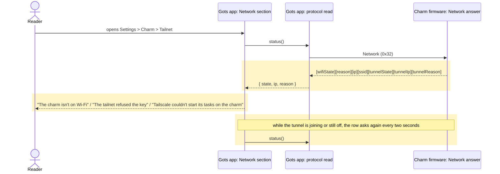

# The Tailnet row says why it is not joined

## Goals

- **G1** Settings → Charm → Tailnet no longer says "Key saved; not joined" and leaves the reader
  guessing: the row names the reason the charm's tunnel is not up — no Wi-Fi under it, the tailnet
  refused the key, Tailscale couldn't set itself up, couldn't start its tasks, its last run never
  stopped, or it keeps dropping off and retrying — in the same way the Wi-Fi row already says "Not
  in range" or "Wrong passphrase".

## Non-goals

- The glass's own network screen, which is the charm's words rather than the phone's.
- A retry button on the row: the charm already retries with a backoff of its own.
- Reading the charm's log automatically when the tunnel fails; the Debug Charm page already reads it
  on request, and this change puts a line of its own there.
- Editing TailTiny, which `components/tailtiny/README.vendored.md` says is vendored as published.

## Change map

| Layer | Status | Goals | Tested at |
|---|---|---|---|
| Charm firmware — the tunnel's own rules (`include/tunnel.h`, `src/tunnel.cpp`) | changed | G1 | `test_tunnel.cpp`, `test_net.cpp` via `scripts/test-host.sh` |
| Charm firmware — the adapter that drives TailTiny (`src/tunnel_board.cpp`) | changed | G1 | not on the host: `pio run` in CI builds it, and the rule it calls is the tested part |
| Charm firmware — the `Network` answer (`src/control.cpp`, `include/control.h`) | changed | G1 | `test_net.cpp` (`theTailnet`, `theLongestAnswer`) |
| Charm firmware — the protocol spec (`docs/PROTOCOL.md`) | changed | G1 | `test_net.cpp` pins the shape the doc describes |
| Gots app — the protocol read (`app/src/lib/charm-protocol.ts`) | changed | G1 | `app/scripts/test-charm-sync.mjs` |
| Gots app — the row's words (`app/src/lib/charm-words.ts`) | changed | G1 | `app/scripts/test-charm-sync.mjs` |
| Gots app — the Network section (`app/src/components/settings/charm.tsx`) | changed | G1 | `app/scripts/test-charm-settings.tsx` |

## Flows

### F1: a reader finds the tunnel down and is told why (changed). Test: "the network lines are the charm's own state in words"



A charm older than the field sends no `tunnelReason`: the row falls back to the state's own words
("Couldn't reach the tailnet", "Key saved; not joined"), which is what an app older than this change
draws for every charm.

## Steps

1. **The charm puts the tunnel's reason on the wire.** `Network`'s answer gains one byte after the
   tunnel's address — `tunnel::Report::reason`, which `tunnel::Tailnet::report()` already computes and
   nothing has ever sent — and `docs/PROTOCOL.md` says so, with the reason table it already documents
   for the adapter. `control::kNetworkBytes` grows by that byte so the longest answer still fits
   `kStatusMaxBytes`. Goals: G1. After: none. Layers: control answer, protocol spec.
   Check: `CXX="/opt/data/tmp-zig/zig c++" bash scripts/test-host.sh` (a Zig driver stands in for the
   g++ this sandbox has none of); `test_net.cpp` gains a test that a charm with no Wi-Fi answers
   `Offline` after its empty address, red before the byte and green after, and `theLongestAnswer`
   still fits.
   Done.

2. **The charm names why Tailscale would not start.** `tunnel::Reason` stops collapsing every
   refusal into `Refused` (5): a `tunnel::refusal(stage, code)` rule behind the seam turns
   `tailtiny_init` answering no handle into `Setup` (6), `tailtiny_start` answering `ESP_FAIL` into
   `NoTask` (7) and `ESP_ERR_INVALID_STATE` into `Stuck` (8), with `Refused` left for a code it does
   not know; `Tailnet::retrying()` puts a `Retrying` (9) on a tunnel TailTiny keeps dropping off the
   tailnet, which today is reported as `Off` with no reason at all. The adapter logs the code it got,
   so the Debug Charm page carries the raw `esp_err_t` beside TailTiny's own line. Goals: G1.
   After: 1. Layers: tunnel rules, the adapter.
   Check: the same suite. `test_tunnel.cpp` pins each `refusal` answer by number;
   `test_net.cpp` drives `failed(Reason::Setup)` and `retrying()` through a `Network` ask and reads
   each back; red before, green after.
   Done.

3. **The app reads the reason.** `parseNetworkReport` takes the byte when the answer has one —
   `reason` on the tunnel, absent for a charm that never sent it — so the shape a new app reads from
   an old charm is not a failure and a short answer is still no answer at all. Goals: G1. After: 1.
   Layers: protocol read.
   Check: `cd app && node --experimental-strip-types --test scripts/test-charm-sync.mjs`; a new
   assertion that an answer with the byte parses with its reason and one without parses with none,
   red before, green after.
   Done.

4. **The Tailnet row says it.** `tailnetWords` words each reason the way `wifiReasonWords` words
   Wi-Fi's, and the fallback stays for a charm that sent none: an off tunnel is "The charm isn't on
   Wi-Fi", not "Key saved; not joined", when the charm says `Offline`. Goals: G1. After: 2, 3.
   Layers: the row's words.
   Check: the same file's "the network lines are the charm's own state in words" — each reason's
   sentence, and the reader's own case (`Off` + `Offline` with a key saved) — red before, green after.
   Done.

5. **The row keeps asking until the tunnel settles.** The section asks the charm's links again every
   `CHARM_POLL_MS` while the tailnet is joining, or off with a key saved, and stops when it is up or
   has failed — so a key written from this screen is followed to what the charm actually did with it,
   rather than read once before the tunnel had started. Goals: G1. After: 4. Layers: Network
   section.
   Check: `cd app && node --max-old-space-size=1536 --test --import ./scripts/component-hooks.mjs
   scripts/test-charm-settings.tsx`; a stand-in radio that answers `Joining`, then `Failed` with
   `BadKey`, draws the refusal without the section being reopened — red before, green after.
   Done.

## Decisions

- **Cause confirmed: the reason exists on the charm and has never been on the wire.** `tunnel::Report`
  carries a `reason` (`include/tunnel.h`), `Tailnet::report()` fills it (`src/tunnel.cpp`), and
  `networkReport` (`src/control.cpp`) writes only `[tunnelState][tunnelIpLen][tunnelIp]`. Proof, a
  frame shaped as `networkReport` builds it and read back through the app's own parser and words:

  ```
  Wi-Fi down, key saved
    frame:   010032000a00050004486f6d650000
    parsed:  {"state":0,"ip":""}
    Wi-Fi:   Not set
    Tailnet: Key saved; not joined

  Wi-Fi up, the tailnet refused the key (charm's reason 3)
    frame:   010032000a02000004486f6d650300
    parsed:  {"state":3,"ip":""}
    Tailnet: Couldn't reach the tailnet
  ```

  Two different causes, two states, and the same shape on the wire: nothing in the answer says which.

- **Refuted: the app dropped a reason the wire carried.** `parseNetworkReport` reads every field the
  firmware writes and no more; the firmware writes no reason. Both sides were read.

- **Refuted: the app never re-reads after a key is written, so a stale row is the whole story.** It
  does re-read once after the write (`useCharmReport().refresh`), and that read is what draws the
  frames above. Being stale for a moment is a second fault, and step 5 handles it, but no amount of
  re-reading would have produced a reason that never left the charm.

- **Refuted: TailTiny knows why it would not start, and the charm could have asked.** `tailtiny_init`
  answers a null handle and no code at all, and `tailtiny_start` answers an `esp_err_t` whose three
  values are all the detail there is; `ML_STATE_ERROR` is only ever set by a `stop()` that timed out.
  So the exact reasons the firmware can state are the stage and the code — which is what step 2
  reports, with the raw code in the charm's log where TailTiny's own line already is.

- **Made by the agent: the reason byte goes at the end of the answer.** Both parsers stop before it,
  so a new charm's answer is still read by an app in the field, and a new app reads an old charm's
  answer as the state alone. Decided this way because the reverse order (a new app waiting for a byte)
  would make every charm in the field read as a broken answer.

## Risks

- `kNetworkBytes` is a hand-counted mirror of the answer's layout. Missing the byte there would cut
  every `Network` answer to its four status bytes on a charm whose fields are longest — the exact
  off-by-one `theLongestAnswer` exists to catch, and it is the check of step 1.
- The adapter's mapping (`src/tunnel_board.cpp`) is board code the host suite cannot run, and this
  sandbox has no PlatformIO: step 2's check proves the rule, and CI's `pio run` is what proves the
  call.
- A reader on a charm that has not taken the firmware update still sees "Key saved; not joined" for
  an off tunnel. The row cannot say what the charm does not send.

## Not now

- `ML_STATE_ERROR` is mapped to `BadKey` today — "the tailnet refused the key" — and that state is
  only ever set by a failed `stop()`, so the sentence is a claim the charm cannot back. Left as it is
  here because it is a runtime failure rather than a refusal to start, and reaching it takes a stop
  that timed out; step 2's `Stuck` is the honest word and the mapping is a one-line change when
  someone wants it.
- TailTiny's `ML_STATE_RECONNECTING` also covers a lost long-poll and a failed TCP connect, so
  "keeps dropping off the tailnet and retrying" is the most any charm can honestly say without a
  last-error API from the vendored library.
- The glass drawing the tunnel's reason, from `test_screen.cpp`'s network words.
