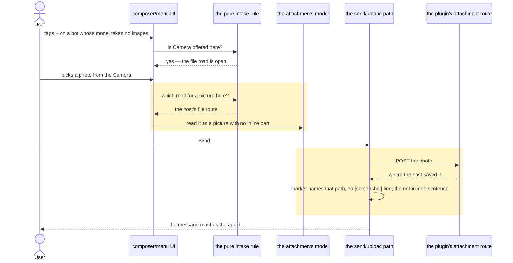
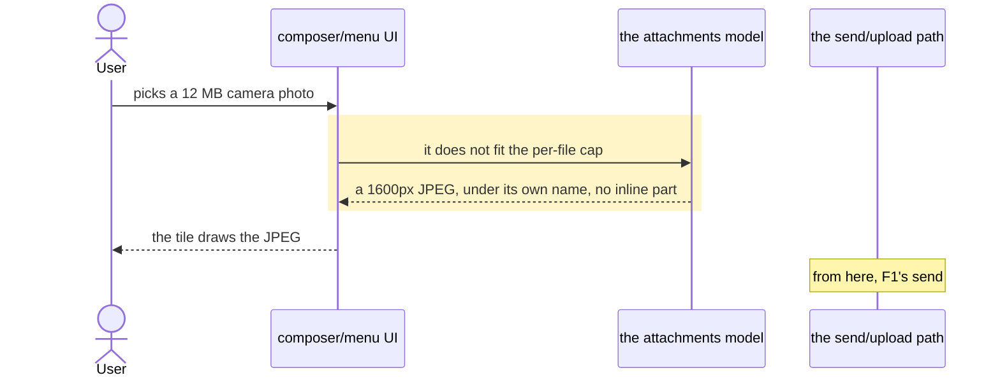
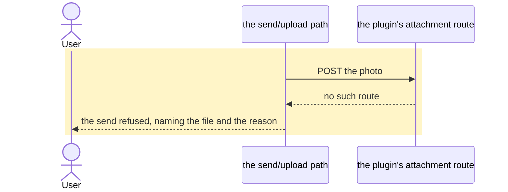
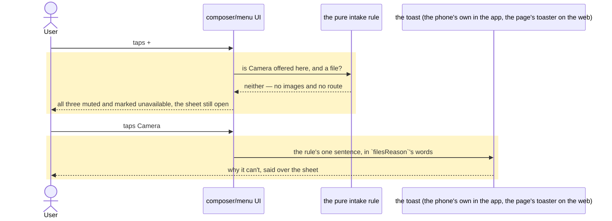

# A photo reaches the agent from Camera or Photos, whichever road is open

Today the `+` sheet disables Camera and Photos whenever the bot's model takes no image input, even though
the same photo picked through Files reaches the agent as a path on the host. This change makes the sheet
answer for each source out of what can actually be delivered: a photo rides inline when the model reads
images, and otherwise it takes the host path Files already uses. The one state where neither road exists —
the host has answered that it has no upload route — leaves every source tappable and says why when one is
tapped, in a sentence no longer printed under the buttons.

## Goals
- **G1** Camera, Photos and Files are each offered whenever what they pick can reach the agent by some route.
- **G2** When the model takes no images, a Camera or Photos pick is sent as a file on the host path — the
  road Files already takes — instead of the source being disabled.
- **G3** Where the host has answered that it has no plugin upload route, a photo can reach the agent by no
  route at all, and that case is refused out loud, with the reason, rather than shown as a dead button.

## Non-goals
- Clips from the Photos gallery as a supported scenario with a test of its own: a clip takes the file road
  only because Files does, and no check promises it.
- HEIC/HEIF conversion.
- The share sheet's own intake guess (`routes/share.tsx`); its photos are drawn as pictures, and nothing
  else on that screen moves.
- A model-pill warning, or offering a vision model, when the chosen model can't read images.

## Change map
| Layer | Status | Goals | Tested at |
|---|---|---|---|
| the pure intake rule (`lib/attachment-caps.ts`) | changed | G1, G2, G3 | `intake()`, the road rule and the source rule called directly (`test-attachment-caps.mjs`) |
| the attachments model (`Attachment` in `lib/db.ts`, `lib/attachments.ts`) | changed | G2 | a pick read into an attachment and sent (`test-composer-intake.tsx`) |
| the message text (`lib/attachment-text.ts`) | changed | G2 | `attachmentsText()` and `splitAttachments()` called directly (`test-attachments.mjs`) |
| the mid-reply rule (`lib/steer.ts`) | changed | — | `test-steer.mjs` |
| the send/upload path (`lib/send-turn.ts`) | changed | G2 | a message sent to a faked host, reading the run body and the uploads (`test-main-triage.tsx`, `test-steer-files.tsx`) |
| the stored rows (a device's messages, in `lib/db.ts`'s Dexie schema) | changed | G2 | a stored photo's row replayed through the send path (`test-main-triage.tsx`) |
| composer/menu UI (`components/chat/composer.tsx`, `components/chat/attach-menu.tsx`) | changed | G1, G2, G3 | the `+` sheet off a mounted chat (`test-attach-menu.tsx`); the composer's pickers (`test-composer-intake.tsx`) |
| the toast the sheet speaks through (`lib/tell.ts`, `android/…/ToastPlugin.java`) | added | G3 | the sheet's refusal reaching the toaster (`test-attach-menu.tsx`); the plugin is Android's own and unbuilt here |
| the attachment tile (`components/chat/attachments.tsx`) | changed | G2 | a staged photo's tile (`test-attachment-row.tsx`) |
| the plugin's attachment route (`plugin/attachments.py`) | affected | G2 | unchanged: it already takes an image and answers with a path |
| the share screen (`routes/share.tsx`) | affected | — | a shared photo for a bot whose model takes no images (`test-share-caps.tsx`) |
| chat-next's turn flow (`chat-next/turn.ts`, `chat-next/app-view.tsx`) | affected | G2 | a chat-next send (`test-chat-next-steer.mjs`) |

## Flows
### F1: a Camera photo for a model that takes no images (changed). Test: "a photo picked for a model that takes no pictures lands as a file, and its send names the path"

### F2: a photo over 9 MB, where the file road is the only road (changed). Same sequence as F1 up to the pick. Test: "a photo over nine megabytes is scaled to fit on the file road"

### F3: a pick while the host has not answered (changed). Test: "a photo that travels as a file says why it never reached the agent when the host won't take it"
Same sequence as F1, except the rule answers "try it" instead of "the file road", and the plugin refuses:
`Send` stops with the file named and the host's reason, handing the message back to the composer.

### F4: the host has no upload route and the model takes no images (changed). Test: "a host with no upload route refuses all three, and each says why when it is tapped"

## Steps
1. **Preparatory refactor: a picture stops meaning "inline".** `Attachment.image` comes to mean only that the
   file is a picture, and the presence of `Attachment.inline` means the model is sent these bytes. The inline
   road always sets that part — the file itself when nothing was scaled, or the scaled copy — so
   `keptImage`'s two-shapes answer goes. Every reader moves onto the meaning it wants: the tile and the
   composer's placeholder read `image`; the `[screenshot]` line, the not-inlined sentence, `inlineSize`,
   `wireContent`, the steer rule and the send's skip-versus-fatal rule read the part. The rows a device
   already holds are folded in the same slice: a Dexie upgrade gives every stored attachment with
   `image: true` and no part one equal to its `blob`, because before this change that flag was the only
   record that the bytes rode inline. Prepares: 2–6. After: none. Layers: the attachments model, the message
   text, the mid-reply rule, the send/upload path, the stored rows. Check: `test-attachment-caps.mjs`,
   `test-attachments.mjs`, `test-steer.mjs`, `test-composer-intake.tsx` and `test-share-caps.tsx` green
   before and after; the two assertions that spell the retired meaning — `keptImage(photo, photo)`'s
   `{ kept: photo }` and the share screen's file icon for a photo — are rewritten in this step, and a new
   case "a stored photo with no part still goes inline when its message is sent again" (`test-main-triage.tsx`)
   is green before and after too. **Done.**
2. **Preparatory refactor: one rule answers which road a pick takes.** The reach stops being worked out
   inside `addFiles` (`because ? added.filter(f => imagesAvailable && isPhoto(f.type)) : added`) and becomes
   a pure rule beside the caps: from whether the pick is a picture, whether the model reads images, and what
   the host answered about its upload route (`yes`, `no`, `unknown`), it answers the road — inline, the
   host's file, or none with the sentence to show. The composer asks it for every arrival and says a route
   refusal once per intake, as the count refusal is one line for a batch. The sheet is untouched in this
   step. Prepares: 3, 4, 6. After: none. Layers: the pure intake rule, composer/menu UI. Check:
   `test-attachment-caps.mjs` and `test-composer-intake.tsx` green before and after with every asserted
   outcome unchanged, plus one characterization case — "a pasted photo is refused where the host has no
   upload route, in the same words" — pinning today's behaviour. **Done.**
3. **Preparatory refactor: the intake asks the road per file, and the upload path names its two questions.**
   `intake` and `prepareIntake` take the two facts (does the model read pictures, what the host answered) and
   ask the rule once per file, so the per-file cap exemption follows the road instead of a batch flag; the
   share screen keeps its own guess and passes nothing new, so its intake behaves as today. In `send-turn.ts`
   the three places that derive "may this upload be skipped?" and "is its failure fatal?" read one predicate
   about the inline part instead of `image`. Prepares: 4, 5. After: 2. Layers: the pure intake rule, the
   attachments model, the send/upload path, composer/menu UI. Check: `test-attachment-caps.mjs`,
   `test-composer-intake.tsx`, `test-share-caps.tsx`, `test-main-triage.tsx` and `test-steer-files.tsx` green
   before and after; the pure test's calls move onto the new arguments and every asserted take and refusal
   stays word for word. **Done.**
4. **A Camera or Photos pick lands as a picture on the file road.** With the model reading no images, a pick
   is prepared as a picture with no inline part — the file's own bytes — and the upload becomes the only
   copy: an upload that fails stops the send, naming the file and the reason, where a document does the same
   today. The tile draws it from bytes the device can decode and falls back to its name, so a photo the
   browser can't render still reads as the picture it is. Goals: G2. After: 1, 3. Layers: the attachments
   model, composer/menu UI, the send/upload path, the attachment tile. Check: "a photo picked for a model that
   takes no pictures lands as a file, and its send names the path" (`test-composer-intake.tsx`), "a photo
   that travels as a file says why it never reached the agent when the host won't take it"
   (`test-main-triage.tsx`), and "a photo the browser can't draw is still drawn as a picture"
   (`test-attachment-row.tsx`) — red first. **Done.**
5. **A photo the file road carries is taken at any size.** The intake stops measuring a picture against the
   per-file cap on either road; a photo over 9 MB is scaled to the 1600px JPEG the app already makes for the
   inline road, kept under its own `.jpg` name, and only a photo the browser cannot decode at all is refused
   — by its size, as the cap does today. Goals: G2. After: 3, 4. Layers: the pure intake rule, the
   attachments model. Check: "a photo over the file cap is taken on the file road too"
   (`test-attachment-caps.mjs`) and "a photo over nine megabytes is scaled to fit on the file road"
   (`test-composer-intake.tsx`) — red first. **Done.**
6. **The sheet offers what can reach, and a source it refuses says why when tapped.** The sheet asks the
   rule for each source: Files follows today's gate (the route must be confirmed), Camera and Photos follow
   a picture's road — offered when the model reads images or the host hasn't refused, refused only where
   the host answered `no` and the model takes no images. A refused source is neither a dead button nor a
   sentence under the buttons: it stays tappable, is drawn muted and marked `aria-disabled="true"` for
   assistive tech (never the `disabled` attribute, which would eat the tap), and a tap says why in a toast
   — the one sentence `pickRoad` already returns, in `filesReason`'s words — leaving the sheet open. The
   toast is the phone's own inside the Android app and the page's toaster everywhere else (`lib/tell.ts`
   over the `Toast` plugin, which falls back to the toaster on an APK built before it); on the web the
   sheet is marked `data-toast-above`, so the toast rises over it rather than behind it. The `Banner`
   under the sources goes. Goals: G1, G3. After: 2, 3. Layers: composer/menu UI, the pure intake rule,
   the toast. Check: `test-attach-menu.tsx` — "a model that takes no pictures still offers Camera and
   Photos" goes from disabled to offered, and "a host with no upload route refuses all three, and each
   says why when it is tapped" replaces "Camera is untouched" — red first. **Done.**

## Decisions
- **A photo that travels as a file and is over the 9 MB cap is scaled to fit, not refused.** Made by the user
  (Q1), because refusing a modern camera's photo is the case the inline road already solves by scaling.
- **While the plugin's features answer is unknown, Camera and Photos are offered anyway, and the send says why
  if the upload then fails.** Made by the user (Q2), because an answer not read yet is not a no, and a dead
  button teaches the user nothing.
- **One pure rule decides, per pick, which road it takes, and the sheet and the composer both read it.** Made
  by the agent (D3), because the sheet refusing what the composer would accept is the bug, and two copies of
  that answer drift apart.
- **`Attachment.image` means "this file is a picture"; the presence of the inline part means "the model is
  sent these bytes", and a stored row is folded so nothing already on the device changes hands.** Made by the
  agent (D4), because a photo on the file road is a picture the model is not given, and because every stored
  photo relies on the flag today: leaving the fold to a later change would replay existing photos as files.
- **Files keeps its `yes`-only gate while Camera and Photos are offered at `unknown`.** Made by the agent,
  because Q2 names the two photo sources, and moving a document's gate was not asked for.
- **Under `no`, all three sources stay tappable — muted and marked unavailable — and a tap says the
  sentence in a toast.** Made by the user, because a sentence printed under the buttons read as a notice
  about the sheet rather than an answer about the tap, and a refusal spoken where it was asked for leaves
  the other two sources in reach with the sheet still open.
- **A toast is the phone's own in the Android app and the page's toaster everywhere else.** Made by the
  user, because a notice drawn over the WebView sits behind a sheet the app has open and under the
  system's own bars; one module (`lib/tell.ts`) is where the app asks for one, so the other 43 sonner
  calls stay where they are until moving them is decided on its own.
- **A refused photo reuses the sentence Files already gives.** Made by the agent, because it is the same
  missing capability and the words a refusal uses are written once.

## Risks
- The fold touches every stored photo row once, on the first open after the upgrade; a device that opens
  mid-conversation pays a one-off write and nothing else.
- A photo the browser cannot decode (a HEIC on the web) that is also over 9 MB is refused by name: scaling is
  the only way it could fit, and there is no scaled copy to make.
- A scaled photo is named `.jpg` after the file the user picked, so the agent opens the JPEG and the original
  name is gone; the pixels are 1600px on the long edge.
- A HEIC under the cap travels as itself, which the agent's vision tool may not be able to open — the same
  today through Files.
- On an unconfirmed host the gallery still offers clips, which have no inline road and so fail at send —
  as they do today; narrowing that picker was not taken on.
- On a bot with no API key the sheet offers Camera and Photos and the send refuses the message; that is Q2's
  bargain, and the refusal names the file and the plugin.
- A photo on the file road costs an upload the inline road never needed, and on a host that advertises the
  route but refuses the file the whole message is refused where an inline photo would have gone.
- In the Android app a toast is Android's own, so it carries no action, no colour and no place above the
  composer: the sheet's refusal is only ever the one sentence, and an APK built before the `Toast` plugin
  says it through the page's toaster instead.

## Not now
- Narrowing the gallery's picker so a clip is offered only where the file road is confirmed: a source would
  then promise exactly what it delivers, but clips are fenced off here, so the picker stays as it is.
- A photo's own refusal sentence naming the model's blindness as well as the plugin's age, from G3's reading.
- Offering Files while the answer is unknown, so all three sources stand on one footing.
- Renaming `imagesAvailable`, now that it decides only whether a picture can go inline.
- A mark on the tile saying which road a photo took, so the user can tell an inline photo from a stored one.
- Scaling a file-road photo that fits, to help the agent's own vision tool read it.
- Moving the app's other toasts onto `lib/tell`: the sheet's refusal is the only one that has to reach a
  phone's own toast here, and the rest are a decision of their own.
- Bounding the file road's total: ten photos are ten uploads, each its own request under the plugin's cap.
